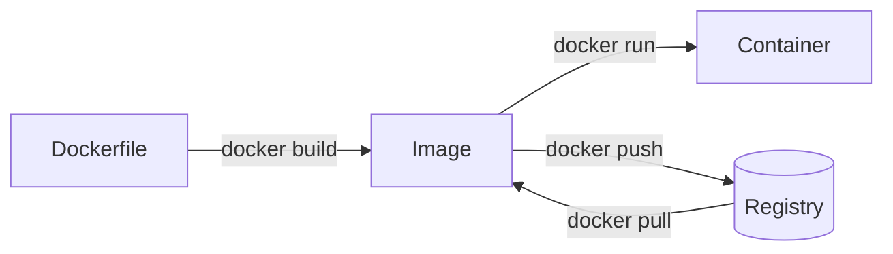

# Docker fundamentals for Happymeal

**Reading time:** about 15 minutes. **Next:** [02-docker-compose-build-and-deploy.md](02-docker-compose-build-and-deploy.md).

This is the first of two study documents. It gives you the mental model and the daily commands. The second document uses them to build the Happymeal API image, run it with Compose and deploy it by hand.

After this document you can:

- Explain the difference between an image, a container, a volume and a registry.
- Run, inspect and remove containers from the command line.
- Read a Dockerfile and a Compose file and say what each line does.
- Explain what `docker-compose.yml` in this repository does today.

## Why containers

Happymeal needs a .NET 10 runtime and a PostgreSQL 18 server. Installing both by hand on every machine is slow and easy to get wrong. A container packages an application together with everything it needs to run. The same package behaves the same on your Windows laptop and on the Debian server.

A container is not a virtual machine. It does not run its own operating system kernel. It is a normal Linux process, isolated from the other processes by the kernel. This is why containers start in seconds and use little memory.

## Core concepts

| Term | What it is | Happymeal example |
|---|---|---|
| **Image** | A read-only template. It contains a file system and the default command to run. | `postgres:18-alpine` |
| **Container** | A running (or stopped) instance of an image. | `happymeal-postgres` |
| **Registry** | A server that stores images. You pull from it and push to it. | Docker Hub, `mcr.microsoft.com`, GitHub Container Registry |
| **Volume** | Storage managed by Docker that lives outside the container. | `happymeal-postgres-data` |
| **Dockerfile** | A text recipe that describes how to build an image. | The one we still have to write |

A useful comparison for a C# developer: an image is like a class, and a container is like an object created from it. You can create many containers from one image.



### Docker Engine

When you type a `docker` command, you use the **client**. The client sends the request to the **Docker daemon**, which builds images and runs containers. On Windows, Docker Desktop runs the daemon inside a small Linux virtual machine. On the Debian server, the daemon runs directly on the host.

### Layers and cache

An image is a stack of **layers**. Each instruction in a Dockerfile creates one layer. Layers are read-only and shared between images. If two images start from the same base, the base is stored once.

When you rebuild an image, Docker reuses a layer from the cache if the instruction and its inputs did not change. As soon as one layer changes, all the layers after it are rebuilt. This is why the order of instructions matters. You put the things that change rarely first, and the things that change often last.

### Tags and digests

An image name has the form `name:tag`, for example `postgres:18-alpine`. A tag is a label that points to an image. The owner can move it to a different image later. `latest` is only the tag Docker uses when you do not write one. It does not mean "the newest". For this reason, you should always use explicit tags.

A **digest** (`name@sha256:...`) identifies the exact content of an image. It never changes.

## Daily commands

Use a throwaway PostgreSQL container to practice. The commands use port 5433 and a different name, so they do not clash with the Compose container described later.

```bash
docker pull postgres:18-alpine
docker run -d --name pg-playground -e POSTGRES_PASSWORD=changeme -p 5433:5432 postgres:18-alpine
docker ps
docker logs -f pg-playground
docker exec -it pg-playground psql -U postgres
docker stop pg-playground
docker rm pg-playground
```

| Part | Meaning |
|---|---|
| `-d` | Run in the background (detached). |
| `--name` | Give the container a name. Without it, Docker invents one. |
| `-e KEY=value` | Set an environment variable inside the container. |
| `-p 5433:5432` | Publish a port: `host_port:container_port`. |
| `--rm` | Remove the container automatically when it stops. |
| `-it` | Interactive terminal. Needed for shells and `psql`. |

Other commands you should know:

| Command | Purpose |
|---|---|
| `docker ps -a` | List all containers, including stopped ones. |
| `docker images` | List local images. |
| `docker logs <name>` | Show the output of the main process. |
| `docker exec -it <name> sh` | Open a shell inside a running container. |
| `docker inspect <name>` | Show all the details as JSON. |
| `docker rmi <image>` | Remove an image. |

> **Important:** inside a container, `localhost` means the container itself. If the API runs in one container and PostgreSQL in another, the API cannot reach the database at `localhost`. You will use a service name instead. See the networking section.

## Containers are disposable

Container data lives in a thin writable layer on top of the image. When you remove the container, that layer is deleted. Try it: create a table in `pg-playground`, run `docker rm -f pg-playground`, start a new one, and the table is gone.

For data that must survive, you use a **volume**. There are two kinds:

| Kind | Syntax | Use |
|---|---|---|
| **Named volume** | `-v happymeal-postgres-data:/var/lib/postgresql` | Docker manages the location. Best for databases. |
| **Bind mount** | `-v ./config:/etc/app` | Maps a host folder into the container. Best for config files and source code in development. |

Removing a container does not remove its named volumes. You must remove a volume explicitly.

## Dockerfile anatomy

A Dockerfile is a list of instructions. Docker runs them from top to bottom to build an image.

| Instruction | Meaning |
|---|---|
| `FROM` | The base image to start from. Every Dockerfile begins with it. |
| `WORKDIR` | Sets the working directory for the next instructions. |
| `COPY` | Copies files from the build context into the image. |
| `RUN` | Runs a command at **build time** and saves the result as a layer. |
| `ENV` | Sets an environment variable for the image. |
| `ARG` | A variable that exists only at build time. |
| `EXPOSE` | Documents the port the application listens on. It does not publish it. |
| `USER` | The user that runs the next instructions and the container. |
| `ENTRYPOINT` / `CMD` | The command to run when the container **starts**. |

Two ideas you need for the next document:

- **Build context.** `docker build .` sends the folder `.` to the daemon. `COPY` can only use files inside it. A `.dockerignore` file lists what to leave out, so the context stays small and does not include secrets or build output.
- **Multi-stage build.** You can use several `FROM` lines in one file. The first stage uses the big .NET SDK image to compile the code. The last stage uses the small ASP.NET runtime image and copies only the compiled output. The final image has no compiler and no source code.

## Networking basics

By default, a container is isolated from the outside world. There are two ways to connect things:

- **Publishing a port** (`-p 8080:8080`) lets traffic from the host reach a container. This is how you open the API in a browser.
- **User-defined networks** let containers talk to each other. On such a network, Docker runs a small DNS service. A container can reach another one by its **name**, for example `postgres:5432`. Compose creates this kind of network for you.

Containers on the same network do not need published ports to talk to each other. You publish a port only when something **outside** Docker needs access.

## Docker Compose

Running several `docker run` commands with many flags is hard to repeat. **Docker Compose** lets you describe a group of containers in one YAML file and manage them with one command. In Compose, each container definition is a **service**.

This is the current `docker-compose.yml` of the repository:

```yaml
services:
  postgres:
    image: postgres:18-alpine
    container_name: happymeal-postgres
    environment:
      POSTGRES_DB: happymeal
      POSTGRES_USER: happymeal
      POSTGRES_PASSWORD: happymeal_local_dev
    ports:
      - "5432:5432"
    volumes:
      - happymeal-postgres-data:/var/lib/postgresql

volumes:
  happymeal-postgres-data:
```

| Line | What it does |
|---|---|
| `services:` | The list of containers to manage. |
| `image: postgres:18-alpine` | Use this image from Docker Hub. The `alpine` variant is small. |
| `container_name` | Fixes the container name. Useful in a demo. It prevents running two copies. |
| `environment:` | The PostgreSQL image reads these variables on its **first start** to create the database and the user. |
| `ports: "5432:5432"` | Publishes the database to the host, so `dotnet run` on your machine can connect to `localhost:5432`. |
| `volumes:` (service) | Mounts the named volume at `/var/lib/postgresql`. PostgreSQL 18 images store data in a versioned subfolder of that path. |
| `volumes:` (top level) | Declares the named volume. Compose creates it if it does not exist. |

The file has no `version:` key. That is correct. The key is obsolete in the current Compose specification.

The commands you will use all the time:

```bash
docker compose up -d        # create and start everything, in the background
docker compose ps           # list the services
docker compose logs -f api  # follow the logs of one service
docker compose down         # stop and remove containers and the network
docker compose down -v      # same, and also DELETE the named volumes
```

Compose names everything with a **project name**, which is the folder name by default. It also creates a network called `<project>_default` and connects all services to it.

> **Warning:** `down` is safe for your data. `down -v` deletes it. Treat the `-v` like `DROP DATABASE`.

## Try it

Run these steps from the `Happymeal-BE` folder against a disposable local database. Create `.env` and configure the local SDK connection string as described in the [README](../../README.md#run-the-api-with-the-local-sdk) first. Each step confirms a concept from this document.

1. `docker compose up -d postgres`, then `docker compose ps`. Only the `postgres` service is running; the API will run through the local SDK in this exercise.
2. `dotnet run --project src/Happymeal.API`. In Development, the API applies the migrations at startup.
3. Check the data:
   ```bash
   docker compose exec postgres psql -U happymeal -d happymeal -c 'SELECT count(*) FROM "Happymeal"."Recipes";'
   ```
   > **PowerShell:** it removes the double quotes before passing the argument to `docker`. Postgres then receives `Happymeal.Recipes`, lowercases it, and fails with `relation "happymeal.recipes" does not exist`. Escape the quotes with a backslash, or send the query through stdin:
   > ```powershell
   > docker compose exec postgres psql -U happymeal -d happymeal -c 'SELECT count(*) FROM \"Happymeal\".\"Recipes\";'
   > 'SELECT count(*) FROM "Happymeal"."Recipes";' | docker compose exec -T postgres psql -U happymeal -d happymeal
   > ```
4. Create a recipe from the Scalar UI, and run the query again.
5. Stop the local SDK API, run `docker compose down`, then `docker compose up -d postgres`. Start the API again and run the query. The recipe is still there, because the volume survived.
6. For this disposable local database only, stop the API, run `docker compose down -v`, then `docker compose up -d postgres`. Start the API again. The table is back, but empty. Never run this volume deletion against the homelab database.

## Check yourself

Try to answer without looking at the text.

1. What is the difference between an image and a container?
2. Why does the order of instructions in a Dockerfile affect build time?
3. A container is removed. What happens to its data? And to the data in a named volume?
4. What does `-p 8080:8080` do? Which number is the host port?
5. Why can an API container not reach PostgreSQL at `localhost`?
6. What is the difference between `docker compose down` and `docker compose down -v`?
7. Why is `latest` a poor tag for deployments?

## Where to go next

The second document explains the implemented Dockerfile, API and migration services, versioning, and the manual deployment to the Debian server.
