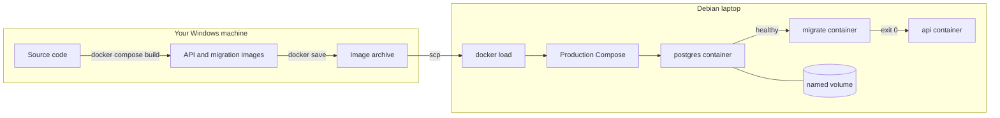

# Build, configure and deploy Happymeal with Docker Compose

**Reading time:** about 20 minutes. **Before this:** [01-docker-fundamentals.md](01-docker-fundamentals.md).

This document explains the Dockerfile and Compose files in the repository, from source code to a running API on your Debian server. Run local commands from `Happymeal-BE/`. PowerShell blocks run on Windows; Bash blocks in the deployment section run on the Debian server unless stated otherwise.

After this document you can:

- Write the Dockerfile for the API and explain each line.
- Run the API and PostgreSQL together with Compose, with the right configuration.
- Explain how the data survives and how the schema is created.
- Tag an image so you know what version runs where.
- Deploy a new version by hand, check it, and roll it back.

## The path from code to server



There is no registry in this flow. Both images travel through SSH in one archive. Later, a registry can replace the transfer step.

## What the API needs at runtime

These facts come from the code and decide how the container must be configured.

| Fact | Source | Consequence |
|---|---|---|
| The connection string is empty by default and the API stops at startup without it. | `appsettings.json` | You must set `ConnectionStrings__Happymeal`. |
| The API applies migrations at startup only in `Development`; Compose runs a separate migration job. | `Program.cs`, `Dockerfile`, Compose files | A new database gets its schema before the Production API starts. See [Database schema](#database-schema-and-migrations). |
| Scalar and OpenAPI are mapped only in `Development`. | `ApiServiceExtensions.cs` | There is no Scalar UI on the server. Use `/health` and `/api/recipes` to check it. |
| HTTPS redirection is enabled outside `Development`. | `ApiServiceExtensions.cs` | The container has no certificate. See [Ports](#ports-and-network). |
| `/health` includes a `DbContext` check. | `ServiceExtensions.cs` | It proves the API can connect to the database. It does not prove the schema exists. |
| `OutboxDispatcher` is a background service. | `ServiceExtensions.cs` | It starts with the API and needs the database. |

In a container, `ASPNETCORE_ENVIRONMENT` is `Production` unless you set it. Do not set it to `Development` to get the migrations. That would also expose the Scalar UI and change other behavior.

### Environment variables and configuration keys

ASP.NET Core reads environment variables as configuration. A double underscore `__` replaces the `:` separator in a key:

| Configuration key | Environment variable |
|---|---|
| `ConnectionStrings:Happymeal` | `ConnectionStrings__Happymeal` |
| `Outbox:PollInterval` | `Outbox__PollInterval` |

Environment variables override `appsettings.json`. This is how you configure the same image for different environments.

## Build the image

### Choose the base images

The Dockerfile uses three Microsoft base images:

| Image | Contains | Use |
|---|---|---|
| `mcr.microsoft.com/dotnet/sdk:10.0` | Compiler, `dotnet publish`, NuGet | Build stage only. It is large. |
| `mcr.microsoft.com/dotnet/aspnet:10.0` | ASP.NET Core runtime only | Final stage. It is much smaller. |
| `mcr.microsoft.com/dotnet/runtime-deps:10.0` | Native dependencies for self-contained .NET apps | Migration image; the bundle includes its own .NET runtime. |

The repository has a `global.json` that asks for SDK `10.0.400`, and it allows a newer feature band (`rollForward: latestFeature`). The `sdk:10.0` tag moves to the latest SDK. Check that it satisfies the file:

```bash
docker run --rm mcr.microsoft.com/dotnet/sdk:10.0 dotnet --version
```

If the version is lower than `10.0.400`, the build will fail and you need a more specific tag. This also shows the trade-off of floating tags such as `10.0`: they are convenient, but the build is not fully reproducible.

### Build context and `.dockerignore`

The API references the Application, Domain, Infrastructure and Common projects. The build context must contain all of them. That means the context is the `Happymeal-BE` folder, where `Happymeal.slnx` lives. The Dockerfile can be in that same folder.

Without a `.dockerignore`, Docker sends everything to the daemon. Here that includes build output from your Windows machine. A `bin` or `obj` folder from outside Docker can break `dotnet restore` inside the image, because it contains paths and caches from another operating system.

Things to exclude:

- `**/bin`, `**/obj`
- `.git`, `.vs`, `.idea`, `TestResults`
- `.env` and other files with secrets
- Folders the build does not need: `tests`, `skills`, `docs`, `.claude`, `.agents`

### The Dockerfile, instruction by instruction

The file has four named stages: `build`, `migrations-build`, `migrate` and `final`. Compose builds two runnable images from the `migrate` and `final` targets.

**Stage 1: build**

| Instruction | What it does | Why Happymeal needs it |
|---|---|---|
| `FROM mcr.microsoft.com/dotnet/sdk:10.0 AS build` | Starts from the SDK image and names the stage `build`. | The compiler is only needed here. |
| `WORKDIR /src` | Sets the folder for the next commands. | A predictable place for the source. |
| `COPY` of `global.json` and the five production `.csproj` files | Copies SDK selection and project definitions first. | See the cache note below. The solution and test projects are not needed to publish the API. |
| `RUN dotnet restore src/Happymeal.API/Happymeal.API.csproj` | Downloads the NuGet packages. | Restoring only the API restores only the projects it references. |
| `COPY .editorconfig ./` | Copies the repository's compiler and style settings. | Keeps the build consistent with local development. |
| `COPY src/ src/` | Copies the source code. | Now the code is available to compile. |
| `RUN dotnet publish src/Happymeal.API/Happymeal.API.csproj -c Release -o /app/publish --no-restore` | Compiles and writes the output to `/app/publish`. | `--no-restore` reuses the restore layer. `-c Release` builds optimized code. |

**The cache note.** NuGet packages change rarely, and source code changes all the time. If you copy only the `.csproj` files and restore before you copy the source, the restore layer stays in the cache while you edit code. A build after a code change then skips the slow package download. The difficulty: `COPY src/*/*.csproj ./` would flatten the folders, so you need one `COPY` line per project file to keep the structure.

**Stages 2 and 3: migration bundle and runner**

`migrations-build` starts from `build`, copies `.config/`, restores the pinned `dotnet-ef` tool and runs `dotnet ef migrations bundle` for Infrastructure. The self-contained `linux-x64` output is `/app/efbundle`.

`migrate` starts from `runtime-deps:10.0`, copies only that bundle and runs it as `$APP_UID`, with `ENTRYPOINT ["./efbundle"]`. Compose supplies the database connection through `--connection`. The SDK and source stay out of the runner image. This bundle targets an x86-64 Linux server.

**Stage 4: API runtime**

| Instruction | What it does | Why Happymeal needs it |
|---|---|---|
| `FROM mcr.microsoft.com/dotnet/aspnet:10.0 AS final` | Starts a new, small image. Nothing from stage 1 is included. | No compiler and no source code in production. |
| `WORKDIR /app` | The folder where the app lives. | Matches the next `COPY` and `ENTRYPOINT`. |
| `COPY --from=build /app/publish .` | Copies the output from stage 1. | Only published API files enter this image. |
| `USER $APP_UID` | Runs the process as a non-root user. | The .NET images define a non-root user. If the app is compromised, it has fewer rights. |
| `EXPOSE 8080` | Documents the port. | Since .NET 8 the images listen on 8080 by default. This line does not publish anything. |
| `ENTRYPOINT ["dotnet", "Happymeal.API.dll"]` | The command that starts the container. | The assembly name comes from the project name. |

Details to be able to explain:

- **Exec form.** `["dotnet", "Happymeal.API.dll"]` runs `dotnet` as the main process, so it receives the stop signal (`SIGTERM`) from `docker stop` and can shut down cleanly. The shell form (`ENTRYPOINT dotnet Happymeal.API.dll`) runs through `/bin/sh`, which can hide the signal.
- **Ports.** The non-root user cannot bind ports below 1024. This is why the .NET images use 8080 and not 80. You can change it with `ASPNETCORE_HTTP_PORTS`.
- **Version metadata.** The current Dockerfile does not add OCI version labels. The build script records the version and Git SHA in the image tag. See [Versioning](#versioning-your-images).

Your exercise: follow each stage in the existing `Dockerfile` and explain which files enter each final image and why the copy order affects caching.

### Build and run it alone

From the `Happymeal-BE` folder:

```bash
docker build -t happymeal-api:dev .
docker images happymeal-api
docker history happymeal-api:dev
```

`docker history` shows the layers and their sizes. Compare the size of this image with the SDK image to see the benefit of multi-stage builds.

Run it without configuration first:

```bash
docker run --rm -p 8080:8080 happymeal-api:dev
```

The API stops with a message about the missing connection string. This is the fail-fast behavior in `appsettings.json`. Now give it a database. With the Compose PostgreSQL running and published on your machine, a container on Docker Desktop reaches your host through `host.docker.internal`:

```powershell
# After creating .env as described below:
docker compose up -d postgres
$dbPassword = Read-Host 'POSTGRES_PASSWORD from .env'
docker run --rm -p 8080:8080 `
  -e "ConnectionStrings__Happymeal=Host=host.docker.internal;Port=5432;Database=happymeal;Username=happymeal;Password=$dbPassword" `
  happymeal-api:dev
```

The tables do not exist yet if the database is new, because the environment is `Production`. Open `http://localhost:8080/health`. It can return `Healthy`, because the check only tests the connection. Now call `http://localhost:8080/api/recipes`. It fails, because the table is missing. This is useful to see once: a green health check does not mean the schema is ready.

## Run the API and the database with Compose

The local file defines three services: `postgres`, `migrate` and `api`. This excerpt shows the startup dependencies; see `docker-compose.yml` for the full build targets, volumes and configuration.

```yaml
services:
  postgres:
    # Other fields omitted here.
    healthcheck:
      test: ["CMD-SHELL", "pg_isready -U happymeal -d happymeal"]
      interval: 5s
      timeout: 3s
      retries: 10
    restart: unless-stopped

  migrate:
    image: happymeal-migrate:${HAPPYMEAL_TAG}
    command: ["--connection", "Host=postgres;Port=5432;Database=happymeal;Username=happymeal;Password=${POSTGRES_PASSWORD}"]
    depends_on:
      postgres:
        condition: service_healthy
    restart: 'no'

  api:
    image: happymeal-api:${HAPPYMEAL_TAG}
    environment:
      ConnectionStrings__Happymeal: "Host=postgres;Port=5432;Database=happymeal;Username=happymeal;Password=${POSTGRES_PASSWORD}"
    ports:
      - "8080:8080"
    depends_on:
      postgres:
        condition: service_healthy
      migrate:
        condition: service_completed_successfully
    restart: unless-stopped
```

### Why each field matters

- **`Host=postgres`.** The service name is the hostname on the Compose network. This is the answer to the `localhost` problem from the first document.
- **`image:` or `build:`.** On your machine you can use `build: .` to build from source. On the server there is no source code, so you use `image:` with an explicit tag. The loaded image must have exactly that name and tag.
- **`depends_on` with `service_healthy`.** A plain `depends_on` only waits for the container to *start*. PostgreSQL needs some seconds before it accepts connections. The healthcheck uses `pg_isready` to tell Compose when it is ready.
- **`service_completed_successfully`.** The API waits for the migration bundle to exit with code 0. A failed bundle blocks API startup; a completed `migrate` container is expected to remain exited.
- **`restart: unless-stopped`.** Docker restarts the container after a crash or after the server reboots, unless you stopped it yourself.
- **Startup resilience.** The API also retries database operations (`EnableRetryOnFailure`). That covers short interruptions, but it is not a replacement for ordering the startup.

### Configuration and secrets

Compose resolves `${VARIABLE}` from your shell and from a `.env` file in the same folder as the Compose file. The repository's `.gitignore` already ignores `.env`. This is the right place for the password and the image tag:

```text
POSTGRES_PASSWORD=choose-a-real-password
HAPPYMEAL_TAG=0.1.0
```

Good practice:

- Commit a `.env.example` with fake values, so the required variables are documented.
- On the server, restrict the file: `chmod 600 .env`.
- Remember the three ways to set variables on a service: `environment:` (inline), `env_file:` (a file) and `${}` interpolation. If the same variable is in `environment:` and `env_file:`, `environment:` wins.
- Beyond this week: Docker secrets and the `POSTGRES_PASSWORD_FILE` variant avoid putting passwords in environment variables.

Create the local file before the first Compose command:

```powershell
Copy-Item .env.example .env
```

Edit `.env` to choose the password and base version. In Bash, use `cp .env.example .env`. The same variables are required on the server, but use a separate password there. The fallback password in `appsettings.Development.json` is not updated by Compose. If you run the API with `dotnet run`, provide `ConnectionStrings__Happymeal` with the actual local password; .NET does not load `.env` itself.

Start the complete local stack with `docker compose up -d --build`. Check `http://localhost:8080/health` and `http://localhost:8080/api/recipes`. For development with the local SDK, start only `docker compose up -d postgres`, configure the connection string and run `dotnet run --project src/Happymeal.API`; Scalar is then available at `https://localhost:7180/scalar/v1`.

### Ports and network

- **Local ports:** `docker-compose.yml` publishes API port `8080:8080` and database port `5432:5432` for the local SDK workflow.
- **Server ports:** `docker-compose.prod.yml` publishes only the API (`8091:8080`). The API and migration job reach PostgreSQL through the internal network; the server does not publish port 5432.
- **Docker and the firewall.** Docker publishes ports by editing the host firewall rules directly. A published port can bypass tools like `ufw`. Do not rely on `ufw` to hide a container port. Do not publish it.
- **HTTPS redirection.** The container listens on HTTP only. The middleware cannot find an HTTPS port, so it logs a warning and does not redirect. Check the log on the first start. TLS would be handled by a reverse proxy later. That is out of scope for now.

### One Compose file or two

The repository uses two standalone files:

| File | Command | Purpose |
|---|---|---|
| `docker-compose.yml` | `docker compose up -d --build` | Local builds of both images; API on 8080 and PostgreSQL on 5432. |
| `docker-compose.prod.yml` | `docker compose -f docker-compose.prod.yml up -d` | Prebuilt images on the server; API on 8091 and PostgreSQL internal. |

Use the production file alone, not as an override merged with the local file: merging would retain local build settings and the PostgreSQL port mapping. The duplication makes the server configuration explicit.

## Persistence

Data lives in the named volume `happymeal-postgres-data`. The container can be recreated with a new image and the database stays.

| Action | Containers | Network | Volume (data) |
|---|---|---|---|
| `docker compose down` | Removed | Removed | **Kept** |
| `docker compose down -v` | Removed | Removed | **Deleted** |
| `docker compose up -d` after a new image | Recreated | Kept | **Kept** |

Two details to remember:

- **Initial variables apply once.** `POSTGRES_DB`, `POSTGRES_USER` and `POSTGRES_PASSWORD` are used only when the data folder is empty. If you change the password in `.env` later, the existing database keeps the old one.
- **The volume is on the host.** Docker stores it under `/var/lib/docker/volumes/` on the server. Deleting the volume, or reinstalling the machine, deletes the data.

A volume is not a backup. A minimal backup and restore with the tools in the container:

```bash
docker compose -f docker-compose.prod.yml exec -T postgres pg_dump -U happymeal happymeal > backup.sql
docker compose -f docker-compose.prod.yml exec -T postgres psql -U happymeal -d happymeal < backup.sql
```

Run these Bash commands in the server deployment folder. The restore command writes into the selected database; test it against a separate recovery database before relying on a backup. Keep the deployment folder (and therefore Compose project name) stable: named volumes are prefixed by that project name. A different project can create a new empty volume even when the YAML volume key is unchanged.

## Database schema and migrations

In Development the API calls `MigrateAsync()` at startup. In Production the API does not migrate. Both Compose files use a separate migration job so that a new volume receives its schema before the API starts.

| Option | How it works | Trade-off |
|---|---|---|
| **Idempotent SQL script** | Generate a script from the migrations and apply it with `psql` before starting the new version. | Explicit and easy to review. One manual step. |
| **Migrate at API startup** | Call `MigrateAsync()` in every environment. | Simple. Several API instances could migrate at the same time. The app needs schema-change rights. |
| **Migration job (implemented)** | A separate one-shot container applies the migrations and exits. | Separate API and migration lifecycle; requires transferring two images. |

The implemented sequence is:

1. PostgreSQL initializes its data volume and passes `pg_isready`.
2. `happymeal-migrate:<tag>` runs the EF bundle with the connection string supplied by Compose.
3. The bundle creates the schema and records applied migrations in EF's history table. Subsequent runs skip migrations already applied.
4. The bundle exits with code 0; Compose can now start `happymeal-api:<tag>`. If it fails, inspect its logs before retrying.

Check the job on the server:

```bash
docker compose -f docker-compose.prod.yml ps -a
docker compose -f docker-compose.prod.yml logs --tail 100 migrate
```

Expect `migrate` to show `Exited (0)`. There is no separate `migrate.sql` step in this deployment flow. Build and transfer the migration image on every release, even if there are no new migrations, so its tag matches the API.

`/health` tests database connectivity, not table creation. Also request `/api/recipes`: `200` with `[]` is the expected result for a newly initialized database. An empty list alone does not prove that the volume was new; record that fact when performing a first deployment. Do not delete an existing homelab volume to repeat this check.

## Versioning your images

A deployment must answer one question: **which code is running right now?** A tag such as `latest` cannot answer it, because it moves.

A simple scheme:

- A **base version** in your local `.env`: `HAPPYMEAL_TAG=0.1.0`.
- A **release tag** produced by `build.ps1`: for example `0.1.0-6d69e69`, using `git rev-parse --short HEAD`.
- Two images with that same release tag: `happymeal-api:0.1.0-6d69e69` and `happymeal-migrate:0.1.0-6d69e69`.

```powershell
./build.ps1
if ($LASTEXITCODE -ne 0) { throw 'Docker image build failed' }
$releaseTag = $env:HAPPYMEAL_TAG
docker image inspect "happymeal-api:$releaseTag" "happymeal-migrate:$releaseTag" --format '{{json .RepoTags}}'
```

Run the script in the same PowerShell session used for export. It sets `$env:HAPPYMEAL_TAG` to `<base-version>-<short-sha>`, overriding the value in `.env` for Compose commands in that shell. It does not rewrite `.env`. A fresh shell must run the script again or set the exact release tag explicitly.

Keep the local `.env` value as the base version; put the full release tag in the server `.env`. Build from committed changes so the SHA identifies the source. The current Dockerfile does not write version labels. Do not overwrite a tag already deployed; keep both images for each release to make rollback predictable.

## Deploy by hand to the Debian server

### One-time setup

1. Check Docker and Compose: `docker --version` and `docker compose version`. Use `docker compose` with a space.
2. Set up SSH with a key, so you do not type a password on each transfer.
3. Create a stable deployment folder such as `~/happymeal`. Copy `docker-compose.prod.yml` and `.env.example` there. Create the server's `.env` from the example, set a server-specific password, then `chmod 600 .env`. Keep using that folder on later releases to preserve the Compose project and volume names.
4. Check the architecture: `uname -m` should print `x86_64`. The migration bundle targets `linux-x64`; both images must be `linux/amd64`. Verify with `docker image inspect <image> --format '{{.Os}}/{{.Architecture}}'`.

From Windows PowerShell, replacing `user` with your SSH account:

```powershell
ssh user@192.168.1.142 'mkdir -p ~/happymeal'
scp docker-compose.prod.yml .env.example user@192.168.1.142:happymeal/
```

On Debian:

```bash
cd ~/happymeal
# First deployment only; preserve an existing .env on later releases.
cp .env.example .env
chmod 600 .env
nano .env
```

### Release steps

1. **Check the code.** Commit the release changes and run `dotnet test --project tests/Happymeal.UnitTests`.
2. **Build and export both images** on Windows PowerShell:
   ```powershell
   ./build.ps1
   if ($LASTEXITCODE -ne 0) { throw 'Docker image build failed' }
   $releaseTag = $env:HAPPYMEAL_TAG
   docker save -o "$env:TEMP/happymeal-$releaseTag.tar" "happymeal-api:$releaseTag" "happymeal-migrate:$releaseTag"
   if ($LASTEXITCODE -ne 0) { throw 'Docker image export failed' }
   scp "$env:TEMP/happymeal-$releaseTag.tar" user@192.168.1.142:happymeal/
   scp docker-compose.prod.yml user@192.168.1.142:happymeal/
   ```
   The archive contains both image tags. Saving to a file avoids piping binary data between commands in PowerShell. The archive is outside the source tree.
3. **Load the images** over SSH. In Bash on Debian:
   ```bash
   cd ~/happymeal
   # Replace with the exact tag printed on Windows.
   RELEASE_TAG=0.1.0-6d69e69
   docker load -i "happymeal-$RELEASE_TAG.tar"
   docker image inspect "happymeal-api:$RELEASE_TAG" "happymeal-migrate:$RELEASE_TAG" --format '{{json .RepoTags}}'
   ```
4. **Back up an existing database before migrations:**
   ```bash
   docker compose -f docker-compose.prod.yml exec -T postgres pg_dump -U happymeal happymeal > "backup-before-$RELEASE_TAG.sql"
   ```
   Skip this step only on the first deployment, when there is no existing database. Check that the backup command succeeded before continuing.
5. **Set the full release tag** in the server's `.env`, for example `HAPPYMEAL_TAG=0.1.0-6d69e69`. Keep the existing password. If `HAPPYMEAL_TAG` is also exported in the server shell, unset it with `unset HAPPYMEAL_TAG` so it does not override `.env`.
6. **Start the release:**
   ```bash
   docker compose -f docker-compose.prod.yml config --quiet
   docker compose -f docker-compose.prod.yml up -d
   ```
   Compose runs the matching migration image before starting the new API. No source code or SDK is needed on the server. A failed `migrate` job must be investigated before retrying.
7. **Verify on Debian:**
   ```bash
   docker compose -f docker-compose.prod.yml ps -a
   docker compose -f docker-compose.prod.yml logs --tail 50 migrate api
   curl --fail-with-body -i http://localhost:8091/health
   curl --fail-with-body -i http://localhost:8091/api/recipes
   ```
   Expect healthy PostgreSQL, `migrate` exited with code 0, a running API, `/health` returning `200 Healthy`, and `/api/recipes` returning `200` with a JSON array (`[]` on an empty database). From the LAN the URLs are `http://192.168.1.142:8091/health` and `http://192.168.1.142:8091/api/recipes`. The root URL `/` returns 404 because no root endpoint is mapped. Scalar and OpenAPI are Development-only.

The Compose files do not define an API healthcheck. Verify the HTTP endpoints from the host or LAN; a running container alone does not prove that requests succeed.

### Rollback

If the new version fails, set the previous full tag in `.env` and run `docker compose -f docker-compose.prod.yml up -d` again. Keep both the API and migration images for that tag on the server. Repeat the HTTP checks. Reverting images does not undo database migrations; the old bundle does not downgrade the schema. Keep migrations backward compatible, or plan a database restore from the pre-release backup before rolling back an incompatible change.

### Troubleshooting

| Symptom | Likely cause | Check |
|---|---|---|
| The `api` container exits at once | Missing or wrong connection string | `docker compose -f docker-compose.prod.yml logs api` |
| `/health` returns `Unhealthy` | The API cannot connect: wrong password, host or the database is down | Check `.env` and `docker compose -f docker-compose.prod.yml logs postgres`. |
| `/health` is `Healthy` but `/api/recipes` fails | Missing schema or a query error | Check `migrate` and `api` logs with the production file. |
| `migrate` exits with a nonzero code and the API does not start | Failed migration or connection | `docker compose -f docker-compose.prod.yml logs migrate` |
| `migrate` shows `Exited (0)` | Expected successful one-shot job | Check `/health` and `/api/recipes`. |
| `no such image` on `up` | A missing image or mismatched tag | Check that both API and migration images match the full tag in `.env`. |
| `/` returns 404 | No root endpoint is mapped | Request `/health` and `/api/recipes`. |
| `exec format error` | Wrong CPU architecture | `docker image inspect ... '{{.Architecture}}'` |
| Port already in use | Another process uses 8091 | `ss -ltnp \| grep 8091` |
| The database is empty after a deploy | The volume was deleted or renamed | `docker volume ls` |
| Old password still works | `POSTGRES_PASSWORD` only applies to an empty volume | Change it with SQL (`ALTER USER`) |

### Later: a registry

A registry would replace the archive export, transfer and load steps. Both image names in the Compose file would need registry-qualified names; push and pull both images with the same release tag. The migration ordering and rollback considerations stay the same.

## Defending your choices

Use these as practice for an interview. Answer in your own words in two or three sentences.

1. **Why a multi-stage build?** The final image has only the runtime and the published output. It is smaller, starts faster to pull and has less attack surface.
2. **Why copy the `.csproj` files before the source?** The restore layer stays cached while the code changes. Rebuilds are faster.
3. **Why not use `latest`?** It moves, so you cannot know what is running, and you cannot roll back to it.
4. **Why a non-root user?** If someone exploits the app, they do not get root inside the container.
5. **Why is PostgreSQL not published on the server?** Only the API needs it, through the internal network. Publishing it increases the attack surface, and Docker can bypass the host firewall.
6. **How do the API and the database find each other?** Compose creates a network with DNS. The service name `postgres` is the hostname.
7. **Where do the secrets live?** In a `.env` file that is outside Git and has restricted permissions on the server. Docker secrets would be the next step.
8. **What happens to the data when you deploy a new image?** Nothing. The data is in a named volume. Only `down -v` or deleting the volume removes it.
9. **How do you create the schema in production, and why?** A separate container runs the EF migration bundle after PostgreSQL is healthy. The API starts only when that job succeeds, keeping migrations out of the Production API startup.
10. **How do you roll back?** Set the previous full tag in `.env` and run `docker compose -f docker-compose.prod.yml up -d`. I keep both old images and a database backup; reverting images does not revert migrations.

## Final checklist

You are ready when you can do these without reading this document:

- Explain every line of your own Dockerfile and `.dockerignore`.
- Build the image, run it alone, and explain why it fails without the connection string.
- Start the API and PostgreSQL with Compose, and explain how the API finds the database.
- Explain what `down` and `down -v` do to the data.
- Produce a backup and restore it.
- Tag both images so they link to the same commit, and inspect their tags.
- Transfer both images to the server, deploy with the production Compose file, check the migration exit code, verify `/health` and `/api/recipes`, and explain rollback limits.
