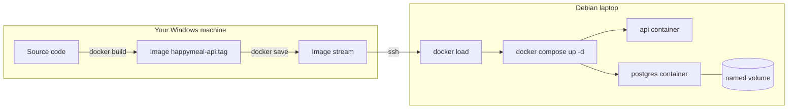

# Build, configure and deploy Happymeal with Docker Compose

**Reading time:** about 20 minutes. **Before this:** [01-docker-fundamentals.md](01-docker-fundamentals.md).

This document takes you from source code to a running API on your Debian server. It explains every Dockerfile instruction you need, but it does not give you the final file. You will assemble it yourself.

After this document you can:

- Write the Dockerfile for the API and explain each line.
- Run the API and PostgreSQL together with Compose, with the right configuration.
- Explain how the data survives and how the schema is created.
- Tag an image so you know what version runs where.
- Deploy a new version by hand, check it, and roll it back.

## The path from code to server



There is no registry in this flow. The image travels through SSH. Later, a registry can replace the transfer step without changing anything else.

## What the API needs at runtime

These facts come from the code and decide how the container must be configured.

| Fact | Source | Consequence |
|---|---|---|
| The connection string is empty by default and the API stops at startup without it. | `appsettings.json` | You must set `ConnectionStrings__Happymeal`. |
| Migrations run only when the environment is `Development`. | `Program.cs` | In a container the database starts empty. See [Database schema](#database-schema-and-migrations). |
| Scalar and OpenAPI are mapped only in `Development`. | `ApiServiceExtensions.cs` | There is no Scalar UI on the server. Use `/health` and `/api/recipes` to check it. |
| HTTPS redirection is enabled outside `Development`. | `ApiServiceExtensions.cs` | The container has no certificate. See [Ports](#ports-and-network). |
| `/health` includes a `DbContext` check. | `ServiceExtensions.cs` | It proves the API can connect to the database. It does not prove the schema exists. |
| `OutboxDispatcher` is a background service. | `ServiceExtensions.cs` | It starts with the API and needs the database. |

In a container, `ASPNETCORE_ENVIRONMENT` is `Production` unless you set it. Do not set it to `Development` to get the migrations. That would also expose the Scalar UI and change other behavior.

### Environment variables and configuration keys

ASP.NET Core reads environment variables as configuration. A double underscore `__` replaces the `:` separator in a key:

| Configuration key | Environment variable |
|---|---|
| `ConnectionStrings:Happymeal` | `ConnectionStrings__Happymeal` |
| `Outbox:PollInterval` | `Outbox__PollInterval` |

Environment variables override `appsettings.json`. This is how you configure the same image for different environments.

## Build the image

### Choose the base images

Microsoft publishes two images you need:

| Image | Contains | Use |
|---|---|---|
| `mcr.microsoft.com/dotnet/sdk:10.0` | Compiler, `dotnet publish`, NuGet | Build stage only. It is large. |
| `mcr.microsoft.com/dotnet/aspnet:10.0` | ASP.NET Core runtime only | Final stage. It is much smaller. |

The repository has a `global.json` that asks for SDK `10.0.400`, and it allows a newer feature band (`rollForward: latestFeature`). The `sdk:10.0` tag moves to the latest SDK. Check that it satisfies the file:

```bash
docker run --rm mcr.microsoft.com/dotnet/sdk:10.0 dotnet --version
```

If the version is lower than `10.0.400`, the build will fail and you need a more specific tag. This also shows the trade-off of floating tags such as `10.0`: they are convenient, but the build is not fully reproducible.

### Build context and `.dockerignore`

The API references the Application, Domain, Infrastructure and Common projects. The build context must contain all of them. That means the context is the `Happymeal-BE` folder, where `Happymeal.slnx` lives. The Dockerfile can be in that same folder.

Without a `.dockerignore`, Docker sends everything to the daemon. Here that includes build output from your Windows machine. A `bin` or `obj` folder from outside Docker can break `dotnet restore` inside the image, because it contains paths and caches from another operating system.

Things to exclude:

- `**/bin`, `**/obj`
- `.git`, `.vs`, `.idea`, `TestResults`
- `.env` and other files with secrets
- Folders the build does not need: `tests`, `skills`, `docs`, `.claude`, `.agents`

### The Dockerfile, instruction by instruction

The file has two stages. Read each table and ask yourself what would break without that line.

**Stage 1: build**

| Instruction | What it does | Why Happymeal needs it |
|---|---|---|
| `FROM mcr.microsoft.com/dotnet/sdk:10.0 AS build` | Starts from the SDK image and names the stage `build`. | The compiler is only needed here. |
| `WORKDIR /src` | Sets the folder for the next commands. | A predictable place for the source. |
| `COPY` of `global.json`, the `.slnx` and the `.csproj` files | Copies only the project files first. | See the cache note below. |
| `RUN dotnet restore src/Happymeal.API/Happymeal.API.csproj` | Downloads the NuGet packages. | Restoring only the API restores only the projects it references. |
| `COPY src/ src/` | Copies the source code. | Now the code is available to compile. |
| `RUN dotnet publish src/Happymeal.API/Happymeal.API.csproj -c Release -o /app/publish --no-restore` | Compiles and writes the output to `/app/publish`. | `--no-restore` reuses the restore layer. `-c Release` builds optimized code. |

**The cache note.** NuGet packages change rarely, and source code changes all the time. If you copy only the `.csproj` files and restore before you copy the source, the restore layer stays in the cache while you edit code. A build after a code change then skips the slow package download. The difficulty: `COPY src/*/*.csproj ./` would flatten the folders, so you need one `COPY` line per project file to keep the structure.

**Stage 2: runtime**

| Instruction | What it does | Why Happymeal needs it |
|---|---|---|
| `FROM mcr.microsoft.com/dotnet/aspnet:10.0 AS final` | Starts a new, small image. Nothing from stage 1 is included. | No compiler and no source code in production. |
| `WORKDIR /app` | The folder where the app lives. | Matches the next `COPY` and `ENTRYPOINT`. |
| `COPY --from=build /app/publish .` | Copies the output from stage 1. | This is the only thing that crosses between the stages. |
| `USER $APP_UID` | Runs the process as a non-root user. | The .NET images define a non-root user. If the app is compromised, it has fewer rights. |
| `EXPOSE 8080` | Documents the port. | Since .NET 8 the images listen on 8080 by default. This line does not publish anything. |
| `ENTRYPOINT ["dotnet", "Happymeal.API.dll"]` | The command that starts the container. | The assembly name comes from the project name. |

Details to be able to explain:

- **Exec form.** `["dotnet", "Happymeal.API.dll"]` runs `dotnet` as the main process, so it receives the stop signal (`SIGTERM`) from `docker stop` and can shut down cleanly. The shell form (`ENTRYPOINT dotnet Happymeal.API.dll`) runs through `/bin/sh`, which can hide the signal.
- **Ports.** The non-root user cannot bind ports below 1024. This is why the .NET images use 8080 and not 80. You can change it with `ASPNETCORE_HTTP_PORTS`.
- **Version metadata.** You can add `ARG VERSION` and `LABEL org.opencontainers.image.version=$VERSION`. See [Versioning](#versioning-your-images).

Your exercise: assemble these lines in order into a `Dockerfile` and a `.dockerignore`. Do not copy the tables blindly. Make sure you can say why each line sits where it is.

### Build and run it alone

From the `Happymeal-BE` folder:

```bash
docker build -t happymeal-api:dev .
docker images happymeal-api
docker history happymeal-api:dev
```

`docker history` shows the layers and their sizes. Compare the size of this image with the SDK image to see the benefit of multi-stage builds.

Run it without configuration first:

```bash
docker run --rm -p 8080:8080 happymeal-api:dev
```

The API stops with a message about the missing connection string. This is the fail-fast behavior in `appsettings.json`. Now give it a database. With the Compose PostgreSQL running and published on your machine, a container on Docker Desktop reaches your host through `host.docker.internal`:

```bash
docker run --rm -p 8080:8080 \
  -e "ConnectionStrings__Happymeal=Host=host.docker.internal;Port=5432;Database=happymeal;Username=happymeal;Password=happymeal_local_dev" \
  happymeal-api:dev
```

The tables do not exist yet if the database is new, because the environment is `Production`. Open `http://localhost:8080/health`. It can return `Healthy`, because the check only tests the connection. Now call `http://localhost:8080/api/recipes`. It fails, because the table is missing. This is useful to see once: a green health check does not mean the schema is ready.

## Run the API and the database with Compose

You add a second service to the Compose file. Do not copy a full file from this document. These fragments show the important fields and why they exist.

```yaml
services:
  postgres:
    # ... as today, plus:
    healthcheck:
      test: ["CMD-SHELL", "pg_isready -U happymeal -d happymeal"]
      interval: 5s
      timeout: 3s
      retries: 10
    restart: unless-stopped

  api:
    image: happymeal-api:${HAPPYMEAL_TAG}
    environment:
      ConnectionStrings__Happymeal: "Host=postgres;Port=5432;Database=happymeal;Username=happymeal;Password=${POSTGRES_PASSWORD}"
    ports:
      - "8080:8080"
    depends_on:
      postgres:
        condition: service_healthy
    restart: unless-stopped
```

### Why each field matters

- **`Host=postgres`.** The service name is the hostname on the Compose network. This is the answer to the `localhost` problem from the first document.
- **`image:` or `build:`.** On your machine you can use `build: .` to build from source. On the server there is no source code, so you use `image:` with an explicit tag. The loaded image must have exactly that name and tag.
- **`depends_on` with `service_healthy`.** A plain `depends_on` only waits for the container to *start*. PostgreSQL needs some seconds before it accepts connections. The healthcheck uses `pg_isready` to tell Compose when it is ready.
- **`restart: unless-stopped`.** Docker restarts the container after a crash or after the server reboots, unless you stopped it yourself.
- **Startup resilience.** The API also retries database operations (`EnableRetryOnFailure`). That covers short interruptions, but it is not a replacement for ordering the startup.

### Configuration and secrets

Compose resolves `${VARIABLE}` from your shell and from a `.env` file in the same folder as the Compose file. The repository's `.gitignore` already ignores `.env`. This is the right place for the password and the image tag:

```text
POSTGRES_PASSWORD=choose-a-real-password
HAPPYMEAL_TAG=0.1.0
```

Good practice:

- Commit a `.env.example` with fake values, so the required variables are documented.
- On the server, restrict the file: `chmod 600 .env`.
- Remember the three ways to set variables on a service: `environment:` (inline), `env_file:` (a file) and `${}` interpolation. If the same variable is in `environment:` and `env_file:`, `environment:` wins.
- Beyond this week: Docker secrets and the `POSTGRES_PASSWORD_FILE` variant avoid putting passwords in environment variables.

The development passwords in the current Compose file are fine for local work. They must not be reused on the server.

### Ports and network

- **Publish only the API** (`8080:8080`). The API reaches PostgreSQL through the internal network. On the server, remove the `5432:5432` mapping, or bind it to the local interface (`127.0.0.1:5432:5432`) if you need `psql` from the host.
- **Docker and the firewall.** Docker publishes ports by editing the host firewall rules directly. A published port can bypass tools like `ufw`. Do not rely on `ufw` to hide a container port. Do not publish it.
- **HTTPS redirection.** The container listens on HTTP only. The middleware cannot find an HTTPS port, so it logs a warning and does not redirect. Check the log on the first start. TLS would be handled by a reverse proxy later. That is out of scope for now.

### One Compose file or two

Your local flow today is `docker compose up -d` for PostgreSQL, then `dotnet run`. If you add the `api` service to the same file, that flow changes. There are two common ways to keep both:

| Approach | How | Trade-off |
|---|---|---|
| Separate file | A second file for deployment, used with `docker compose -f <file> up -d`. | Clear separation. Some duplication. |
| Base file plus override | Shared base file, and an extra file merged with `-f base -f override`. | Less duplication. Harder to read. |

You choose. Be ready to explain your choice.

## Persistence

Data lives in the named volume `happymeal-postgres-data`. The container can be recreated with a new image and the database stays.

| Action | Containers | Network | Volume (data) |
|---|---|---|---|
| `docker compose down` | Removed | Removed | **Kept** |
| `docker compose down -v` | Removed | Removed | **Deleted** |
| `docker compose up -d` after a new image | Recreated | Kept | **Kept** |

Two details to remember:

- **Initial variables apply once.** `POSTGRES_DB`, `POSTGRES_USER` and `POSTGRES_PASSWORD` are used only when the data folder is empty. If you change the password in `.env` later, the existing database keeps the old one.
- **The volume is on the host.** Docker stores it under `/var/lib/docker/volumes/` on the server. Deleting the volume, or reinstalling the machine, deletes the data.

A volume is not a backup. A minimal backup and restore with the tools in the container:

```bash
docker compose exec -T postgres pg_dump -U happymeal happymeal > backup.sql
docker compose exec -T postgres psql -U happymeal -d happymeal < backup.sql
```

Test the restore at least once on a different database. A backup you never restored is only a hope.

## Database schema and migrations

In Development the API calls `MigrateAsync()` at startup. In `Production` it does not, so a new volume gives an empty database and the endpoints fail. `/health` still passes, because it only checks the connection. You need a deliberate strategy. The architecture skill in this repository says the same: "change this deliberately if the strategy changes".

| Option | How it works | Trade-off |
|---|---|---|
| **Idempotent SQL script** | Generate a script from the migrations and apply it with `psql` before starting the new version. | Explicit and easy to review. One manual step. |
| **Migrate at API startup** | Call `MigrateAsync()` in every environment. | Simple. Several API instances could migrate at the same time. The app needs schema-change rights. |
| **Migration job** | A separate one-shot container applies the migrations and exits. | Clean and repeatable. More moving parts. |

For a manual deployment on one server, the script is the easiest to defend. You see exactly what changes the database:

```bash
dotnet tool restore
dotnet ef migrations script --idempotent \
  --project src/Happymeal.Infrastructure \
  --startup-project src/Happymeal.Infrastructure \
  --output migrate.sql
```

Copy `migrate.sql` to the server and apply it:

```bash
docker compose exec -T postgres psql -U happymeal -d happymeal < migrate.sql
```

*Idempotent* means you can run it many times. It skips the migrations that were already applied.

## Versioning your images

A deployment must answer one question: **which code is running right now?** A tag such as `latest` cannot answer it, because it moves.

A simple scheme:

- A **version tag**: `happymeal-api:0.1.0`. You choose it on purpose.
- A **commit tag**: `happymeal-api:0.1.0-3659dd3`, using `git rev-parse --short HEAD`. It links the image to the exact commit.

```bash
VERSION=0.1.0
SHA=$(git rev-parse --short HEAD)
docker build -t happymeal-api:$VERSION-$SHA --build-arg VERSION=$VERSION .
```

Labels follow the OCI standard and stay inside the image:

```bash
docker image inspect happymeal-api:0.1.0-3659dd3 --format '{{json .Config.Labels}}'
```

By convention, you never overwrite a tag that you already deployed. If the code changes, the tag changes. This makes the rollback predictable.

## Deploy by hand to the Debian server

### One-time setup

1. Check Docker and Compose: `docker --version` and `docker compose version`. Your server has Compose v5.6.0, so use `docker compose` with a space.
2. Set up SSH with a key, so you do not type a password on each transfer.
3. Create a folder such as `~/happymeal`. Copy the Compose file there and create the `.env` file with `chmod 600`.
4. Check the architecture: `uname -m` should print `x86_64`. Your Windows build produces `linux/amd64` images, so they match. Verify the image with `docker image inspect <image> --format '{{.Architecture}}'`.

### Release steps

1. **Check the code.** `dotnet test --project tests/Happymeal.UnitTests`.
2. **Build and tag** the image, as in the versioning section.
3. **Transfer** the image through SSH:
   ```bash
   docker save happymeal-api:0.1.0-3659dd3 | gzip | ssh user@server "gunzip | docker load"
   ```
4. **Update the tag** in `~/happymeal/.env`: `HAPPYMEAL_TAG=0.1.0-3659dd3`.
5. **Apply the schema** if there are new migrations (`migrate.sql`).
6. **Start the new version:** `docker compose up -d`. Compose sees the new image and recreates only the `api` container.
7. **Verify:**
   ```bash
   docker compose ps
   docker compose logs --tail 50 api
   curl -i http://<server-ip>:8080/health
   ```
   You expect `200` and `Healthy`. Then call `GET /api/recipes` to confirm that the schema works too.

> **Windows note:** piping binary data between commands can corrupt it in PowerShell. Run step 3 from Git Bash or WSL. Another way is to save to a file and copy it:
> `docker save -o api.tar <image>`, then `scp api.tar user@server:~`, then `docker load -i api.tar` on the server.

The API image has no `curl` or `wget` by default, so a healthcheck that runs *inside* the API container needs an extra tool in the image. Check with `docker run --rm --entrypoint sh happymeal-api:dev -c "which curl"`. For this week, checking `/health` from outside is enough.

### Rollback

If the new version fails, set the previous tag in `.env` and run `docker compose up -d` again. This works only if the old image is still on the server, so do not remove old images right after a deploy. Database changes are not rolled back by this. Keep migrations backward compatible, or restore the backup.

### Troubleshooting

| Symptom | Likely cause | Check |
|---|---|---|
| The `api` container exits at once | Missing or wrong connection string | `docker compose logs api` |
| `/health` returns `Unhealthy` | The API cannot connect: wrong password, host or the database is down | Check `.env` and `docker compose logs postgres`. |
| `/health` is `Healthy` but `/api/recipes` fails | The schema does not exist | Apply `migrate.sql`. |
| `no such image` on `up` | The tag in `.env` does not match the loaded image | `docker images` |
| `exec format error` | Wrong CPU architecture | `docker image inspect ... '{{.Architecture}}'` |
| Port already in use | Another process uses 8080 | `ss -ltnp \| grep 8080` |
| The database is empty after a deploy | The volume was deleted or renamed | `docker volume ls` |
| Old password still works | `POSTGRES_PASSWORD` only applies to an empty volume | Change it with SQL (`ALTER USER`) |

### Later: a registry

A registry replaces step 3. You run `docker push` from your machine and `docker pull` on the server. The tags, the Compose file and the rollback stay the same.

## Defending your choices

Use these as practice for an interview. Answer in your own words in two or three sentences.

1. **Why a multi-stage build?** The final image has only the runtime and the published output. It is smaller, starts faster to pull and has less attack surface.
2. **Why copy the `.csproj` files before the source?** The restore layer stays cached while the code changes. Rebuilds are faster.
3. **Why not use `latest`?** It moves, so you cannot know what is running, and you cannot roll back to it.
4. **Why a non-root user?** If someone exploits the app, they do not get root inside the container.
5. **Why is PostgreSQL not published on the server?** Only the API needs it, through the internal network. Publishing it increases the attack surface, and Docker can bypass the host firewall.
6. **How do the API and the database find each other?** Compose creates a network with DNS. The service name `postgres` is the hostname.
7. **Where do the secrets live?** In a `.env` file that is outside Git and has restricted permissions on the server. Docker secrets would be the next step.
8. **What happens to the data when you deploy a new image?** Nothing. The data is in a named volume. Only `down -v` or deleting the volume removes it.
9. **How do you create the schema in production, and why?** With an idempotent script reviewed before it runs. It is explicit and safe for one server. With several instances or a pipeline, I would consider a migration job.
10. **How do you roll back?** Change the tag in `.env` to the previous image and run `up -d`. I keep the old images and a database backup.

## Final checklist

You are ready when you can do these without reading this document:

- Explain every line of your own Dockerfile and `.dockerignore`.
- Build the image, run it alone, and explain why it fails without the connection string.
- Start the API and PostgreSQL with Compose, and explain how the API finds the database.
- Explain what `down` and `down -v` do to the data.
- Produce a backup and restore it.
- Tag an image so it links to a commit, and find the version inside it.
- Transfer the image to the server, deploy it, verify `/health` and roll back.
