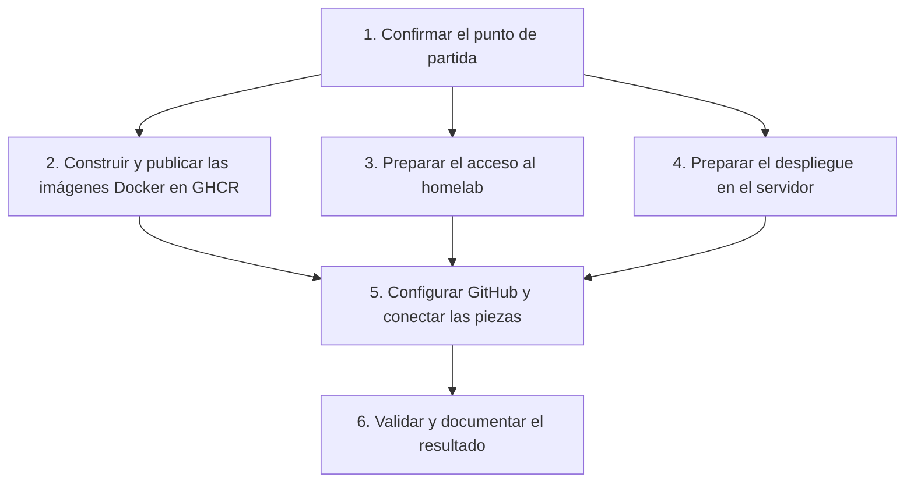

# 14 · Automatizar el despliegue del entorno de pruebas en el homelab

**Issue:** [HappyMeal #14](https://github.com/juampiii/HappyMeal/issues/14)
**Fecha del plan:** acuerdo previo reconstruido; no se conserva aquí una fecha exacta del acuerdo inicial.
**Estado del plan:** Acordado durante la implementación original.
**Estado de la historia:** Finalizada.
**Última revisión:** 2026-11-23.
**Origen:** análisis retrospectivo del plan, la implementación y su validación.

Este documento se escribió después de realizar la historia. Los apartados 1 a 5
reconstruyen el enfoque acordado; no son un plan que se hubiera guardado antes de
comenzar ni una transcripción exacta del texto de la issue. El apartado 6 explica
la ejecución real y las decisiones que aparecieron durante el trabajo.

## 1. Objetivo

Eliminar los pasos manuales necesarios para actualizar HappyMeal en el servidor de
pruebas. Al fusionar un PR en `develop`, GitHub Actions debe ejecutar las pruebas,
construir y publicar las imágenes Docker de la API y de las migraciones, y solicitar
el despliegue de esa misma versión en el homelab.

El resultado debe ser trazable hasta el commit desplegado, conservar los datos
existentes y comprobar que la API responde después de actualizarla. Se acepta una
breve interrupción del servicio. El alcance incluye acceso al servidor, copias
previas a las migraciones, recuperación y documentación; el despliegue sin parada
y la publicación de la API en Internet quedan fuera de esta historia.

## 2. Contexto

- El backend ya tenía Dockerfile, migraciones y Docker Compose. La API y PostgreSQL
  estaban funcionando en el homelab mediante un despliegue manual.
- El servidor era Debian 13 sobre arquitectura `x86_64`, con Docker y Compose.
  Su dirección local era `192.168.1.142`.
- El proyecto Compose existente se llamaba `happymeal`. Había que conservar su
  volumen de PostgreSQL y evitar interferir con los demás servicios del equipo.
- La API utilizaba el puerto local `8091`. El puerto `8090` correspondía a otro
  servicio del homelab; la dirección compartida al principio no era la de la API.
- El homelab se destinaría a pruebas, con un entorno GitHub llamado `testing`.
  `develop` sería la rama que entrega cambios a ese entorno.
- Se buscaba minimizar el coste y mantener comprensible el flujo. El usuario quería
  aprender qué hace GitHub Actions y poder seguir cada fase de la configuración.

## 3. Decisiones de partida

Estas son las decisiones del enfoque acordado antes de conectar el flujo completo.
Los detalles descubiertos o añadidos durante su ejecución se recogen en el cierre.

| Decisión | Motivo | Alternativa considerada |
| --- | --- | --- |
| Desplegar al actualizar `develop` tras un PR | Usar el homelab como entorno de pruebas habitual | Publicar una versión y desplegar manualmente; era la propuesta inicial, pero el usuario pidió automatizar también el último paso |
| Construir en GitHub y publicar en GHCR | El servidor descarga artefactos ya construidos y asociados al código | Clonar y construir el repositorio en el homelab |
| Publicar API y migraciones de la misma versión | Aplicar el esquema correspondiente a la API desplegada | Gestionar por separado las versiones, con mayor posibilidad de desajuste |
| Solicitar el despliegue mediante SSH | Aprovechar el acceso al servidor y evitar un agente de ejecución dentro del homelab | Runner propio o conexión privada desde Actions |
| IP pública y nombre gratuito con Duck DNS | Permitir que Actions localice el servidor aunque cambie la dirección pública | Depender de una IP escrita manualmente o utilizar otra vía de conectividad |
| Paquetes de imágenes públicos | Descargar desde el homelab sin credenciales del registry | Paquetes privados con autenticación; no se descartaron por ser necesariamente de pago |
| Conservar las últimas tres copias previas a migrar | Disponer de versiones recientes de los datos con una retención limitada | Acumular una copia por despliegue indefinidamente |
| Aceptar una breve parada | Mantener sencilla la primera automatización | Instancias paralelas y cambio de tráfico, pospuestos para otra historia |

La implementación conserva `POSTGRES_PASSWORD` en un archivo protegido del homelab.
GitHub guarda las variables y secretos necesarios para solicitar el despliegue por
SSH. Compose lee la contraseña desde `/etc/happymeal/runtime.env` y la proporciona
a los contenedores: no se incorpora al código ni a las imágenes. Esta separación
describe la configuración implementada; no se registra como una decisión inicial
independiente.

### Dudas que había que resolver

| Duda inicial | Cómo se resolvería | Paso dependiente |
| --- | --- | --- |
| ¿La IP pública contratada ya estaba activa? | Comprobar la conectividad tras el reinicio del router | 3 |
| ¿Qué sistema, arquitectura y servicios había instalados? | Inspeccionar el servidor por SSH | 2 y 4 |
| ¿Cómo llegaría Actions al servidor? | Configurar DNS, redirección y acceso SSH, y probar desde fuera de la LAN | 3 y 5 |
| ¿Cómo proteger los datos si falla una migración? | Definir copias, límites de reintento y recuperación | 4 y 6 |

## 4. Vista general de los pasos

| Paso | Qué haremos | Resultado esperado |
| --- | --- | --- |
| 1 · Confirmar el punto de partida | Revisar servidor, despliegue y decisiones | Requisitos y recursos identificados |
| 2 · Construir y publicar las imágenes Docker en GHCR | Validar el código, construir API y migraciones y publicar ambas con la misma etiqueta de commit | Las dos imágenes están disponibles en GHCR para descargarlas desde el homelab |
| 3 · Preparar el acceso al homelab | Configurar nombre, red y SSH | Actions puede contactar con una cuenta restringida |
| 4 · Preparar el despliegue en el servidor | Instalar Compose, scripts, copias y comprobaciones | Actualización controlada de API y esquema |
| 5 · Configurar GitHub y conectar las piezas | Crear entorno, variables, secretos y activar el flujo | Merge en `develop` conectado al despliegue |
| 6 · Validar y documentar el resultado | Probar el recorrido, la recuperación y completar las guías | Automatización comprobada y mantenible |

Tras la revisión inicial, la publicación, el acceso y la preparación del servidor
pueden avanzar por separado, coordinando la cuenta y la clave SSH entre los pasos
3 y 4. Los tres deben estar preparados antes de activar el despliegue completo.
Este diagrama representa dependencias, no el orden exacto de cada acción realizada.

## 5. Descripción de los pasos

### Paso 1 · Confirmar el punto de partida

**Qué queremos conseguir**

Conocer el sistema existente para automatizar su actualización sin sustituir los
datos ni afectar a otros proyectos del homelab.

**Qué haremos**

- Revisar sistema, arquitectura, Docker, Compose, contenedores y puertos.
- Identificar el proyecto `happymeal`, su PostgreSQL y la configuración existente.
- Acordar rama, entorno, conectividad, parada aceptable y retención de copias.

**Qué necesitas entender**

Compose agrupa servicios con un nombre de proyecto. Ese nombre también interviene
en la identificación de recursos como los volúmenes. Conservar el proyecto existente
forma parte de conservar el acceso a los datos que ya utiliza la aplicación.

**Cómo comprobaremos que está terminado**

- Están identificados el despliegue actual, su configuración y los recursos a conservar.
- Se distingue la dirección de la API de las de otros servicios.

**Resultado que deja este paso**

Inventario utilizado para preparar la configuración de `testing` y la guía operativa.

### Paso 2 · Construir y publicar las imágenes Docker en GHCR

**Qué queremos conseguir**

Que las imágenes Docker de la API y de las migraciones estén construidas para el
mismo commit y disponibles en GHCR para descargarlas desde el homelab. Las pruebas
son una condición previa a su publicación.

**Qué haremos**

- Crear un workflow en `.github/workflows/testing.yml`.
- Ejecutar las pruebas en los PR dirigidos a `develop`.
- Tras actualizar `develop`, construir y publicar API y migraciones para `linux/amd64`.
- Identificar ambas imágenes con el commit de origen y comprobar que pueden descargarse.

**Qué necesitas entender**

Un workflow es una automatización descrita en YAML. Un evento la inicia y sus jobs
agrupan trabajo que se ejecuta en máquinas llamadas runners. Aquí `test` valida,
`publish` depende de esas pruebas y `deploy` depende de la publicación.

GHCR es el registro que almacena las imágenes. Una etiqueta permite seleccionar
una versión: `sha-<commit>` identifica el código correspondiente. Una etiqueta
móvil como `develop` podría cambiar para señalar otra imagen; el despliegue acordado
utiliza la referencia del commit para saber qué versión está solicitando.

**Cómo comprobaremos que está terminado**

- Un PR ejecuta las pruebas y omite publicación y despliegue.
- Un push a `develop` publica las dos imágenes del mismo commit tras superar las pruebas.
- El homelab puede descargar ambas sin credenciales del registry.

**Si algo falla**

Revisar primero el job que falla. Si las imágenes existen pero no se pueden descargar
sin autenticar, comprobar la visibilidad de ambos paquetes en GHCR.

**Resultado que deja este paso**

Workflow, script `publish-images.sh` y paquetes `happymeal-api` y `happymeal-migrate`.

### Paso 3 · Preparar el acceso al homelab

**Qué queremos conseguir**

Que el runner de Actions pueda llegar al servidor desde Internet y solicitar solo
las operaciones necesarias para desplegar.

**Qué haremos**

- Comprobar la IP pública y reservar la dirección local del servidor.
- Registrar un nombre Duck DNS y mantenerlo actualizado desde el homelab.
- Configurar la redirección del router y comprobar el firewall del servidor.
- Separar la clave personal del administrador de la clave destinada a Actions.
- Validar el acceso desde fuera de la red local.

**Qué necesitas entender**

Duck DNS traduce un nombre a una IP; no elimina CGNAT ni abre puertos. El router
recibe la conexión en un puerto externo y la redirige al SSH interno del servidor.
El firewall del servidor también debe admitirla.

La clave privada de Actions identifica al cliente. `known_hosts` contiene la identidad
pública esperada del servidor y permite comprobar que se está conectando al equipo
correcto. La clave personal del administrador tiene otra finalidad y no se guarda en Actions.

**Cómo comprobaremos que está terminado**

- El nombre resuelve a la dirección pública correcta y se actualiza periódicamente.
- El acceso externo llega al SSH del homelab.
- La cuenta de despliegue acepta la autenticación prevista, pero no ofrece una consola libre.

**Si algo falla**

Una conexión correcta por LAN no demuestra acceso externo. Revisar DNS, redirección
y firewall por separado. Un fallo al cargar la clave privada requiere revisar el
secreto del cliente; no se corrige cambiando la clave pública del servidor.

**Resultado que deja este paso**

Nombre público, actualización DDNS, configuración de red y acceso SSH restringido.

### Paso 4 · Preparar el despliegue en el servidor

**Qué queremos conseguir**

Actualizar aplicación y esquema con una copia previa y una condición clara de éxito.

**Qué haremos**

- Instalar scripts y Compose controlados por el administrador.
- Conservar el proyecto y el volumen existentes, y mantener la contraseña fuera del repo.
- Descargar ambas imágenes antes de detener la API.
- Detener la API, generar la copia, aplicar migraciones, arrancar y comprobar endpoints.
- Conservar las últimas tres copias completadas y definir el tratamiento de fallos.

**Qué necesitas entender**

La imagen de migraciones ejecuta cambios del esquema una vez; la API queda funcionando
como servicio. Volver a una imagen anterior no deshace esos cambios de esquema.

La copia con `pg_dump` guarda los datos y su estructura en un archivo recuperable.
Comprobar su índice con `pg_restore --list` detecta ciertos problemas del archivo,
pero la prueba de recuperación consiste en restaurarlo y comprobar el resultado.

**Cómo comprobaremos que está terminado**

- La cuenta de despliegue solo puede solicitar el comando permitido y no modificar los scripts.
- Antes de migrar se genera una copia válida y se aplica la retención acordada.
- Tras el despliegue responden `/health` y `/api/recipes`.
- Los fallos posteriores al comienzo de las migraciones requieren revisión antes de reintentar.

**Si algo falla**

Antes de migrar, el script intenta recuperar la API anterior si estaba funcionando.
Una vez iniciadas las migraciones, el administrador revisa esquema, logs y aplicación;
el script bloquea nuevos despliegues mediante `needs-recovery`. No se restaura la base
automáticamente ni se elimina ese bloqueo sin conocer el estado real.

**Resultado que deja este paso**

Scripts instalados, configuración en `/etc/happymeal`, copias y estado de despliegue.
El código fuente de estas piezas queda en `Happymeal-BE/deploy`.

### Paso 5 · Configurar GitHub y conectar las piezas

**Qué queremos conseguir**

Conectar pruebas, publicación y servidor sin introducir contraseñas de la base en GitHub.

**Qué haremos**

- Crear el entorno `testing`, limitado a `develop`.
- Configurar host, puerto, clave de Actions e identidad del servidor.
- Activar el interruptor de despliegue después de las comprobaciones iniciales.
- Exigir PR y pruebas satisfactorias para fusionar cambios en `develop`.

**Qué necesitas entender**

Las variables contienen configuración no confidencial; los secretos guardan credenciales
o datos de confianza. El entorno GitHub agrupa configuración y restricciones del job;
no crea por sí mismo máquinas o contenedores en el homelab.

El workflow responde a `push` en `develop`, que incluye el merge de un PR. La protección
de la rama es lo que obliga a pasar por un PR. El nombre `develop` es una convención;
la relación con `testing` se establece en el workflow y su configuración.

**Cómo comprobaremos que está terminado**

- Las variables y secretos se leen desde los ámbitos correctos.
- Los PR validan sin desplegar; su merge activa el recorrido completo.
- `develop` exige el check `test` para fusionar.

**Si algo falla**

Un job omitido puede deberse a sus condiciones, no a un fallo de SSH. Revisar rama,
evento, interruptor de repositorio y restricciones del entorno antes de revisar el servidor.

**Resultado que deja este paso**

Entorno, variables, secretos y protección de rama en GitHub, documentados sin credenciales.

### Paso 6 · Validar y documentar el resultado

**Qué queremos conseguir**

Demostrar el recorrido completo y dejar una guía para operar y recuperar el servicio.

**Qué haremos**

- Fusionar un PR de prueba y observar `test`, `publish` y `deploy`.
- Comprobar la versión desplegada, las respuestas HTTP y las copias.
- Ensayar una restauración en una base separada de la aplicación.
- Documentar configuración, diagnóstico y recuperación, y registrar las evidencias de cierre.

**Cómo comprobaremos que está terminado**

- El merge concluye con un despliegue saludable del commit esperado.
- Existe una comprobación de restauración, además de la validación del archivo de copia.
- La guía refleja la configuración final y se conocen los límites del procedimiento.

**Si algo falla**

Volver al paso responsable de la comprobación fallida: publicación en el 2, conectividad
en el 3, actualización y recuperación en el 4, condiciones del workflow en el 5.

**Resultado que deja este paso**

Evidencias del despliegue y restauración, guía operativa y cierre de la historia.

## 6. Cierre de la historia

### Resultado final

La historia quedó finalizada con el despliegue automático al fusionar cambios en
`develop`, pruebas previas, imágenes en GHCR, copia antes de migrar, comprobaciones
HTTP y recuperación documentada. Se comprobó la restauración en una base temporal
separada y se protegió `develop` para exigir PR y el check `test`.

El primer despliegue exitoso registrado corresponde al merge del
[PR #17](https://github.com/juampiii/HappyMeal/pull/17), commit
`a127cf4965e993a3a60349955031dc6d7865e77d`. El resumen de Actions mostraba los tres jobs
en verde y `Healthy deployment` para ese commit.

### Cambios y concreciones durante el trabajo

| Paso | Lo previsto | Lo realizado | Motivo |
| --- | --- | --- | --- |
| 2 y 5 | La primera propuesta era publicar versiones y desplegar manualmente | Se acordó automatizar al actualizar `develop` | El usuario pidió cubrir también el último paso |
| 2 | Identificar las imágenes por commit; se habló del SHA corto | La implementación utiliza `sha-` seguido del SHA completo de 40 caracteres | Al advertirlo, el usuario aceptó continuar y posponer el ajuste |
| 3 | Utilizar un nombre relacionado con HomePiLab | Se registró `homepilab-juampi.duckdns.org` | `homepilab.duckdns.org` ya estaba ocupado |
| 3 | Habilitar el acceso externo mediante IP pública y redirección | Además se añadió una excepción IPv4 persistente al firewall del servidor | El acceso funcionaba en LAN, pero las reglas descartaban las conexiones externas |
| 3 y 5 | Usar una clave exclusiva de Actions | Se corrigió el contenido del secreto tras un fallo `error in libcrypto` | SSH no podía cargar la clave privada guardada inicialmente |
| 4 | Automatizar descarga, migración y arranque | Se añadieron instalación controlada por root, comando SSH restringido, bloqueo, orden de ejecuciones y estado de recuperación | Limitar lo que Actions puede ejecutar y evitar actualizaciones simultáneas o reintentos inseguros |
| 5 | Activar el flujo completo | Primero se publicaron imágenes con despliegue desactivado y después se activó el interruptor | Permitir preparar y validar las piezas antes de actualizar el servidor |
| 6 | Documentar el procedimiento | Se comprobó la restauración y se consolidó la guía de configuración y recuperación en el PR #18 | Completar la operación y recuperación tras el primer despliegue |

La necesidad de mantener explicaciones y una vista general durante el trabajo dio
origen posteriormente a la [issue #20](https://github.com/juampiii/HappyMeal/issues/20)
y a la skill utilizada para redactar este documento. Esa mejora del método de trabajo
no era parte del plan inicial del despliegue.

### Validación realizada

| Comprobación | Resultado | Referencia técnica |
| --- | --- | --- |
| Instalación del servidor | El instalador completó las comprobaciones de Compose y sudoers | `install.sh` y configuración instalada en `/etc/happymeal` |
| Actualización DDNS | El servicio actualizó Duck DNS y el nombre resolvió a una IPv4 pública | `homepilab-ddns.service`, su timer y resolución DNS |
| Conectividad y firewall | El acceso externo por SSH quedó operativo tras aplicar la excepción persistente | Redirección TCP 2222 → 22 y drop-in de `homepilab-firewall.service` |
| Despliegue del PR #17 | `test`, `publish` y `deploy` terminaron correctamente para el commit indicado | [PR #17](https://github.com/juampiii/HappyMeal/pull/17), commit `a127cf4965e993a3a60349955031dc6d7865e77d` |
| Pruebas automatizadas | El job `test` completó build, pruebas unitarias, integración y escenarios de despliegue e instalación SSH | `.github/workflows/testing.yml` |
| Copia previa | Se comprobó un archivo de 4.934 bytes correspondiente al primer despliegue | `/var/backups/happymeal/20261122T092800056522067-a127cf4965e993a3a60349955031dc6d7865e77d.dump` |
| Restauración | La copia se restauró en una base temporal; se consultaron las tablas de recetas y outbox y se eliminó la base temporal | `createdb`, `pg_restore --exit-on-error --single-transaction`, consultas con `psql` y limpieza con `dropdb` |
| Protección de rama | `develop` exige PR y el check `test`; la configuración permite excepciones a administradores | Regla de protección de `develop` |
| Documentación | Se completó la guía de despliegue, variables, secretos y restauración | [PR #18](https://github.com/juampiii/HappyMeal/pull/18) |

La comprobación de copias se realizó cuando había una copia disponible. La retención
de tres es un máximo, no un mínimo: su eliminación por antigüedad se cubre en los
escenarios automatizados; no se registra una comprobación de rotación tras cuatro
despliegues reales.

### Pendientes y limitaciones

No queda trabajo de implementación pendiente de esta historia. Las limitaciones
del procedimiento y las precauciones para su mantenimiento son las siguientes:

- El inventario anterior a la activación indicaba imágenes privadas y primer despliegue
  pendiente. El [PR #18](https://github.com/juampiii/HappyMeal/pull/18) recoge la
  actualización documental de cierre; al consultar versiones anteriores de la guía,
  tener en cuenta ese cambio de estado.
- El despliegue tiene una breve parada y está unido a la sesión SSH y sus tiempos
  de espera. Una interrupción durante la actualización puede requerir revisión manual.
- Las tres copias locales no protegen frente a pérdida del disco o del servidor.
- No hay reversión automática del esquema después de migrar. La recuperación sigue
  siendo una operación deliberada del administrador.
- El acceso externo configurado es para SSH. No implica que la API sea accesible
  desde Internet; su dirección habitual documentada es la de la red local.
- Los cambios de scripts o Compose instalados requieren revisión y reinstalación
  administrativa. Publicar imágenes nuevas no actualiza esos archivos del servidor.

## 7. Referencia técnica final

### Archivos del repositorio

| Archivo | Responsabilidad |
| --- | --- |
| [testing.yml](../../../.github/workflows/testing.yml) | Eventos, pruebas, publicación y solicitud de despliegue |
| [publish-images.sh](../../../Happymeal-BE/deploy/publish-images.sh) | Publicación de API y migraciones sin reemplazar etiquetas de commit existentes |
| [compose.testing.yml](../../../Happymeal-BE/deploy/compose.testing.yml) | Servicios e imágenes del entorno de pruebas |
| [happymeal-deploy](../../../Happymeal-BE/deploy/happymeal-deploy) | Descarga, copia, migración, arranque, comprobaciones y estado |
| [happymeal-ssh-dispatch](../../../Happymeal-BE/deploy/happymeal-ssh-dispatch) | Validación del comando recibido por SSH |
| [happymeal-deploy.sudoers](../../../Happymeal-BE/deploy/happymeal-deploy.sudoers) | Permiso sudo limitado al script de despliegue |
| [install.sh](../../../Happymeal-BE/deploy/install.sh) | Instalación administrativa de scripts, configuración y permisos |
| [test-deploy.sh](../../../Happymeal-BE/deploy/test-deploy.sh) y [test-install.sh](../../../Happymeal-BE/deploy/test-install.sh) | Escenarios de prueba del despliegue y su instalación |
| [Guía de despliegue](../../../Happymeal-BE/deploy/README.md) | Procedimientos de instalación, operación y recuperación; actualización de cierre en el PR #18 |

### Variables y secretos de GitHub

| Ámbito | Nombre | Finalidad |
| --- | --- | --- |
| Variable de repositorio | `HOMELAB_DEPLOY_ENABLED` | `true` permite nuevos despliegues; `false` o ausente los omite |
| Variable del entorno `testing` | `HOMELAB_HOST` | Nombre de destino: `homepilab-juampi.duckdns.org` |
| Variable del entorno `testing` | `HOMELAB_SSH_PORT` | Puerto SSH externo: `2222` |
| Secreto del entorno `testing` | `HOMELAB_SSH_KEY` | Clave privada exclusiva de la cuenta de despliegue |
| Secreto del entorno `testing` | `HOMELAB_KNOWN_HOSTS` | Identidad pública del servidor asociada al nombre y puerto |
| Generado por GitHub para la ejecución | `GITHUB_TOKEN` | Autenticación en GHCR; el job de publicación solicita `packages: write` |

El interruptor es de repositorio para poder evaluarlo antes de entrar en el entorno.
Desactivarlo no cancela una migración ya iniciada ni revierte una versión.

### Servicios y localización en el homelab

| Elemento | Ubicación o función |
| --- | --- |
| Nombre público y redirección | `homepilab-juampi.duckdns.org:2222` → `192.168.1.142:22` |
| Cuenta de despliegue | `happymeal-deploy`; comando permitido: `deploy <SHA completo> <número de ejecución>` |
| Cuenta personal | `juampi`; usa su propia clave y no la de Actions |
| API en LAN | [Health](http://192.168.1.142:8091/health) y [recetas](http://192.168.1.142:8091/api/recipes) |
| Configuración instalada | `/etc/happymeal/compose.testing.yml` y `/etc/happymeal/runtime.env` |
| Contraseña de PostgreSQL | En la configuración del servidor; no se copia al workflow ni a este documento |
| Scripts instalados | `/usr/local/sbin/happymeal-deploy` y `/usr/local/sbin/happymeal-ssh-dispatch` |
| Copias | `/var/backups/happymeal/*.dump`, retención de las últimas tres completadas |
| Último despliegue saludable | `/var/lib/happymeal-deploy/state/current` |
| Control de orden | `/var/lib/happymeal-deploy/state/latest-run` |
| Bloqueo de recuperación | `/var/lib/happymeal-deploy/state/needs-recovery` |
| Log privado de migración | `/var/lib/happymeal-deploy/state/migration.log` |
| Actualización del nombre | `homepilab-ddns.service` y `homepilab-ddns.timer` |
| Excepción persistente de SSH | `/etc/systemd/system/homepilab-firewall.service.d/20-public-ssh.conf` |

La excepción del firewall se aplica al reiniciar `homepilab-firewall.service`.
Ejecutar directamente su script Python omite el ajuste añadido mediante systemd.
La configuración del router, DDNS y firewall pertenece al homelab; no la instala
el instalador de HappyMeal.

## 8. Palabras clave

`github-actions`, `ghcr`, `docker`, `compose`, `develop`, `testing`, `homelab`,
`ssh`, `duckdns`, `postgresql`, `migraciones`, `copias-de-seguridad`, `restauracion`
