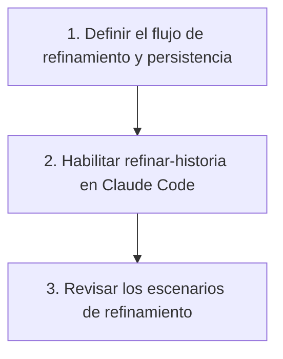

# 23 · Crear skill refinar-historia para Claude Code

**Issue:** [#23](https://github.com/juampiii/HappyMeal/issues/23)
**Fecha del plan:** 2026-11-25
**Estado del plan:** Acordado
**Estado de la historia:** Resultado parcial: implementación terminada, prueba en Claude Code pendiente
**Última revisión:** 2026-11-25
**Origen:** Plan previo al trabajo, basado en el alcance acordado para la v1.

## 1. Objetivo

Convertir ideas o notas sueltas en historias de usuario claras y verificables desde negocio. La skill debe preguntar por la información que falta, distinguir propuestas de decisiones confirmadas y producir una historia preparada para planificación técnica.

Se utilizará en Claude Code, íntegramente en español, con guardado en `docs/stories/` y reanudación de borradores. La publicación en GitHub será manual. Quedan fuera el diseño técnico, las estimaciones y la consulta de código, documentación de negocio o fuentes externas; la consulta de una wiki queda para una evolución posterior.

## 2. Contexto

Las skills existentes se mantienen en `Happymeal-BE/skills/`, con entradas para Claude Code en `Happymeal-BE/.claude/skills/`. Claude Code se inicia en `Happymeal-BE`, según su `CLAUDE.md`. El documento de esta issue registra la implementación; los documentos que produzca la nueva skill serán historias de negocio y tendrán su propia plantilla.

## 3. Decisiones de partida

| Decisión | Motivo | Alternativa considerada |
| --- | --- | --- |
| Crear la entrada `.claude/skills/refinar-historia/SKILL.md` dentro de Happymeal-BE, siguiendo el patrón compartido existente. | Permitir `/refinar-historia` sin duplicar instrucciones. | Mantener una copia completa solo en `.claude`, apartándose de la estructura existente. |
| Guardar historias en `docs/stories/` desde la raíz Git. | Mantener una ubicación estable aunque Claude se inicie en el backend. | Resolver la ruta desde el directorio actual, creando ubicaciones distintas según la sesión. |
| Preguntar hasta cinco cuestiones por ronda y aceptar «ok» para las propuestas explícitas de esa ronda. | Reducir esfuerzo sin convertir suposiciones en requisitos. | Completar reglas faltantes sin confirmación. |
| Mantener un único documento vigente por historia. | Poder retomar decisiones sin versiones divergentes. | Conservar borrador y versión final editables a la vez. |
| Usar INVEST como guía y cerrar solo sin decisiones bloqueantes pendientes. | Preparar la planificación sin sustituir la valoración técnica del equipo. | Garantizar estimabilidad o cerrar por una orden de parar con bloqueos abiertos. |

## 4. Vista general de los pasos

| Paso | Qué haremos | Resultado esperado |
| --- | --- | --- |
| 1 · Definir el flujo de refinamiento y persistencia | Redactar las instrucciones, estados y plantilla de negocio. | Una skill que permite crear, pausar, retomar y finalizar historias. |
| 2 · Habilitar refinar-historia en Claude Code | Añadir su entrada y registrarla en el índice. | El usuario puede localizarla e invocarla con `/refinar-historia`. |
| 3 · Revisar los escenarios de refinamiento | Validar estructura y recorrer una idea ambigua, una historia grande y un borrador retomado. | Evidencia de cobertura y límites de validación documentados. |

## 5. Descripción de los pasos

### Paso 1 · Definir el flujo de refinamiento y persistencia

**Qué queremos conseguir:** historias de negocio verificables con decisiones recuperables entre sesiones.

**Qué haremos:** escribir `Happymeal-BE/skills/refinar-historia/SKILL.md`, definir fuentes permitidas, rondas de preguntas, propuestas, revisión INVEST y plantilla. Precisar el guardado sin sobrescrituras y la conversión del borrador al archivo final.

**Cómo comprobaremos que está terminado:** el flujo distingue decisiones de propuestas, conserva pendientes y no permite marcar como lista una historia con bloqueos de negocio.

**Resultado que deja este paso:** instrucciones compartidas para el refinamiento completo.

### Paso 2 · Habilitar refinar-historia en Claude Code

**Qué queremos conseguir:** que Claude Code encuentre la skill mediante la misma estructura que las existentes.

**Qué haremos:** crear su entrada en `.claude/skills/` y añadirla al índice, distinguiéndola de la planificación técnica de issues.

**Cómo comprobaremos que está terminado:** el nombre y la descripción son válidos y los enlaces resuelven a las instrucciones compartidas.

**Resultado que deja este paso:** entrada de Claude Code e índice actualizado.

### Paso 3 · Revisar los escenarios de refinamiento

**Qué queremos conseguir:** comprobar las decisiones del flujo y señalar las comprobaciones que necesitan una sesión real de Claude Code.

**Qué haremos:** validar los archivos y recorrer manualmente los tres escenarios acordados, incluyendo confirmación parcial, parada con bloqueos y colisión con un archivo final.

**Cómo comprobaremos que está terminado:** cada escenario tiene un resultado esperado coherente con las instrucciones; los resultados observados y las limitaciones se registran sin atribuir ejecuciones no realizadas.

**Resultado que deja este paso:** evidencia de revisión y procedimientos reproducibles en el cierre de esta issue.

## 6. Cierre de la historia

El plan original se conserva en los apartados anteriores.

### Resultado final

Implementada el 2026-11-25 la skill compartida y su entrada para Claude Code. Se
invoca desde `Happymeal-BE` con `/refinar-historia <idea>` o indicando el documento
que se quiere retomar. Guarda historias en `docs/stories/` desde la raíz Git.

La skill incluye rondas de hasta cinco preguntas, confirmaciones parciales,
tratamiento de contradicciones, revisión INVEST, pausa con bloqueos y entrega
completa en Markdown. La conversión entre borrador e historia final mantiene un
único documento vigente y comprueba colisiones antes de renombrar.

### Cambios respecto al plan original

Sin cambios de alcance. La revisión de escenarios es manual; la ejecución de
conversaciones en Claude Code sigue pendiente por no disponer del ejecutable.

### Validación realizada

- Validador de `skill-creator`: ambas skills válidas.
- Enlaces del índice y de la entrada de Claude Code: resueltos correctamente.
- Recorrido manual de los tres escenarios y variantes: cobertura de instrucciones
  revisada. Datos, resultados esperados y límites en [validacion.md](validacion.md).
- No se ha ejecutado la skill dentro de Claude Code ni comprobado su descubrimiento
  y guardado en una sesión real. No se han modificado componentes ejecutables del
  backend, por lo que no corresponde ejecutar sus pruebas .NET.

### Pendientes y limitaciones

Ejecutar los escenarios de [validacion.md](validacion.md) dentro de Claude Code
antes de dar por cerrada la validación funcional de la issue.

## 7. Referencia técnica final

- [Instrucciones compartidas](../../../Happymeal-BE/skills/refinar-historia/SKILL.md).
- [Entrada para Claude Code](../../../Happymeal-BE/.claude/skills/refinar-historia/SKILL.md).
- [Índice de skills](../../../Happymeal-BE/skills/INDEX.md).
- [Escenarios de validación](validacion.md).

## 8. Palabras clave

Claude Code, refinar-historia, historias de usuario, INVEST, criterios de aceptación, borradores.
