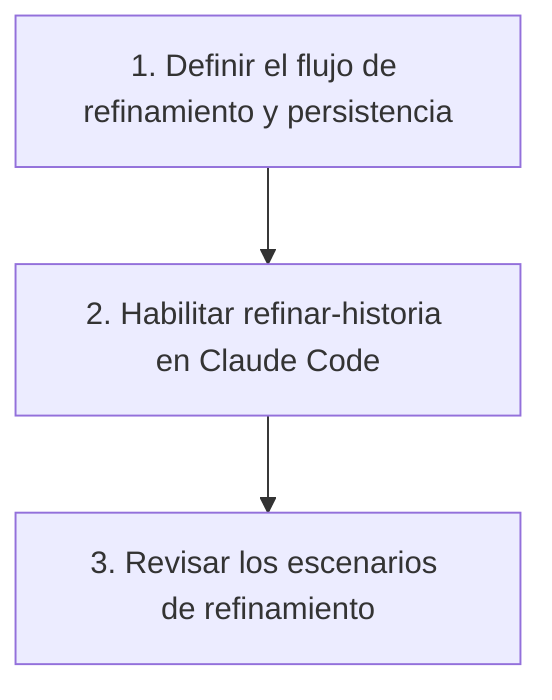

# 23 · Crear skill refine-feature para Claude Code

**Issue:** [#23](https://github.com/juampiii/HappyMeal/issues/23)
**Fecha del plan:** 2026-11-25
**Estado del plan:** Acordado
**Estado de la historia:** Cerrada: implementación terminada y escenarios de validación ejecutados en Claude Code
**Última revisión:** 2026-11-25
**Origen:** Plan previo al trabajo, basado en el alcance acordado para la v1.

## 1. Objetivo

Convertir ideas o notas sueltas en historias de usuario claras y verificables desde negocio. La skill debe preguntar por la información que falta, distinguir propuestas de decisiones confirmadas y producir una historia preparada para planificación técnica.

Se utilizará en Claude Code, íntegramente en español, con guardado en `docs/stories/` y reanudación de borradores. La publicación en GitHub será manual. Quedan fuera el diseño técnico, las estimaciones y la consulta de código, documentación de negocio o fuentes externas; la consulta de una wiki queda para una evolución posterior.

## 2. Contexto

Las skills existentes se mantienen en `Happymeal-BE/skills/`, con entradas para Claude Code en `Happymeal-BE/.claude/skills/`. Claude Code se inicia en `Happymeal-BE`, según su `CLAUDE.md`. El documento de esta issue registra la implementación; los documentos que produzca la nueva skill serán historias de negocio y tendrán su propia plantilla.

## 3. Decisiones de partida

| Decisión | Motivo | Alternativa considerada |
| --- | --- | --- |
| Crear la entrada `.claude/skills/refinar-historia/SKILL.md` dentro de Happymeal-BE, siguiendo el patrón compartido existente. | Permitir `/refinar-historia` sin duplicar instrucciones. | Mantener una copia completa solo en `.claude`, apartándose de la estructura existente. |
| Guardar historias en `docs/stories/` desde la raíz Git. | Mantener una ubicación estable aunque Claude se inicie en el backend. | Resolver la ruta desde el directorio actual, creando ubicaciones distintas según la sesión. |
| Preguntar hasta cinco cuestiones por ronda y aceptar «ok» para las propuestas explícitas de esa ronda. | Reducir esfuerzo sin convertir suposiciones en requisitos. | Completar reglas faltantes sin confirmación. |
| Mantener un único documento vigente por historia. | Poder retomar decisiones sin versiones divergentes. | Conservar borrador y versión final editables a la vez. |
| Usar INVEST como guía y cerrar solo sin decisiones bloqueantes pendientes. | Preparar la planificación sin sustituir la valoración técnica del equipo. | Garantizar estimabilidad o cerrar por una orden de parar con bloqueos abiertos. |

## 4. Vista general de los pasos

| Paso | Qué haremos | Resultado esperado |
| --- | --- | --- |
| 1 · Definir el flujo de refinamiento y persistencia | Redactar las instrucciones, estados y plantilla de negocio. | Una skill que permite crear, pausar, retomar y finalizar historias. |
| 2 · Habilitar refinar-historia en Claude Code | Añadir su entrada y registrarla en el índice. | El usuario puede localizarla e invocarla con `/refinar-historia`. |
| 3 · Revisar los escenarios de refinamiento | Validar estructura y recorrer una idea ambigua, una historia grande y un borrador retomado. | Evidencia de cobertura y límites de validación documentados. |

## 5. Descripción de los pasos

### Paso 1 · Definir el flujo de refinamiento y persistencia

**Qué queremos conseguir:** historias de negocio verificables con decisiones recuperables entre sesiones.

**Qué haremos:** escribir `Happymeal-BE/skills/refinar-historia/SKILL.md`, definir fuentes permitidas, rondas de preguntas, propuestas, revisión INVEST y plantilla. Precisar el guardado sin sobrescrituras y la conversión del borrador al archivo final.

**Cómo comprobaremos que está terminado:** el flujo distingue decisiones de propuestas, conserva pendientes y no permite marcar como lista una historia con bloqueos de negocio.

**Resultado que deja este paso:** instrucciones compartidas para el refinamiento completo.

### Paso 2 · Habilitar refinar-historia en Claude Code

**Qué queremos conseguir:** que Claude Code encuentre la skill mediante la misma estructura que las existentes.

**Qué haremos:** crear su entrada en `.claude/skills/` y añadirla al índice, distinguiéndola de la planificación técnica de issues.

**Cómo comprobaremos que está terminado:** el nombre y la descripción son válidos y los enlaces resuelven a las instrucciones compartidas.

**Resultado que deja este paso:** entrada de Claude Code e índice actualizado.

### Paso 3 · Revisar los escenarios de refinamiento

**Qué queremos conseguir:** comprobar las decisiones del flujo y señalar las comprobaciones que necesitan una sesión real de Claude Code.

**Qué haremos:** validar los archivos y recorrer manualmente los tres escenarios acordados, incluyendo confirmación parcial, parada con bloqueos y colisión con un archivo final.

**Cómo comprobaremos que está terminado:** cada escenario tiene un resultado esperado coherente con las instrucciones; los resultados observados y las limitaciones se registran sin atribuir ejecuciones no realizadas.

**Resultado que deja este paso:** evidencia de revisión y procedimientos reproducibles en el cierre de esta issue.

## 6. Cierre de la historia

El plan original se conserva en los apartados anteriores.

### Resultado final

Implementada el 2026-11-25 la skill compartida y su entrada para Claude Code. Se
invoca desde `Happymeal-BE` con `/refine-feature <idea>` o indicando el documento
que se quiere retomar. Guarda cada historia en su propia carpeta de `docs/stories/`
desde la raíz Git.

La skill incluye rondas de hasta cinco preguntas, confirmaciones parciales,
tratamiento de contradicciones, revisión INVEST, pausa con bloqueos y entrega
completa en Markdown. Cada historia es una carpeta `docs/stories/<nombre>/` con un
archivo por idioma, `<nombre>.<lang>.md`, y su avance se indica en el campo `Estado`
de cada archivo.

### Cambios respecto al plan original

Sin cambios de alcance. La skill se renombró de `refinar-historia` a `refine-feature`:
la entrada es una idea de funcionalidad que debería acabar en una historia y, solo si
es demasiado grande, en varias confirmadas por el usuario. Los apartados 1 a 5
conservan el nombre original. En la revisión posterior se eliminó la conversión de
`borrador-<nombre>.md` a `<nombre>.md` (paso 1): un solo archivo con campo `Estado`
evita las comprobaciones de colisión y renombrado. También se añadieron a la
plantilla los grupos de criterios camino feliz, errores y casos límite. Las
instrucciones de la skill pasaron a inglés, como las del resto de skills. Después,
cada historia pasó de un único archivo `<nombre>.md` a una carpeta con un archivo por
idioma. El nombre va en inglés, las traducciones solo se crean si el usuario las pide
y los enlaces entre historias apuntan al mismo idioma. La historia se escribe en
inglés por defecto, aunque la conversación siga el idioma del usuario, en línea con
`AGENTS.md`. `validacion.md` se renombró a `validation.md`. La revisión de escenarios
fue manual al principio; después se ejecutaron en sesiones reales de Claude Code (ver
«Validación realizada»). De esa ejecución salió un ajuste: el paso 1 de la skill
indica ahora que se juzga si una historia está relacionada solo por el nombre de su
carpeta, y que solo se lee la historia que el usuario elige.

### Validación realizada

- Validador de `skill-creator`: ambas skills válidas.
- Enlaces del índice y de la entrada de Claude Code: resueltos correctamente.
- Recorrido manual de los tres escenarios y variantes: cobertura de instrucciones
  revisada. Datos, resultados esperados y límites en [validation.md](validation.md).
- Escenario 1 ejecutado en una sesión real de Claude Code abierta en `Happymeal-BE`
  (2026-11-25), con `/refine-feature` ya registrado. Resultado: la skill se descubrió
  e invocó, localizó la raíz Git y guardó `docs/stories/organize-meals/organize-meals.en.md`
  en inglés aunque la conversación fue en español. Hizo cinco preguntas sin proponer
  respuestas sin base, confirmó solo lo respondido sin repetirlo, no confirmó nada con
  la orden de parar, dejó el estado en `Needs refinement` y entregó el documento
  completo en un único bloque Markdown. El resultado de la prueba se borró después.
- Resto de escenarios ejecutados el mismo día en sesiones reales abiertas en
  `Happymeal-BE`:
  - Escenario 2 (historia grande): propuso dividir en cuatro historias, no guardó
    ninguna hasta que se confirmó el reparto, no inventó una integración con
    supermercados y, ya confirmado, refinó solo `plan-menu` con el resto fuera de
    alcance.
  - Escenario 3 (retomar y finalizar): recuperó las decisiones sin volver a
    preguntarlas, el «ok» confirmó solo P1 y P2, que pasaron a reglas, decisiones y
    criterios, y la historia pasó a «Listo para planificación técnica» en el mismo
    archivo y en español. Antes de cerrar planteó dos preguntas nuevas y legítimas
    (una comida por día y qué datos se muestran), que se respondieron.
  - Variante de contradicción: mantuvo lo confirmado, dejó el conflicto como duda
    bloqueante y preguntó qué prevalece.
  - Variante de nombre ocupado: usó otro nombre y la historia existente quedó intacta
    (mismo hash).
  - Traducción: creó `view-menu.en.md` con el mismo estado y sin tocar el original.
    Al cambiar la española avisó de que la inglesa quedaba desfasada y no la tradujo.
    Tradujo también los textos literales de pantalla («Sin planificar» a "Not
    planned"), algo a tener en cuenta si deben mantenerse tal cual.
- Hallazgo del escenario 2: con otra historia relacionada en `docs/stories/`, la sesión
  la abrió para decidir si lo estaba y usó su contenido. Se precisó el paso 1. En una
  sesión nueva, con carpetas de nombre parecido y una historia marcada, no abrió
  ninguna y preguntó si retomaba una o era nueva. No se repitió el escenario 2 completo
  con el ajuste.
- Todo lo generado por las pruebas se borró al terminar.
- Antes de eso, una sesión iniciada desde la raíz del repositorio no tenía registrado
  `/refine-feature`; apareció al abrir un archivo de `Happymeal-BE`. Por eso se invoca
  desde `Happymeal-BE`.
- Con la entrada de Claude Code la sesión de prueba aplicó la deducción «uso solo yo»
  a partir de «lo usaré yo». Es razonable, pero no es una confirmación literal.
- No se han modificado componentes ejecutables del backend, por lo que no
  corresponde ejecutar sus pruebas .NET.

### Pendientes y limitaciones

Ninguno que impida cerrar la issue. Quedan dos mejoras opcionales: repetir el
escenario 2 completo con el paso 1 ya precisado y decidir si los textos literales de
pantalla deben mantenerse en el idioma original al traducir una historia.

## 7. Referencia técnica final

- [Instrucciones compartidas](../../../Happymeal-BE/skills/refine-feature/SKILL.md).
- [Entrada para Claude Code](../../../Happymeal-BE/.claude/skills/refine-feature/SKILL.md).
- [Índice de skills](../../../Happymeal-BE/skills/INDEX.md).
- [Escenarios de validación](validation.md).

## 8. Palabras clave

Claude Code, refinar-historia, refine-feature, historias de usuario, INVEST, criterios de aceptación, borradores.
