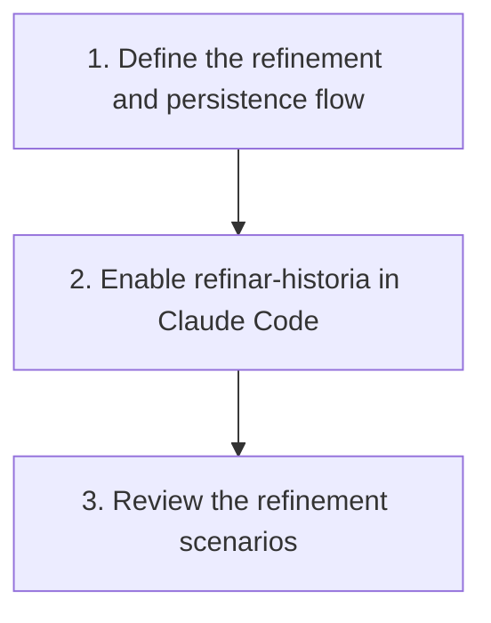

# 23 · Create the refine-feature skill for Claude Code

**Issue:** [#23](https://github.com/juampiii/HappyMeal/issues/23)
**Plan date:** 2026-11-25
**Plan status:** Agreed
**Story status:** Closed: implementation finished and validation scenarios run in Claude Code
**Last review:** 2026-11-25
**Origin:** Plan made before the work, based on the scope agreed for v1.

## 1. Objective

Turn ideas or loose notes into clear user stories that can be checked from the business side. The skill must ask for the missing information, tell proposals apart from confirmed decisions and produce a story ready for technical planning.

It will be used in Claude Code, entirely in Spanish, saving in `docs/stories/` and resuming drafts. Publishing to GitHub will be manual. Technical design, estimates and looking at code, business documentation or external sources are out of scope. Looking at a wiki is left for a later evolution.

## 2. Context

The existing skills live in `Happymeal-BE/skills/`, with Claude Code entries in `Happymeal-BE/.claude/skills/`. Claude Code starts in `Happymeal-BE`, according to its `CLAUDE.md`. The document of this issue records the implementation. The documents that the new skill produces will be business stories and will have their own template.

## 3. Starting decisions

| Decision | Reason | Alternative considered |
| --- | --- | --- |
| Create the entry `.claude/skills/refinar-historia/SKILL.md` inside Happymeal-BE, following the existing shared pattern. | Allow `/refinar-historia` without duplicating instructions. | Keep a full copy only in `.claude`, moving away from the existing structure. |
| Save stories in `docs/stories/` from the Git root. | Keep a stable location even when Claude starts in the backend. | Resolve the path from the current directory, creating different locations depending on the session. |
| Ask up to five questions per round and accept "ok" for the explicit proposals of that round. | Reduce effort without turning assumptions into requirements. | Complete missing rules without confirmation. |
| Keep a single current document per story. | Be able to resume decisions without diverging versions. | Keep a draft and a final version that can both be edited. |
| Use INVEST as a guide and close only with no pending blocking decisions. | Prepare the planning without replacing the technical judgment of the team. | Guarantee estimability or close on an order to stop with blockers still open. |

## 4. Overview of the steps

| Step | What we will do | Expected result |
| --- | --- | --- |
| 1 · Define the refinement and persistence flow | Write the instructions, statuses and business template. | A skill that can create, pause, resume and finish stories. |
| 2 · Enable refinar-historia in Claude Code | Add its entry and register it in the index. | The user can find it and call it with `/refinar-historia`. |
| 3 · Review the refinement scenarios | Validate the structure and go through an ambiguous idea, a big story and a resumed draft. | Evidence of coverage and documented validation limits. |

## 5. Description of the steps

### Step 1 · Define the refinement and persistence flow

**What we want to achieve:** verifiable business stories with decisions that can be recovered between sessions.

**What we will do:** write `Happymeal-BE/skills/refinar-historia/SKILL.md`, define the allowed sources, rounds of questions, proposals, INVEST review and template. Define saving without overwriting and the conversion from the draft to the final file.

**How we will check it is finished:** the flow tells decisions from proposals, keeps pending items and does not allow a story with business blockers to be marked as ready.

**What this step leaves:** shared instructions for the full refinement.

### Step 2 · Enable refinar-historia in Claude Code

**What we want to achieve:** Claude Code finds the skill through the same structure as the existing ones.

**What we will do:** create its entry in `.claude/skills/` and add it to the index, making it different from the technical planning of issues.

**How we will check it is finished:** the name and the description are valid and the links resolve to the shared instructions.

**What this step leaves:** Claude Code entry and updated index.

### Step 3 · Review the refinement scenarios

**What we want to achieve:** check the decisions of the flow and point out the checks that need a real Claude Code session.

**What we will do:** validate the files and go through the three agreed scenarios by hand, including partial confirmation, stopping with blockers and a clash with a final file.

**How we will check it is finished:** each scenario has an expected result that matches the instructions. The observed results and the limits are recorded without claiming runs that did not happen.

**What this step leaves:** review evidence and reproducible procedures in the closing of this issue.

## 6. Closing of the story

The original plan is kept in the sections above.

### Final result

On 2026-11-25 the shared skill and its Claude Code entry were implemented. It is called from `Happymeal-BE` with `/refine-feature <idea>` or by naming the document to resume. It saves each story in its own folder in `docs/stories/`, from the Git root.

The skill includes rounds of up to five questions, partial confirmations, handling of contradictions, INVEST review, pause with blockers and full delivery in Markdown. Each story is a folder `docs/stories/<name>/` with one file per language, `<name>.<lang>.md`. The progress is shown in the `Status` field of each file.

### Changes from the original plan

No change of scope. The skill was renamed from `refinar-historia` to `refine-feature`: the input is a feature idea that should end in one story and, only if it is too big, in several stories confirmed by the user. Sections 1 to 5 keep the original name. In the later review, the conversion from `borrador-<name>.md` to `<name>.md` (step 1) was removed. A single file with a `Status` field avoids the checks for clashes and renaming. The groups of criteria happy path, errors and edge cases were also added to the template. The skill instructions moved to English, like those of the other skills. After that, each story moved from a single `<name>.md` file to a folder with one file per language. The name is in English, translations are created only if the user asks, and links between stories point to the same language. The story is written in English by default, even when the conversation follows the user's language, in line with `AGENTS.md`. `validacion.md` was renamed to `validation.md`, and this README and that file were translated to English. The scenario review was manual at first. Later the scenarios ran in real Claude Code sessions (see "Validation done"). One adjustment came from that run: step 1 of the skill now says to judge whether a story is related only by the name of its folder, and to read only the story the user selects.

### Validation done

- `skill-creator` validator: both skills are valid.
- Links in the index and in the Claude Code entry: resolved correctly.
- Manual walk through the three scenarios and variants: coverage of the instructions reviewed. Data, expected results and limits are in [validation.md](validation.md).
- Scenario 1 ran in a real Claude Code session opened in `Happymeal-BE` (2026-11-25), with `/refine-feature` already registered. Result: the skill was found and called, it located the Git root and saved `docs/stories/organize-meals/organize-meals.en.md` in English although the conversation was in Spanish. It asked five questions without proposing answers that had no basis, confirmed only what was answered without repeating it, confirmed nothing with the order to stop, left the status as `Needs refinement` and delivered the full document in a single Markdown block. The test result was deleted afterwards.
- The other scenarios ran the same day in real sessions opened in `Happymeal-BE`:
  - Scenario 2 (big story): it proposed splitting into four stories, saved none until the split was confirmed, did not invent a supermarket integration and, once confirmed, refined only `plan-menu` with the rest out of scope.
  - Scenario 3 (resume and finish): it recovered the decisions without asking them again. The "ok" confirmed only P1 and P2, which became rules, decisions and criteria. The story changed to "Listo para planificación técnica" in the same file and in Spanish. Before closing, it asked two new and legitimate questions (one meal per day, and which data is shown), which were answered.
  - Contradiction variant: it kept what was confirmed, left the conflict as a blocking doubt and asked which one wins.
  - Name already used variant: it used another name and the existing story stayed intact (same hash).
  - Translation: it created `view-menu.en.md` with the same status and without touching the original. When the Spanish file changed, it warned that the English one was out of date and did not translate it. It also translated the literal screen texts ("Sin planificar" to "Not planned"). This matters if they must stay as they are.
- Finding in scenario 2: with another related story in `docs/stories/`, the session opened it to decide whether it was related and used its content. Step 1 was made more precise. In a new session, with folders with similar names and a marked story, it opened none and asked whether to resume one or start a new story. Scenario 2 was not run again in full with the adjustment.
- Everything the tests generated was deleted at the end.
- Before that, a session started from the repository root did not have `/refine-feature` registered. It appeared when a file in `Happymeal-BE` was opened. For that reason it is called from `Happymeal-BE`.
- With the Claude Code entry, the test session deduced "only I use it" from "lo usaré yo". It is reasonable, but it is not a literal confirmation.
- No executable component of the backend was changed, so its .NET tests do not apply.

### Pending items and limitations

None that prevents closing the issue. Two optional improvements remain: run scenario 2 again in full with step 1 already made more precise, and decide whether literal screen texts must stay in the original language when a story is translated.

## 7. Final technical reference

- [Shared instructions](../../../Happymeal-BE/skills/refine-feature/SKILL.md).
- [Claude Code entry](../../../Happymeal-BE/.claude/skills/refine-feature/SKILL.md).
- [Skill index](../../../Happymeal-BE/skills/INDEX.md).
- [Validation scenarios](validation.md).

## 8. Keywords

Claude Code, refinar-historia, refine-feature, user stories, INVEST, acceptance criteria, drafts.
