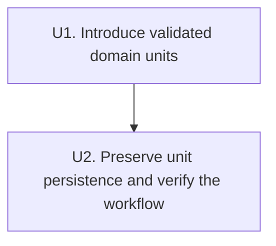

# 34 — Unit of measure value object

**Work item:** [Manage recipes](https://dev.azure.com/juampidev/HappyMeal/_workitems/edit/34)
**Plan date:** 2026-11-27
**Plan status:** Agreed
**Implementation status:** Completed and verified locally
**Origin:** Backend review amendment agreed before implementation

This document records the unit-of-measure amendment to story #34. Its completion
status applies to this amendment, not the complete shared recipe-book release.

## 1. Objective

Ingredients currently store their unit as a nullable string while `RecipeUnits`
provides a static list of accepted codes. Represent a valid individual unit as an
immutable domain value object with equality by code and controlled construction.

Introduce `UnitOfMeasure` separately from quantity. Preserve the current supported
codes and the independent optionality of quantity and unit, the HTTP string
contract, field-level validation errors and existing nullable text persistence.

## 2. Agreed decisions

| Decision | Reason |
| --- | --- |
| Model one unit as `UnitOfMeasure`, with immutable code and value equality. | An ingredient should hold a valid domain unit rather than an arbitrary string. |
| Validate construction through `Result<UnitOfMeasure>`. | Expected invalid input follows the existing domain error conventions. |
| Keep quantity and unit independently optional. | This is an existing confirmed business rule; this change adds no combined amount rules. |
| Retain g, kg, ml, l, ud, cucharadita and cucharada. | No new units, aliases, normalization or conversion rules are introduced. |
| Keep transport codes as strings and persistence as nullable text where supported. | The frontend contract and stored values need not change to strengthen the domain model. |

## 3. Steps and verification

| Step | Work | Observable outcome |
| --- | --- | --- |
| U1 · Introduce validated domain units | Add the value object; adapt ingredient construction, validation and DTO projection. | Invalid codes cannot create a unit, equal codes compare by value, optional units still work, and validation retains ingredient paths. |
| U2 · Preserve unit persistence and verify the workflow | Configure the EF conversion and verify domain and HTTP/database behavior. | Existing string codes and null units round-trip without changing the API or database column shape. |

For U1, use focused unit tests for creation, equality and invalid values, retaining
aggregate validation behavior. For U2, use the existing PostgreSQL integration
suite plus focused round-trip coverage. Check the EF model for unintended schema
changes before adding a migration; none is intended for a string conversion.

## 4. Closing

Implemented and reviewed on 2026-11-27. The agreed steps above are preserved;
there were no scope deviations. `UnitOfMeasure` is a sealed immutable record with
a getter-only code, private construction, predefined supported values and
`Result<UnitOfMeasure>` creation. `RecipeIngredient.Unit` now uses the nullable
value object; quantity remains independently optional.

Requests, commands and responses continue using the same string codes. EF converts
the value object to the existing nullable text column. No migration or snapshot
change was needed. Validation continues to collect failures using ingredient field
paths, and creation accepts exactly the previously supported codes.

Verification completed by the implementation subagent and reviewed before commit:

- Solution build with `EnforceCodeStyleInBuild=true`: passed; only the existing
  IDE0005 documentation-generation warning was reported.
- Unit suite: 70 passed, covering valid/invalid codes, value equality, independent
  quantity/unit optionality and aggregated validation paths.
- Docker/PostgreSQL integration suite: 32 passed, including HTTP/database
  round-trips and `HasPendingModelChanges()` returning false.
- Parent review of production mappings and tests, plus `git diff --check`: passed.

This closes the amendment only. No deployed household data was changed. Unit
conversion and combined quantity/unit modeling remain outside this change.

## 5. Scope and references

Unit conversion, combined quantity/unit value objects and new supported units are
outside this amendment. This decision is specific domain modeling, not a general
rule to replace every string with a value object.

- [Recipe ingredients](../../../Happymeal-BE/src/Happymeal.Domain/RecipeIngredient.cs)
- [Recipe validation](../../../Happymeal-BE/src/Happymeal.Domain/Params/RecipeParams.cs)
- [EF recipe configuration](../../../Happymeal-BE/src/Happymeal.Infrastructure/Database/Configurations/RecipeConfiguration.cs)

- [Unit of measure](../../../Happymeal-BE/src/Happymeal.Domain/UnitOfMeasure.cs)
- [Value object tests](../../../Happymeal-BE/tests/Happymeal.UnitTests/Domain/UnitOfMeasureTests.cs)
- [Persistence and contract tests](../../../Happymeal-BE/tests/Happymeal.IntegrationTests/Recipes/UnitOfMeasurePersistenceTests.cs)

## 6. Review amendment: recipe-owned steps and tags

**Agreement date:** 2026-11-27

**Status:** Completed and verified locally

The unit-of-measure plan and its verified outcome above remain unchanged. This
additional amendment replaces the list converters and custom collection comparers
for steps and tags with explicit elements owned by the recipe aggregate.

`Recipe` controls the creation and modification of ingredients, steps and tags,
including validation and publication restrictions. `RecipeStep` contains a
zero-based `Position` and `Content`; `RecipeTag` contains `Name`. Neither has a
separate repository or independent identifier. The API continues to receive and
return string lists, and a global tag catalog remains outside scope.

| Step | Work | Observable outcome |
| --- | --- | --- |
| O1 · Model steps and tags within the recipe aggregate | Add owned domain types and read-only collections; adapt response projection. | Existing normalization, validation and lifecycle rules remain intact, and steps are explicitly ordered by position. |
| O2 · Migrate recipe contents to owned tables | Map `RecipeSteps` and `RecipeTags` with owner-scoped keys; migrate the existing arrays. | Existing text and step order survive upgrade and downgrade, with no custom collection converter or comparer. |
| O3 · Verify aggregate persistence and record modeling preferences | Exercise replacement, ordering and concurrency; document the domain modeling criteria in the architecture skill. | Repeated tracked edits save correctly; child-only changes keep audit, concurrency and outbox behavior. |

### Amendment outcome

Implemented on 2026-11-27 without scope deviations. `RecipeStep` and `RecipeTag`
are created within `Recipe`, whose read-only collections protect external access.
Step reads explicitly sort by position. Requests and responses retain string
lists, and publication restrictions and normalization remain unchanged.

EF now maps the two collections to `RecipeSteps` and `RecipeTags` using owner-scoped
keys and backing fields. The migration backfills the old arrays before dropping
their columns and reconstructs them on downgrade. Tag order is not significant;
step order is preserved in both directions. Existing aggregate root updates
continue to protect owned-content-only edits with audit stamping, `xmin`
concurrency and transactional outbox events.

Verification:

- Solution build with `EnforceCodeStyleInBuild=true`: passed with the existing
  IDE0005 documentation-generation warnings only.
- Unit suite: 72 passed, including normalized step content, positions and tags.
- Docker/PostgreSQL integration suite: 37 passed. Coverage includes migration
  upgrade/downgrade with existing content and empty drafts, unordered database
  insertion, unchanged detail/list HTTP contracts, repeated replacements in one
  tracked context, audit/events and step/tag edits racing publication.
- EF model matches the migration snapshot; `git diff --check` passed.

Reusable preferences are recorded in the architecture skill's
[domain modeling reference](../../../Happymeal-BE/skills/architecture/references/domain-modeling.md).
The main implementation and persistence checks are in
[Recipe](../../../Happymeal-BE/src/Happymeal.Domain/Recipe.cs),
[RecipeConfiguration](../../../Happymeal-BE/src/Happymeal.Infrastructure/Database/Configurations/RecipeConfiguration.cs),
[owned-content persistence tests](../../../Happymeal-BE/tests/Happymeal.IntegrationTests/Recipes/RecipeOwnedContentPersistenceTests.cs)
and [migration tests](../../../Happymeal-BE/tests/Happymeal.IntegrationTests/Recipes/RecipeMigrationTests.cs).

No deployed household database was migrated. This amendment does not close the
complete shared recipe-book story.

## Review amendment — Recipe name collation

**Agreement date:** 2026-11-27

Replace the derived `NameKey` and custom Unicode key generation with a PostgreSQL
ICU collation on `Recipe.Name`. Keep the displayed name and domain trimming;
enforce case/accent-insensitive uniqueness with a unique index on that column.
Repository checks compare names directly using the same database collation.
Ingredient duplicate validation remains inside the aggregate, using the standard
.NET invariant comparer with `IgnoreCase | IgnoreNonSpace` and trimmed names.
The comparer is not claimed to reproduce every ICU equivalence for arbitrary text.

The agreed implementation has two steps: replace the domain/application key flow
and configure the collation; then migrate existing databases and verify database
uniqueness, concurrent requests, updates, Unicode names and PostgreSQL 18 `LIKE`.
Do not change recipe collection query splitting as part of this amendment.

Use the `happymeal_recipe_name` collation in `public`, with ICU locale
`und-u-ks-level1` and `deterministic: false`. The explicit schema prevents EF's
default `Happymeal` schema from creating a collation outside the column's search
path. The column has a unique index on `Name`; names are not normalized into a
second domain property. Other text properties keep their existing collations.

Add a forward migration rather than rewriting migrations already applied to local
databases. The historical key backfill remains for that history and rollback only;
its SQL behavior is unchanged. The new migration trims legacy display names,
removes the key and replaces the unique index. It fails transactionally if the new
collation reveals a collision. Downgrade restores historical keys before restoring
their unique index, and removes the collation after removing its column dependency.
Only temporary test databases are migrated during verification.

Implemented and verified locally on 2026-11-27: solution build with enforced style
passed (existing IDE0005 documentation-generation warning only), 72 unit tests and
42 PostgreSQL integration tests passed. Tests cover composed/decomposed Unicode,
case/accent-insensitive creation and updates, current-recipe exclusion, unique-index
enforcement without a precheck, concurrent equivalent-name requests, PostgreSQL 18
`LIKE`, upgrade/downgrade preservation and model/snapshot agreement. The original
story plan remains unchanged; this closes only the name-comparison amendment.

## Review amendment — Split queries for recipe listing

On 2026-11-27, the user approved using `AsSplitQuery()` for the existing
`GET /api/recipes` listing after the [performance evaluation](recipe-query-performance.md).
Apply it only in `RecipeRepository.GetAllAsync`, preserving the visibility filter,
name ordering, no-tracking reads and response shape. The detail GET and the shared
tracked `GetAsync` remain single-query reads. No global policy, paging, transaction
isolation or database-model change is part of this amendment.

Implemented and verified locally: solution build with enforced style passed
(existing IDE0005 documentation-generation warnings only), and all 42 PostgreSQL
integration tests passed. Existing tests verify listing contents, hidden-recipe
filtering, step ordering and detail responses. `git diff --check` passed.
