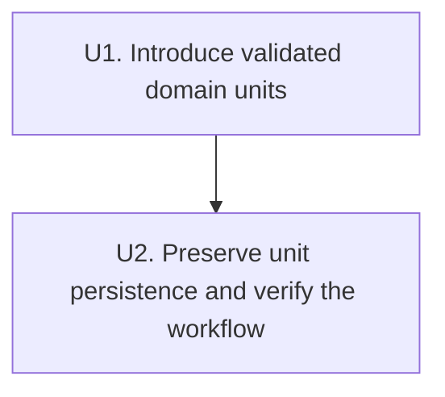

# 34 — Unit of measure value object

**Work item:** [Manage recipes](https://dev.azure.com/juampidev/HappyMeal/_workitems/edit/34)
**Plan date:** 2026-11-27
**Plan status:** Agreed
**Implementation status:** Completed and verified locally
**Origin:** Backend review amendment agreed before implementation

This document records the unit-of-measure amendment to story #34. Its completion
status applies to this amendment, not the complete shared recipe-book release.

## 1. Objective

Ingredients currently store their unit as a nullable string while `RecipeUnits`
provides a static list of accepted codes. Represent a valid individual unit as an
immutable domain value object with equality by code and controlled construction.

Introduce `UnitOfMeasure` separately from quantity. Preserve the current supported
codes and the independent optionality of quantity and unit, the HTTP string
contract, field-level validation errors and existing nullable text persistence.

## 2. Agreed decisions

| Decision | Reason |
| --- | --- |
| Model one unit as `UnitOfMeasure`, with immutable code and value equality. | An ingredient should hold a valid domain unit rather than an arbitrary string. |
| Validate construction through `Result<UnitOfMeasure>`. | Expected invalid input follows the existing domain error conventions. |
| Keep quantity and unit independently optional. | This is an existing confirmed business rule; this change adds no combined amount rules. |
| Retain g, kg, ml, l, ud, cucharadita and cucharada. | No new units, aliases, normalization or conversion rules are introduced. |
| Keep transport codes as strings and persistence as nullable text where supported. | The frontend contract and stored values need not change to strengthen the domain model. |

## 3. Steps and verification

| Step | Work | Observable outcome |
| --- | --- | --- |
| U1 · Introduce validated domain units | Add the value object; adapt ingredient construction, validation and DTO projection. | Invalid codes cannot create a unit, equal codes compare by value, optional units still work, and validation retains ingredient paths. |
| U2 · Preserve unit persistence and verify the workflow | Configure the EF conversion and verify domain and HTTP/database behavior. | Existing string codes and null units round-trip without changing the API or database column shape. |

For U1, use focused unit tests for creation, equality and invalid values, retaining
aggregate validation behavior. For U2, use the existing PostgreSQL integration
suite plus focused round-trip coverage. Check the EF model for unintended schema
changes before adding a migration; none is intended for a string conversion.

## 4. Closing

Implemented and reviewed on 2026-11-27. The agreed steps above are preserved;
there were no scope deviations. `UnitOfMeasure` is a sealed immutable record with
a getter-only code, private construction, predefined supported values and
`Result<UnitOfMeasure>` creation. `RecipeIngredient.Unit` now uses the nullable
value object; quantity remains independently optional.

Requests, commands and responses continue using the same string codes. EF converts
the value object to the existing nullable text column. No migration or snapshot
change was needed. Validation continues to collect failures using ingredient field
paths, and creation accepts exactly the previously supported codes.

Verification completed by the implementation subagent and reviewed before commit:

- Solution build with `EnforceCodeStyleInBuild=true`: passed; only the existing
  IDE0005 documentation-generation warning was reported.
- Unit suite: 70 passed, covering valid/invalid codes, value equality, independent
  quantity/unit optionality and aggregated validation paths.
- Docker/PostgreSQL integration suite: 32 passed, including HTTP/database
  round-trips and `HasPendingModelChanges()` returning false.
- Parent review of production mappings and tests, plus `git diff --check`: passed.

This closes the amendment only. No deployed household data was changed. Unit
conversion and combined quantity/unit modeling remain outside this change.

## 5. Scope and references

Unit conversion, combined quantity/unit value objects and new supported units are
outside this amendment. This decision is specific domain modeling, not a general
rule to replace every string with a value object.

- [Recipe ingredients](../../../Happymeal-BE/src/Happymeal.Domain/RecipeIngredient.cs)
- [Recipe validation](../../../Happymeal-BE/src/Happymeal.Domain/Params/RecipeParams.cs)
- [EF recipe configuration](../../../Happymeal-BE/src/Happymeal.Infrastructure/Database/Configurations/RecipeConfiguration.cs)

- [Unit of measure](../../../Happymeal-BE/src/Happymeal.Domain/UnitOfMeasure.cs)
- [Value object tests](../../../Happymeal-BE/tests/Happymeal.UnitTests/Domain/UnitOfMeasureTests.cs)
- [Persistence and contract tests](../../../Happymeal-BE/tests/Happymeal.IntegrationTests/Recipes/UnitOfMeasurePersistenceTests.cs)
