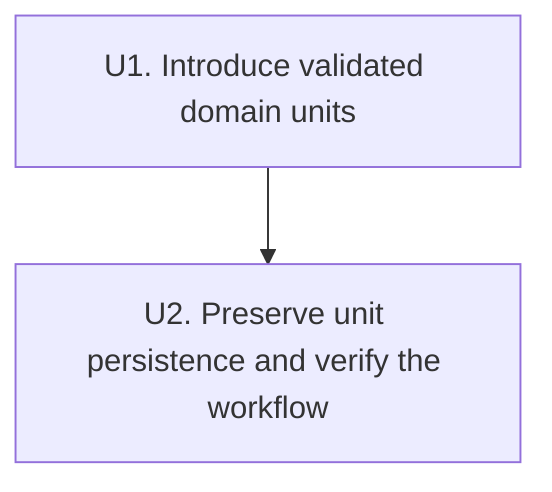

# 34 — Unit of measure value object

**Work item:** [Manage recipes](https://dev.azure.com/juampidev/HappyMeal/_workitems/edit/34)
**Plan date:** 2026-11-27
**Plan status:** Agreed
**Implementation status:** Completed and verified locally
**Origin:** Backend review amendment agreed before implementation

**Current migration history:** `InitialCreate` followed by `ManageRecipes`.
The later consolidation amendment supersedes the intermediate migration strategy
described below; earlier agreed plans and verification records are retained.

This document records the unit-of-measure amendment to story #34. Its completion
status applies to this amendment, not the complete shared recipe-book release.

## 1. Objective

Ingredients currently store their unit as a nullable string while `RecipeUnits`
provides a static list of accepted codes. Represent a valid individual unit as an
immutable domain value object with equality by code and controlled construction.

Introduce `UnitOfMeasure` separately from quantity. Preserve the current supported
codes and the independent optionality of quantity and unit, the HTTP string
contract, field-level validation errors and existing nullable text persistence.

## 2. Agreed decisions

| Decision | Reason |
| --- | --- |
| Model one unit as `UnitOfMeasure`, with immutable code and value equality. | An ingredient should hold a valid domain unit rather than an arbitrary string. |
| Validate construction through `Result<UnitOfMeasure>`. | Expected invalid input follows the existing domain error conventions. |
| Keep quantity and unit independently optional. | This is an existing confirmed business rule; this change adds no combined amount rules. |
| Retain g, kg, ml, l, ud, cucharadita and cucharada. | No new units, aliases, normalization or conversion rules are introduced. |
| Keep transport codes as strings and persistence as nullable text where supported. | The frontend contract and stored values need not change to strengthen the domain model. |

## 3. Steps and verification

| Step | Work | Observable outcome |
| --- | --- | --- |
| U1 · Introduce validated domain units | Add the value object; adapt ingredient construction, validation and DTO projection. | Invalid codes cannot create a unit, equal codes compare by value, optional units still work, and validation retains ingredient paths. |
| U2 · Preserve unit persistence and verify the workflow | Configure the EF conversion and verify domain and HTTP/database behavior. | Existing string codes and null units round-trip without changing the API or database column shape. |

For U1, use focused unit tests for creation, equality and invalid values, retaining
aggregate validation behavior. For U2, use the existing PostgreSQL integration
suite plus focused round-trip coverage. Check the EF model for unintended schema
changes before adding a migration; none is intended for a string conversion.

## 4. Closing

Implemented and reviewed on 2026-11-27. The agreed steps above are preserved;
there were no scope deviations. `UnitOfMeasure` is a sealed immutable record with
a getter-only code, private construction, predefined supported values and
`Result<UnitOfMeasure>` creation. `RecipeIngredient.Unit` now uses the nullable
value object; quantity remains independently optional.

Requests, commands and responses continue using the same string codes. EF converts
the value object to the existing nullable text column. No migration or snapshot
change was needed. Validation continues to collect failures using ingredient field
paths, and creation accepts exactly the previously supported codes.

Verification completed by the implementation subagent and reviewed before commit:

- Solution build with `EnforceCodeStyleInBuild=true`: passed; only the existing
  IDE0005 documentation-generation warning was reported.
- Unit suite: 70 passed, covering valid/invalid codes, value equality, independent
  quantity/unit optionality and aggregated validation paths.
- Docker/PostgreSQL integration suite: 32 passed, including HTTP/database
  round-trips and `HasPendingModelChanges()` returning false.
- Parent review of production mappings and tests, plus `git diff --check`: passed.

This closes the amendment only. No deployed household data was changed. Unit
conversion and combined quantity/unit modeling remain outside this change.

## 5. Scope and references

Unit conversion, combined quantity/unit value objects and new supported units are
outside this amendment. This decision is specific domain modeling, not a general
rule to replace every string with a value object.

- [Recipe ingredients](../../../Happymeal-BE/src/Happymeal.Domain/RecipeIngredient.cs)
- [Recipe validation](../../../Happymeal-BE/src/Happymeal.Domain/Params/RecipeParams.cs)
- [EF recipe configuration](../../../Happymeal-BE/src/Happymeal.Infrastructure/Database/Configurations/RecipeConfiguration.cs)

- [Unit of measure](../../../Happymeal-BE/src/Happymeal.Domain/UnitOfMeasure.cs)
- [Value object tests](../../../Happymeal-BE/tests/Happymeal.UnitTests/Domain/UnitOfMeasureTests.cs)
- [Persistence and contract tests](../../../Happymeal-BE/tests/Happymeal.IntegrationTests/Recipes/UnitOfMeasurePersistenceTests.cs)

## 6. Review amendment: recipe-owned steps and tags

**Agreement date:** 2026-11-27

**Status:** Completed and verified locally

The unit-of-measure plan and its verified outcome above remain unchanged. This
additional amendment replaces the list converters and custom collection comparers
for steps and tags with explicit elements owned by the recipe aggregate.

`Recipe` controls the creation and modification of ingredients, steps and tags,
including validation and publication restrictions. `RecipeStep` contains a
zero-based `Position` and `Content`; `RecipeTag` contains `Name`. Neither has a
separate repository or independent identifier. The API continues to receive and
return string lists, and a global tag catalog remains outside scope.

| Step | Work | Observable outcome |
| --- | --- | --- |
| O1 · Model steps and tags within the recipe aggregate | Add owned domain types and read-only collections; adapt response projection. | Existing normalization, validation and lifecycle rules remain intact, and steps are explicitly ordered by position. |
| O2 · Migrate recipe contents to owned tables | Map `RecipeSteps` and `RecipeTags` with owner-scoped keys; migrate the existing arrays. | Existing text and step order survive upgrade and downgrade, with no custom collection converter or comparer. |
| O3 · Verify aggregate persistence and record modeling preferences | Exercise replacement, ordering and concurrency; document the domain modeling criteria in the architecture skill. | Repeated tracked edits save correctly; child-only changes keep audit, concurrency and outbox behavior. |

### Amendment outcome

Implemented on 2026-11-27 without scope deviations. `RecipeStep` and `RecipeTag`
are created within `Recipe`, whose read-only collections protect external access.
Step reads explicitly sort by position. Requests and responses retain string
lists, and publication restrictions and normalization remain unchanged.

EF now maps the two collections to `RecipeSteps` and `RecipeTags` using owner-scoped
keys and backing fields. The migration backfills the old arrays before dropping
their columns and reconstructs them on downgrade. Tag order is not significant;
step order is preserved in both directions. Existing aggregate root updates
continue to protect owned-content-only edits with audit stamping, `xmin`
concurrency and transactional outbox events.

Verification:

- Solution build with `EnforceCodeStyleInBuild=true`: passed with the existing
  IDE0005 documentation-generation warnings only.
- Unit suite: 72 passed, including normalized step content, positions and tags.
- Docker/PostgreSQL integration suite: 37 passed. Coverage includes migration
  upgrade/downgrade with existing content and empty drafts, unordered database
  insertion, unchanged detail/list HTTP contracts, repeated replacements in one
  tracked context, audit/events and step/tag edits racing publication.
- EF model matches the migration snapshot; `git diff --check` passed.

Reusable preferences are recorded in the architecture skill's
[domain modeling reference](../../../Happymeal-BE/skills/architecture/references/domain-modeling.md).
The main implementation and persistence checks are in
[Recipe](../../../Happymeal-BE/src/Happymeal.Domain/Recipe.cs),
[RecipeConfiguration](../../../Happymeal-BE/src/Happymeal.Infrastructure/Database/Configurations/RecipeConfiguration.cs),
[owned-content persistence tests](../../../Happymeal-BE/tests/Happymeal.IntegrationTests/Recipes/RecipeOwnedContentPersistenceTests.cs)
and [migration tests](../../../Happymeal-BE/tests/Happymeal.IntegrationTests/Recipes/RecipeMigrationTests.cs).

No deployed household database was migrated. This amendment does not close the
complete shared recipe-book story.

## Review amendment — Recipe name collation

**Agreement date:** 2026-11-27

Replace the derived `NameKey` and custom Unicode key generation with a PostgreSQL
ICU collation on `Recipe.Name`. Keep the displayed name and domain trimming;
enforce case/accent-insensitive uniqueness with a unique index on that column.
Repository checks compare names directly using the same database collation.
Ingredient duplicate validation remains inside the aggregate, using the standard
.NET invariant comparer with `IgnoreCase | IgnoreNonSpace` and trimmed names.
The comparer is not claimed to reproduce every ICU equivalence for arbitrary text.

The agreed implementation has two steps: replace the domain/application key flow
and configure the collation; then migrate existing databases and verify database
uniqueness, concurrent requests, updates, Unicode names and PostgreSQL 18 `LIKE`.
Do not change recipe collection query splitting as part of this amendment.

Use the `happymeal_recipe_name` collation in `public`, with ICU locale
`und-u-ks-level1` and `deterministic: false`. The explicit schema prevents EF's
default `Happymeal` schema from creating a collation outside the column's search
path. The column has a unique index on `Name`; names are not normalized into a
second domain property. Other text properties keep their existing collations.

Add a forward migration rather than rewriting migrations already applied to local
databases. The historical key backfill remains for that history and rollback only;
its SQL behavior is unchanged. The new migration trims legacy display names,
removes the key and replaces the unique index. It fails transactionally if the new
collation reveals a collision. Downgrade restores historical keys before restoring
their unique index, and removes the collation after removing its column dependency.
Only temporary test databases are migrated during verification.

Implemented and verified locally on 2026-11-27: solution build with enforced style
passed (existing IDE0005 documentation-generation warning only), 72 unit tests and
42 PostgreSQL integration tests passed. Tests cover composed/decomposed Unicode,
case/accent-insensitive creation and updates, current-recipe exclusion, unique-index
enforcement without a precheck, concurrent equivalent-name requests, PostgreSQL 18
`LIKE`, upgrade/downgrade preservation and model/snapshot agreement. The original
story plan remains unchanged; this closes only the name-comparison amendment.

## Review amendment — Split queries for recipe listing

On 2026-11-27, the user approved using `AsSplitQuery()` for the existing
`GET /api/recipes` listing after the [performance evaluation](recipe-query-performance.md).
Apply it only in `RecipeRepository.GetAllAsync`, preserving the visibility filter,
name ordering, no-tracking reads and response shape. The detail GET and the shared
tracked `GetAsync` remain single-query reads. No global policy, paging, transaction
isolation or database-model change is part of this amendment.

Implemented and verified locally: solution build with enforced style passed
(existing IDE0005 documentation-generation warnings only), and all 42 PostgreSQL
integration tests passed. Existing tests verify listing contents, hidden-recipe
filtering, step ordering and detail responses. `git diff --check` passed.

## Review amendment — Visible names, content limits and tag normalization

**Agreement date:** 2026-11-27

The user approved four review follow-ups: hiding releases a recipe's name; owned
content needs length/count limits; tags ignore blank values and deduplicate case
variants; remove obsolete deletion events because there are no historical outbox
messages to retain. Keep `Version = 1`: new-version creation remains out of scope.
No change to collation placement or the other review findings was agreed here.

Apply a visible-only name precheck and matching partial unique index. Preserve
case/accent-insensitive uniqueness among visible recipes and access to hidden
recipes by ID. Validate limits in Domain before mutation and configure matching
column lengths: 100 ingredients with names up to 200 characters, 100 steps up to
2,000 characters each, and 20 distinct nonempty tags up to 50 characters each.
Use trimmed text lengths. Ignore blank tags and collapse case variants using
`OrdinalIgnoreCase`, keeping the first spelling; accents remain distinct.

Introduce these storage changes with a forward migration. Overlength legacy data
causes migration failure rather than silent truncation. A downgrade reinstates
global name uniqueness, so it can fail if a released hidden name has been reused;
resolve those duplicate names before downgrading. No application database is
migrated automatically as part of this implementation.

Verify maximum accepted lengths/counts and rejection just above each limit, error
paths and unchanged aggregate state after rejected edits. Exercise HTTP/database
name reuse after hiding, continued visibility rules, database uniqueness, oversized
tags returning 400, persisted tag deduplication and migration/model consistency.

Implemented and verified locally: build with enforced style passed (existing
IDE0005 documentation-generation warnings only); 77 unit tests and 46 PostgreSQL
integration tests passed. Existing migration upgrade/downgrade and model-snapshot
checks pass with the new migration. New coverage exercises maximum lengths/counts,
rejected fields, ignored blank/case-duplicate tags, failed-update atomicity,
visible-name reuse through HTTP and directly through the database, and oversized
tag validation before persistence. The obsolete event and handler overload were
removed; the remaining lifecycle handler is retained. No commit, push or application
database migration was performed as part of these follow-ups.

## Review amendment — Specific persistence conflicts and owned loading

On 2026-11-27, the user approved translating known unique constraints separately
and removing redundant owned-collection includes. Map `Happymeal.Recipes` violations
of `IX_Recipes_Name` to a name conflict and `PK_Recipes` to an ID conflict. Keep
concurrency handling unchanged. Other constraint failures remain unexpected errors
for the API exception handler rather than being mislabeled as name/ID conflicts.
Verify actual database constraints and transaction rollback, plus propagation of
an unrelated uniqueness failure.

Remove the explicit ingredient includes from list and detail queries because EF
loads owned elements automatically. Preserve split-query behavior only on listing,
tracked detail loading, all response content and visibility rules. The user deferred
separating `IngredientParams` from the HTTP contract; leave that contract unchanged.

Implemented and verified locally: build with enforced style passed (existing
IDE0005 documentation-generation warnings only), 78 unit tests and 48 PostgreSQL
integration tests passed. New database tests bypass prechecks to exercise both
named constraints, verify the specific conflict message, tracker clearing and
rollback of recipe/outbox writes. A unit test verifies an unrelated unique
constraint failure is propagated. Existing detail/list tests verify owned content
still loads after removing explicit includes. `git diff --check` passed.

## Review amendment — Consolidate unreleased migrations and bound tag input

On 2026-11-27, the user requested replacing all four unreleased feature migrations
with a single migration. Preserve `20261031120108_InitialCreate` unchanged and
generate `ManageRecipes` directly from its model to the current model. This
supersedes the earlier forward-migration strategy: intermediate storage states,
`NameKey`, generated Unicode backfill and array conversions are no longer needed
for this first release. Keep the original decisions above as review history.

The single feature migration creates owned ingredients, steps and tags with their
final limits, the recipe lifecycle fields and concurrency token, and the visible-only
name index with the ICU collation. Existing baseline names have ordinary outer
spaces trimmed before uniqueness is enforced. Legacy rows start at version 1.
Downgrade removes feature content and preserves baseline recipe fields; remove
the column's collation dependency before dropping the collation itself.

Add a separate maximum of 100 incoming tag entries, checked before normalization;
retain the maximum of 20 distinct nonempty tags. Blank and duplicate entries count
towards the input cap but are ignored within an accepted request. Reuse the existing
coverage for content limits, hidden-name reuse and conflict messages, and add raw
input boundary/HTTP tests. Rewrite migration tests for direct upgrade from
`InitialCreate`, collision rollback, downgrade and reapplication.

`IngredientParams` remains unchanged as previously agreed. The collation remains
in `public`; the migration role needs permission to create it there. This change
does not provision roles or change the deployment privilege model.

Only disposable test databases are changed. An existing development database with
any removed migration applied must be returned to the baseline using the old
migrations or recreated before applying the consolidated history; changing source
files does not rewrite an already-applied database history.

Implemented and verified locally: build with enforced style passed (existing
IDE0005 documentation-generation warning only), 80 unit tests and 49 PostgreSQL
integration tests passed. Coverage includes the raw tag cap at 100/101 entries,
HTTP 400 for oversized raw lists, direct baseline upgrade, collision rollback,
downgrade preserving baseline fields, reapplication and model/snapshot agreement.
`InitialCreate` is unchanged and only one feature migration remains. The new
migration contains no derived name key, intermediate array columns or generated
Unicode backfill. `git diff --check` passed. No commit or push was performed.

## Review amendment — Stable error codes for client localization

On 2026-11-27, the user approved preparing backend errors for Spanish/English
localization before completing the backend PR. Add stable outcome codes and
per-field validation codes with interpolation parameters; expose them through
ProblemDetails while preserving existing messages, field paths, HTTP statuses and
success responses. Document the codes for the future frontend translations.
Do not implement frontend localization or add translation packages in this change.

Common owns generic outcome/rule codes and validation metadata. Domain owns recipe
outcome codes and supplies a code for every recipe rule. Application prechecks and
database constraint handling use the same codes for equivalent outcomes. API owns
ProblemDetails mapping, automatic model-binding codes and unexpected-error fallback.
Domain remains independent of HTTP and translation resources. No schema change or
additional migration is required.

The [error-code catalog](../../../Happymeal-BE/docs/api-error-codes.md) defines
top-level `code` and `validationErrors` field arrays containing `code` and
`parameters`. Existing `detail`, `title` and `errors` remain diagnostic text.
Validation aggregation retains metadata when grouping or remapping nested unit
errors. Frontend clients should translate codes and retain a localized fallback
for unknown future codes, without comparing English messages.

Implemented and verified locally: enforced-style solution build passed (existing
IDE0005 documentation-generation warnings only), 82 unit tests and 56 PostgreSQL
integration tests passed. New tests cover validation codes/limits and camelCase
indexed paths, unit-code propagation, publication parameters, not-found and
precheck/database conflict codes, malformed JSON binding, unexpected 500 responses
without internal details, legacy message compatibility and trace IDs.

## Review amendment — Missing-name validation and HTTP-specific codes

On 2026-11-27, the user requested follow-up corrections before moving to frontend.
Allow missing/null names in create/update DTOs to reach the domain required rule,
so otherwise-valid JSON returns `validation.required` for `name`. Preserve rejection
of truly malformed JSON or wrong property types as binding errors. The request
mapper represents the optional transport name as an empty command string.

Restrict the automatic `request.invalid` mapping to HTTP 400; use distinct 405 and
415 codes and a generic `http.error` fallback for other statuses without a specific
code. Move concurrency/save-failure constants to Application's
`RecipePersistenceErrorCodes`, keeping their wire values unchanged.

The unique index still rejects equivalent existing names transactionally; do not
delete or rename data automatically to make a migration succeed. Stable unit codes
remain unchanged and will receive translated display labels in frontend. Frontend
localization is still outside this backend correction.

Verified locally: enforced-style solution build passed (existing IDE0005 warnings
only), 82 unit tests and 62 PostgreSQL integration tests passed. New contract tests
exercise `{}` and explicit null names for both create and update, preserve stored
names after rejected updates, and verify distinct HTTP 405/415 codes. No schema
or migration changes were required; serialized persistence codes are unchanged.

## 34 — Recipe-book frontend localization

**Work item:** Manage recipes (#34)
**Agreement date:** 2026-11-27
**Plan status:** Agreed
**Implementation status:** Completed and verified locally

### Objective and scope

The recipe-book interface currently embeds Spanish text in its components and
feedback. Make all application-owned text available in Spanish and English with
Spanish as the default. Switch language without reloading or losing recipe input.

Include a persistent language selector, translated unit labels, accessible names,
placeholders, lifecycle feedback, empty/loading states, document language/title
and locale-aware display formatting. Consume the backend's stable error codes and
validation parameters; never translate by matching server prose. User-authored
recipe names, descriptions, ingredients, steps and tags remain unchanged.
Authentication and PWA installation stay outside story #34.

### Agreed decisions

- Keep one deployed Angular application and switch language at runtime.
- Use small typed ES/EN catalogs and an Angular signal service; no new dependency
  is needed for this interface. Each catalog must contain the same keys.
- Store a validated preference in localStorage, defaulting to Spanish. Blocked
  storage must not prevent reading recipes or switching language in the session.
- Keep language-neutral API payloads, numeric form values and stable unit codes.
- Store feedback identifiers or original errors so visible feedback can translate
  again when language changes. Unknown server codes use localized fallbacks.
- Backend contract reference: `feature/34-manage-recipes-be`, commit `2a4fdb6`.
  Keep this frontend branch independent; do not merge backend implementation here.

### Plan

| Step | Work | Observable result |
| --- | --- | --- |
| F1 — Add runtime localization and language choice | Typed catalogs, language/formatting service, selector and document metadata. | Spanish loads by default; English and saved preferences work without a reload. |
| F2 — Translate recipe flows and coded errors | Replace UI literals, preserve user content, translate units/numbers and backend codes/parameters. | List, edit, detail and lifecycle feedback use the selected language without changing payloads or losing edits. |
| F3 — Verify bilingual recipe workflows | Component/service tests, production build and browser-level workflow checks where available. | Both languages render, switching preserves state, errors translate, and existing lifecycle restrictions still hold. |

F1 precedes F2; F3 verifies their combined result. Existing lifecycle tests remain
part of verification. This plan records the localization amendment, not closure
of the entire shared recipe-book release.

### Delivery and verification

Implemented on 2026-11-27. F1 and F2 provide runtime ES/EN catalogs, persistent
language choice, document metadata, locale-aware numbers/dates, translated units
and all recipe-book application text. Components keep original errors and feedback
keys so already-visible feedback changes language. Form values, dirty state and
user-authored content survive switching. API transport unit codes are unchanged.
Length limits for ingredient/step inputs match the backend; it remains authoritative.

F3 adds Playwright as a development-only dependency. Eight controlled-response
browser cases run on desktop/mobile Chromium and are configured in the existing
CI workflow. Four opt-in live-backend cases exercise the full draft/edit/publish/hide
flow in both languages and viewport sizes. Default runs skip live cases unless
`HAPPYMEAL_LIVE_API=1`; they never reset an existing database.

Verification completed locally:

- `npm test -- --watch=false`: 23 tests passed across five files.
- `npm run build`: passed; initial production assets approximately 341 kB raw,
  below the configured 500 kB warning budget.
- `HAPPYMEAL_LIVE_API=1 npm run test:e2e`: all 12 Chromium cases passed, including
  all four real-backend cases against commit `2a4fdb6` and a disposable PostgreSQL
  18 container. No existing application database was changed.
- Visual inspection of the English mobile detail screenshot: labels, selector,
  translated units and user content render correctly; the browser checks no
  horizontal overflow at 390 pixels. Desktop rendering is covered by the same tests.
- Catalog key/placeholder parity, blocked/invalid storage, live error translation,
  indexed validation parameters, legacy/unknown error fallback, number/date
  formatting and unchanged outgoing unit codes are covered by tests.
- CI execution itself has not been run remotely for these unpushed changes.

The original F1–F3 plan above is preserved. The integration base was updated after
backend PR #26 merged (`270e1a2`), bringing the already-approved backend through
the base branch rather than adding new backend implementation to this delivery.
Its story document is retained above; this section closes only the frontend
localization amendment. Authentication and PWA installation remain outside scope.
No frontend feature commit or push was requested in this implementation turn.

Main references: [catalogs](../../../Happymeal-FE/src/app/i18n/messages.ts),
[localization service](../../../Happymeal-FE/src/app/i18n/i18n.ts),
[coded API errors](../../../Happymeal-FE/src/app/api-errors.ts),
[browser tests](../../../Happymeal-FE/e2e/localization.spec.ts) and
[frontend instructions](../../../Happymeal-FE/README.md).

## Frontend review follow-up — Feedback and field validation

The review's legacy `errorMessage`/prefix mapping and four-test observations refer
to the earlier frontend: current localization already consumes backend codes,
parameters and indexed fields, including publication `MinItems` and distinct
conflict messages. The review did identify real feedback/validation gaps.

Apply these scoped corrections while preserving the F1–F3 localization plan:

- Transfer the creation response and saved notice through transient router info,
  captured during component construction and consumed once on the destination.
  Do not fetch the just-created recipe again; reload/back reads fresh data.
- Update `isPublished` after a successful publish POST without blanking/refetching
  the detail. Failed/pending publication keeps the original content and draft state.
- Add localized field feedback with `aria-describedby`, including server codes.
  Reject whitespace-only ingredient names/steps; check text, collection and tag
  limits in the client as early feedback. Domain remains authoritative.
- Clear stale feedback and hide confirmations on action/field changes. Retry is
  offered specifically for a failed detail load, alongside the existing back link.
- Use singular unit labels for quantities of one. Keep the static API unit-code
  contract and verify all offered codes against the real backend; an endpoint
  for discovering future unit additions is not introduced in this frontend PR.
- Add portable Prettier checking to CI. Browser tests use their own server on
  port 4300 so a live preview/HMR session on 4200 cannot affect test initialization.

The absence of a client version in PUT does not remove the backend's existing
`xmin` protection between its aggregate read and save. This follow-up changes no
backend concurrency contract or promises about detecting an old browser form.

Implemented and verified locally on 2026-11-27:

- All 34 frontend tests passed across six files, including pending/failed/successful
  publication, editing/saving without navigation, field feedback, stale feedback
  clearing, load retry, text/tag/count boundaries and singular unit labels.
- All 22 Playwright cases passed on desktop/mobile Chromium: 16 controlled-response
  cases and six live-backend cases against disposable PostgreSQL. The creation
  test uses the actual router and verifies the saved notice, no duplicate GET,
  language switching and a fresh GET without an old notice on reload.
- Production build passed (approximately 349 kB initial raw assets, within budget).
- `npm run format:check` and `git diff --check` passed. The CI workflow is configured
  to enforce formatting; no remote CI run is claimed for these unpushed edits.
- English mobile field-error rendering was visually checked, and browser cases
  verify no horizontal overflow at 390 pixels. Preview remains on port 4200;
  isolated tests use 4300. No production database or backend code was changed.

Changes remain uncommitted for frontend review. Use the current frontend worktree
rather than the older remote frontend commit when reviewing these corrections.

## Frontend independent review — Async loads and accessible feedback

On 2026-11-27, apply the remaining review corrections without changing the backend
or the agreed ES/EN scope:

- Detail loads check both a monotonically increasing request generation and the
  current route ID. Old successes, failures and finally blocks cannot overwrite
  the current recipe, feedback or pending-loading state. Destroyed views invalidate
  outstanding requests as well.
- Form value events identify the changed control path and remove only its
  structured server errors. Collection structural changes invalidate that
  collection's indexed errors; unrelated fields retain their feedback.
- Editing validation uses one brief alert summary plus field descriptions,
  rather than announcing every field message twice. Detail-only publication
  errors keep their descriptive minimum-items feedback because no fields are shown.
- A permanent 404 offers the existing back link. Retry applies to network errors,
  HTTP 408/429 and server failures. A failed hide keeps its confirmation open and
  shows the error inside it, allowing retry/cancel without reopening.
- Native labels use `for`/`id`; field errors live outside labels. All input/select/
  textarea controls expose `aria-invalid` for local/server failures and descriptions
  through `aria-describedby`. Icon/action labels retain their contextual names.
- `FieldError` uses signal inputs, computed feedback and Angular RxJS interop to
  follow control events with automatic cleanup. Positive numbers have an explicit
  semantic validator; a generic minimum is formatted as a minimum, not guessed
  from its actual value. Ingredient amount formatting joins nonempty parts only.
- Playwright defaults to its own port 4300, overridable with `HAPPYMEAL_E2E_PORT`.
  Do not reuse an unrelated server or HMR preview. Keep project instructions short;
  implementation details and current API-contract links belong in README.

Two review observations do not require a behavior change: backend tag comparison
is `OrdinalIgnoreCase`, so accents remain distinct just as in the frontend's
Spanish/English tag handling; the earlier claim that tags ignore accents confused
them with ingredient-name comparison. Playwright is the explicitly agreed test
tool, and the dependency restriction concerns UI/state libraries. No new runtime
dependency or backend endpoint is introduced here.

Verification: 45 unit tests and 28 Playwright cases pass, including the live
backend lifecycle in Spanish and English on desktop and mobile. The browser suite
also passes with `HAPPYMEAL_E2E_PORT=4317`. Production build, Prettier checks and
`git diff --check` pass. The mobile field-error screenshot was reviewed for layout
and readable feedback.

## Frontend pull request delivery

On 2026-11-27, the user approved committing, pushing and opening the frontend PR.
The final delivery includes ES/EN localization, structured API error translation,
field validation, lifecycle feedback and the independent-review corrections above.
The PR targets `feature/34-manage-recipes`, which already contains the approved
backend PR #26; its review diff therefore contains frontend work and shared CI/docs.
Remote CI results remain to be checked after publication. Authentication (#35),
PWA installation (#36) and recipe version creation remain outside this scope.
