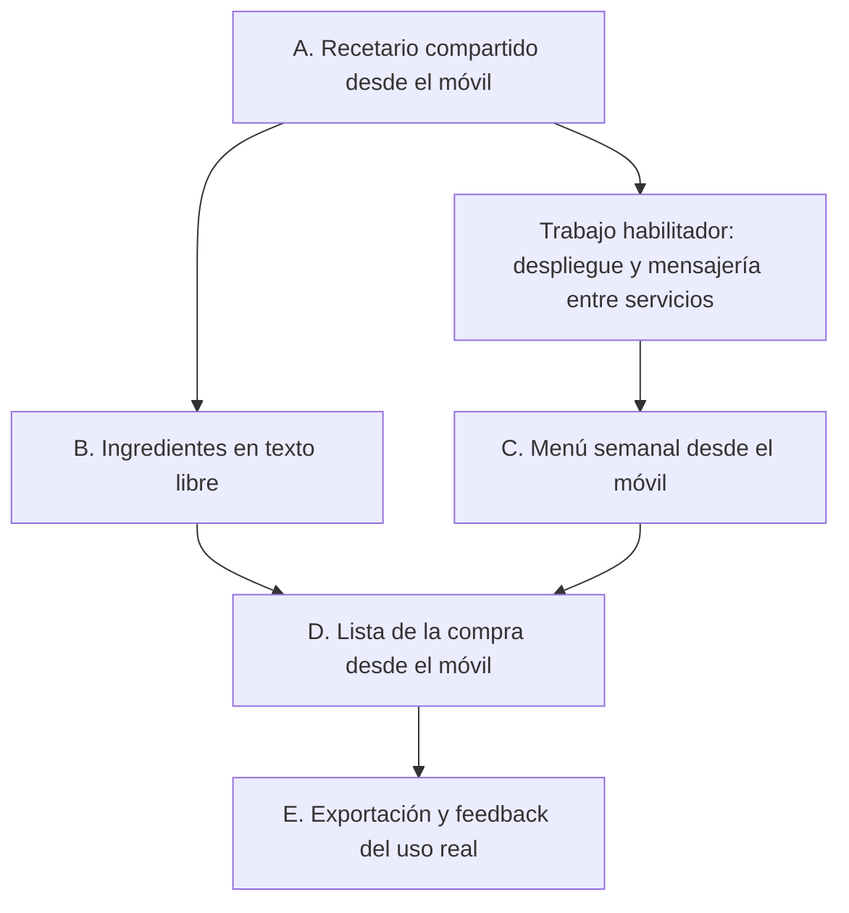
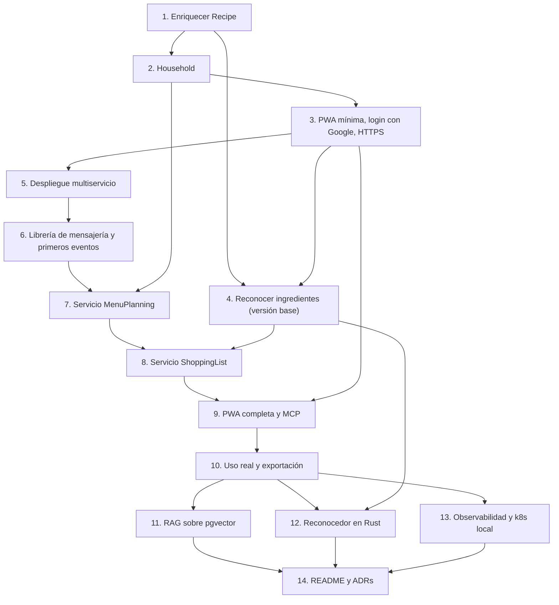

# roadmap · De un CRUD de recetas a un planificador de comidas compartido

[English](README.md)

**Épica relacionada:** [#33 · Shared household meal planning and shopping](https://dev.azure.com/juampidev/HappyMeal/_workitems/edit/33)
**Fecha del plan:** 2026-11-26
**Estado del plan:** Acordado
**Estado de la historia:** Sin comenzar
**Última revisión:** 2026-11-26
**Origen:** Plan previo al trabajo

Este roadmap abarca la evolución completa del producto y los objetivos de aprendizaje.
La épica #33 cubre el recetario compartido inicial, el menú semanal, la lista de la
compra y la exportación de datos del hogar. MCP, búsqueda semántica/RAG, el reconocedor
en Rust y Kubernetes/Terraform son ampliaciones posteriores fuera de esa épica.
Sus historias iniciales son #34–#41 en Azure DevOps y se refinarán individualmente
antes de la planificación técnica.

## Revisión vigente · 2026-11-26

La skill de planificación técnica pasa a llamarse `plan-feature` (antes
`issue-planning`); el refinamiento de negocio sigue usando `refine-feature`.
Las referencias al nombre anterior en el plan histórico conservan ese nombre
como parte del plan original.

**Estado:** Acordada. Esta revisión establece el alcance y el orden de entrega de
la épica #33. El plan original del 2026-11-26 se conserva debajo como referencia
histórica. Cuando difiera de esta revisión, prevalece esta revisión. Es una
actualización de planificación; no se ha completado la implementación del producto
ni la validación operativa.

### Objetivo y alcance

Entregar un recetario compartido, planificación semanal, lista de la compra y
exportación de datos del hogar para el propietario y su pareja. Ambos usan español
y acceden desde el móvil, también fuera de casa. Los datos pertenecen al hogar.

La primera versión usable es el recetario. Se mantienen como dirección acordada
el login con Google, la comprobación de acceso al hogar, una PWA con Angular,
HTTPS y el alojamiento en el homelab. Los servicios separados de Recipes/hogar,
MenuPlanning y ShoppingList y RabbitMQ siguen siendo decisiones técnicas del plan
original; su trabajo habilitador se planifica aparte del refinamiento de negocio.
El código y CI/CD permanecen en GitHub; la planificación de producto y el backlog,
en Azure DevOps.

### Bloques de entrega y resultados observables

| Entrega | Historias iniciales | Resultado observable | Relación con el plan original |
| --- | --- | --- | --- |
| A · Usar el recetario compartido desde el móvil | #34 Gestionar recetas con ingredientes y detalles de preparación; #35 Acceder al recetario compartido del hogar; #36 Usar el recetario desde el móvil | Ambos miembros autorizados pueden gestionar recetas con ingredientes estructurados desde una PWA instalable por HTTPS, también fuera de casa. Hay copias programadas y una restauración probada antes de almacenar datos reales del hogar. | Pasos 1–3; se adelanta desde el paso 5 el trabajo inicial de copias y restauración. |
| B · Introducir ingredientes en texto libre | #37 Introducir ingredientes en texto libre | El reconocimiento rellena los campos estructurados y el usuario puede corregir el resultado. El comportamiento detallado se confirma en el refinamiento. | Paso 4, después del primer recetario usable. |
| C · Planificar el menú semanal desde el móvil | #38 Planificar el menú semanal | Los usuarios pueden planificar y modificar la semana desde la PWA según las reglas confirmadas de comidas y raciones. | Paso 7 más su pantalla de menú del paso 9. El despliegue y la mensajería de los pasos 5–6 habilitan esta entrega. |
| D · Generar y gestionar la lista de la compra desde el móvil | #39 Generar la lista de la compra desde el menú semanal; #40 Gestionar la lista de la compra del hogar | Los usuarios pueden obtener la lista desde el menú, añadir ítems manuales y marcar productos comprados desde la PWA, según las reglas confirmadas en el refinamiento. | Paso 8 más su pantalla de compra del paso 9. |
| E · Exportar datos del hogar y aprender del uso real | #41 Exportar datos del hogar | La exportación se verifica según el contenido y formato confirmados. De dos a tres semanas de uso real producen un backlog escrito de problemas y capacidades que faltan. | Paso 10; no depende de MCP ni del trabajo posterior de IA. |

Los bloques agrupan el refinamiento y la entrega; cada historia se refina de forma
individual y puede dividirse en historias con valor independiente cuando se acuerde.
Las pantallas de menú y compra se entregan con sus respectivas capacidades.
Completar la PWA y validar el uso real no esperan a un servidor MCP.

### Trabajo habilitador y ampliaciones posteriores

- Las copias programadas y una restauración probada se adelantan a la entrega A.
  El paso 5 las amplía después a las bases de datos de todos los servicios y a
  los escenarios de fallo del despliegue.
- El despliegue de servicios y la mensajería fiable siguen siendo trabajo
  habilitador previo a los servicios de menú y compra. Sus elementos de backlog
  y sus planes técnicos siguen pendientes.
- La observabilidad se separa de Kubernetes/Terraform. Su trabajo puede acompañar
  a la integración de servicios; el clúster local es una ampliación de aprendizaje
  posterior.
- MCP, búsqueda semántica/RAG, el reconocedor en Rust y Kubernetes/Terraform quedan
  fuera de la épica #33 y no condicionan su cierre. Al refinar la búsqueda habrá
  que distinguir la recuperación de recetas de cualquier respuesta generada.
- La importación de recetas desde URLs, texto pegado y fotos sigue como candidata
  futura de backlog con su propio refinamiento. El plan original recoge una
  dirección propuesta, no otra entrega necesaria para cerrar la épica #33.
- El alta general de varios hogares y una interfaz multilingüe siguen fuera del
  alcance inicial. La documentación y los ADRs evolucionan junto al trabajo.

### Reglas de negocio y cierre

Las historias #34–#41 establecen por ahora títulos y capacidades, no reglas de
negocio definitivas. Los campos obligatorios de las recetas, las comidas del menú,
el cálculo de raciones, los cambios y borrados de recetas, el recálculo de la lista,
la conservación de marcas de comprado y el contenido y formato de exportación
siguen pendientes de confirmar con `refine-feature`. Los ejemplos concretos y
criterios de aceptación de negocio del plan histórico son entradas al refinamiento,
no reglas confirmadas cuando esas decisiones sigan abiertas. Una historia solo
estará lista para la planificación técnica al resolver sus decisiones de negocio
bloqueantes.

La épica #33 termina cuando ambos miembros autorizados pueden usar el flujo de
recetas, menú y compra desde el móvil fuera de casa, se aplica el control de acceso
al hogar, las historias incluidas cumplen sus criterios acordados, se han verificado
la exportación y la restauración y se recoge feedback del uso real. La configuración
de autenticación y del nombre público, la ubicación del frontend y los detalles de
integración entre servicios siguen como temas de planificación técnica. La épica y
esta revisión comparten ese límite de cierre.

## Referencia histórica · Plan original del 2026-11-26

Los apartados siguientes conservan las decisiones, los pasos, el diagrama y los
criterios originales. Se leen junto a la revisión vigente anterior, que prevalece.

## 1. Objetivo

Hoy Happymeal es un CRUD de recetas. Una receta solo tiene nombre y descripción. No hay planificador de menús, ni lista de la compra, ni interfaz de usuario. El objetivo es una aplicación real que dos personas usen cada semana: guardar recetas, planificar el menú semanal y obtener una lista de la compra.

La app es primero para uso personal. Los dos usuarios son el propietario y su pareja. Comparten un mismo conjunto de datos y hablan español. La app corre en el homelab. La primera versión usable es un recetario en una app para el móvil (paso 3). El menú y la lista de la compra llegan como servicios separados que se comunican por RabbitMQ. Las funciones de IA (RAG, MCP, reconocimiento de ingredientes) se añaden cuando la app ya es útil sin ellas. El proyecto también es un portfolio público, así que los pasos dejan buena documentación y ADRs.

## 2. Contexto

- Existe un bounded context: Recipes (CRUD con vertical slices, `Result<T>`, validación en el dominio).
- El outbox funciona con Postgres. `OutboxDispatcher` envía los eventos de dominio a handlers en proceso. No hay message broker.
- La API no tiene autenticación. `HttpCurrentUser` ya lee la claim `sub`, y `ApiServiceExtensions` tiene un TODO para la autenticación.
- Las pull requests ejecutan el build y los tests. Fusionar en `develop` publica las imágenes `api` y `migrate` en GHCR y despliega con un comando SSH restringido. El archivo compose es de root y se instala a mano en el servidor. Cada despliegue hace antes un `pg_dump`.
- La solución usa .NET 10 y Postgres (`Npgsql.EntityFrameworkCore.PostgreSQL`).
- No hay frontend ni funciones de IA.
- El homelab es un portátil con Debian 13: Intel i5-4200H (2 núcleos, 4 hilos), 8 GB de RAM, GTX 950M con 2 GB, 1 TB de disco interno y un SSD USB externo de 256 GB. Los modelos de IA locales tienen que ser pequeños.

## 3. Decisiones de partida

| Decisión | Motivo | Alternativa considerada |
| --- | --- | --- |
| Primero el valor: una app usable antes que la IA | La app tiene que ayudar en el día a día. La IA se construye sobre datos y uso reales. | Empezar por el RAG o por Rust. Descartado porque todavía no hay nada que buscar ni reconocer. |
| Tres servicios: la API actual (Recipes y hogar), `MenuPlanning` y `ShoppingList`. Un repositorio y una solución, con los proyectos compartidos `Happymeal.Common`, `Happymeal.Messaging` y `Happymeal.Contracts`. Cada servicio tiene su propia base de datos en la misma instancia de Postgres. | El propietario quiere practicar eventos de integración, RabbitMQ y diseño distribuido. También es un buen tema de portfolio. No hay ganancia operativa para dos usuarios, y el propietario acepta el coste extra. | Un monolito modular primero y separar después. Es más barato, y un camino válido si el coste se vuelve demasiado alto. |
| Los servicios se comunican con eventos de integración sobre RabbitMQ, con una librería propia pequeña construida sobre el outbox existente (más una bandeja de entrada para los consumidores). Los eventos de dominio se quedan dentro de cada servicio. | El outbox ya existe y está probado. Una librería pequeña da control total y es un buen objetivo de aprendizaje. | MassTransit (comprobar la licencia de su versión 9) o Wolverine. Descartados por ahora. |
| Un evento de integración es solo una notificación con `id`, `householdId` y `version`. El consumidor lee los detalles de un endpoint GET interno protegido con una API key (una por consumidor). Ese endpoint no tiene ruta en el proxy inverso. Cada consumidor mantiene su propio modelo de lectura. Un 404 significa que el elemento se borró. Un endpoint de listado (`updatedSince`) da la carga inicial. | Contratos pequeños que casi no cambian. Los eventos que llegan tarde o repetidos no hacen daño, porque el consumidor siempre lee el estado actual. Solo llaman al endpoint servicios de confianza, así que devuelve datos de cualquier hogar. | Un evento de foto con el estado completo. Los consumidores no necesitan al otro servicio al procesar, pero el contrato es más grande. |
| Los miembros del hogar se replican con el mismo patrón: el evento `HouseholdMembershipChanged` y un endpoint interno. Cada servicio guarda `(UserSub, HouseholdId)` y valida el JWT por su cuenta. | Sin dependencia en tiempo de ejecución entre servicios. | Que el proxy resuelva el hogar y lo envíe en una cabecera (obliga a confiar en la cabecera), o una llamada a la API principal en cada petición. |
| Todos los servicios se despliegan juntos con el mismo SHA de commit. Los contratos de eventos solo añaden campos. | Es simple y mantiene juntas versiones compatibles. Unos segundos de parada son aceptables para dos usuarios. | Despliegue independiente de cada servicio. Descartado: demasiada complejidad. |
| Una PWA mínima de recetas llega antes que los servicios nuevos (paso 3) | El propietario quiere usar la app pronto. El recetario ya es útil por sí solo. | Construir toda la interfaz después de los servicios. Descartado: la app sería inutilizable durante mucho más tiempo. |
| Los datos pertenecen a un `Household`, no a un usuario. Se añade `HouseholdId` a cada agregado. | Los dos usuarios comparten recetas, menú y lista. Añadirlo más tarde obliga a migrar todos los datos. | Propietario por usuario. Descartado: compartir exigiría lógica extra. |
| Un único hogar fijo con dos miembros al principio | Es suficiente por ahora. Más hogares solo significan crear más filas después. | Alta completa multi-tenant. Descartado por estar fuera de alcance. |
| Login con Google (OIDC). Cada API solo valida el JWT. Sin servidor de identidades propio. | No se guardan contraseñas. No hay un servicio nuevo. Cambiar de proveedor después no cambia las APIs. | ASP.NET Core Identity (contraseñas propias) o Keycloak en el homelab. Descartado para dos usuarios. |
| Los usuarios permitidos viven en la tabla de miembros del hogar (email de Google). Los dos primeros miembros se crean desde la configuración en el primer arranque. | Añadir a una persona no requiere redesplegar, y enlaza al usuario con un hogar. | Solo una lista de emails en la configuración. Descartado: cada cambio exige redesplegar. |
| PWA con Angular como interfaz de usuario | Elegido por el propietario. La lista de la compra se usa en el móvil, en el supermercado. | Blazor o React. No elegidos. |
| Datos e interfaz en español | Los dos usuarios hablan español. También afecta al catálogo de ingredientes y a los embeddings. | Varios idiomas. No hace falta ahora. |
| Los ingredientes son estructurados desde el principio (nombre, cantidad y unidad opcionales, texto original opcional) | Datos limpios para la lista de la compra desde el primer día. Cantidad y unidad son opcionales porque líneas como "sal al gusto" no tienen número. Cuando el reconocedor esté activo (paso 4), la entrada puede pasar a texto libre y el reconocedor rellena los campos estructurados. | Empezar con texto libre. Descartado: la lista de la compra no podría sumar cantidades. |
| El reconocedor de ingredientes empieza como una versión base con reglas en .NET, en una librería compartida que usan la API actual y `ShoppingList` | La lista de la compra funciona antes de que exista el servicio en Rust. La versión base es la referencia a superar. | Escribir primero el servicio en Rust. Descartado: bloquearía el uso personal. |
| El servicio de reconocimiento de ingredientes se escribe en Rust | Es la preferencia del propietario, destaca en el portfolio y el servicio (texto a datos, sin estado) encaja bien. El contrato no depende del lenguaje, así que reescribirlo en Go sigue siendo posible. | Go. Más rápido de aprender, pero no es la preferencia del propietario. |
| `pgvector` en el mismo Postgres para el RAG | Sin infraestructura nueva. Los filtros de negocio son SQL normal. | Qdrant o Azure AI Search. Descartado para este volumen de datos. |
| Los modelos de IA pequeños corren en local con Ollama, detrás de `IEmbeddingGenerator` e `IChatClient`. El modelo generativo es opcional. | Sin coste y sin que los datos salgan de casa. El servidor es un portátil pequeño, así que los modelos deben ser pequeños. Ollama corre en su propio contenedor con límite de memoria y carga un modelo a la vez. | Una API externa o `AgentGateway.Api`. Se mantienen como plan B si el modelo local es demasiado lento o flojo. ONNX Runtime dentro de la API es una opción solo para embeddings. |
| La app se expone a internet con redirección de puertos y un nombre de DuckDNS, como el SSH actual. Un proxy inverso le da HTTPS. | El móvil debe llegar a la app fuera de casa, y tanto una PWA como el login con Google necesitan HTTPS. | Tailscale (sin exposición pública, pero cada dispositivo lo necesita) o Cloudflare Tunnel. No elegidos por ahora. |
| Los datos reales viven en el entorno de pruebas que se despliega desde `develop`. El propietario acepta el riesgo. | Un solo servidor y sin coste extra. El riesgo se reduce con la copia antes de cada despliegue, y con las copias programadas y la prueba de restauración del paso 5. | Un entorno aparte para uso real, actualizado a mano. Descartado por ahora. |
| La importación de recetas crea un borrador que el usuario revisa antes de guardar. Es un caso de uso en .NET con una interfaz por etapa (extraer, estructurar), no un servicio en Rust ni en LangGraph. Orden: URLs con datos `schema.org`, después texto pegado con el LLM local y por último fotos. | Un LLM puede leer mal una receta, y un ingrediente erróneo llegaría a la lista de la compra. El flujo es casi lineal, así que basta con código normal. Muchas webs de recetas ya publican datos estructurados, por lo que no necesitan IA. | Un servicio en Python con LangGraph. Válido como elección de aprendizaje, pero no hace falta técnicamente. |

### Dudas pendientes

| Duda | Cómo se resolverá | Paso que depende de ella |
| --- | --- | --- |
| ¿Google acepta el nombre de DuckDNS como URI de redirección de OAuth? | Probarlo al crear el cliente de Google. Si no, usar un dominio propio o Tailscale. | 3 |
| ¿Dónde vive el proyecto Angular (por ejemplo una carpeta `Happymeal-FE` junto a `Happymeal-BE`)? | Acordarlo al definir la issue del paso 3. | 3 |
| ¿Cómo leer la foto de una receta: OCR local (flojo con letra manuscrita) o un modelo de visión externo? Los modelos de visión locales son demasiado pesados para el servidor. | Probar OCR con fotos reales al empezar el trabajo de importación. Usar un modelo externo requiere una decisión explícita del propietario. | 10 |
| ¿Cómo se autentica el servidor MCP frente a los servicios? | Decidirlo al definir la issue del paso 9. | 9 |
| ¿Qué modelo de embeddings (por ejemplo `bge-m3` o uno más ligero) y qué LLM pequeño, si hay alguno? | Medir velocidad, memoria y calidad en el homelab al empezar los pasos 11 y 12, con los sets de evaluación. | 11, 12 |

## 4. Vista general de los pasos

| Paso | Qué haremos | Resultado esperado |
| --- | --- | --- |
| 1 · Enriquecer `Recipe` con ingredientes estructurados, pasos, raciones, tiempo de preparación y etiquetas | Ampliar el agregado, los DTOs, la migración, los eventos y los tests. Cada ingrediente tiene un nombre, una cantidad y una unidad opcionales, y un texto original opcional. | Se puede crear y leer una receta con sus ingredientes a través de la API. |
| 2 · Limitar todos los datos a un `Household` con dos miembros | Añadir `HouseholdId`, una tabla de miembros y un filtro global de EF Core. Usar un hogar fijo. | Ninguna consulta puede devolver datos de otro hogar. |
| 3 · Usar las recetas desde el móvil con una PWA mínima de Angular, login con Google y HTTPS | Construir la PWA solo para recetas. Añadir Google OIDC y la comprobación de miembros. Poner un proxy inverso con HTTPS delante de la API y exponer el nombre de DuckDNS. | Los dos usuarios inician sesión con Google en el móvil, fuera de casa, y gestionan sus recetas. |
| 4 · Reconocer ingredientes desde texto libre con una versión base de reglas en .NET | Definir `IIngredientRecognizer`, un catálogo de ingredientes con sinónimos, unidades y secciones del súper, y un set de evaluación de 50 a 100 ejemplos. Aceptar líneas de ingredientes en texto libre en la API y en el formulario de la PWA. | "2 dientes de ajo picados" se convierte en un ingrediente canónico con cantidad y unidad. Se registra la puntuación de la versión base. |
| 5 · Desplegar varios servicios a la vez con RabbitMQ | Añadir RabbitMQ al compose. Construir un par de imágenes por servicio. Ampliar el script de despliegue para migrar y comprobar cada servicio y para copiar cada base de datos. Añadir copias programadas. Probarlo con un esqueleto vacío de `MenuPlanning`. | Un despliegue de la API, el esqueleto y RabbitMQ funciona al fusionar una PR. Se prueba una restauración desde una copia. |
| 6 · Construir la librería `Happymeal.Messaging` y los primeros eventos de integración | Construir la librería sobre `RabbitMQ.Client`: publicación desde el outbox, bandeja de entrada, consumidores con reintentos y cola de mensajes muertos. Añadir `Happymeal.Contracts`, los eventos `RecipeChanged` y `HouseholdMembershipChanged` y los endpoints internos de la API. | Un cambio en una receta llega a un consumidor de prueba y se procesa una sola vez en efecto, aunque el broker haya estado caído un rato. |
| 7 · Planificar el menú semanal en el nuevo servicio `MenuPlanning` | Añadir el agregado `WeeklyMenu`, un modelo de lectura de recetas y miembros, los endpoints públicos e internos y el evento `WeeklyMenuPlanned`. | Se puede planificar una semana completa. `MenuPlanning` sigue funcionando con el servicio de recetas parado. |
| 8 · Generar la lista de la compra desde el menú en el nuevo servicio `ShoppingList` | Mantener un modelo de lectura de recetas con ingredientes. Reaccionar a `WeeklyMenuPlanned`. Sumar ingredientes iguales, convertir unidades y agrupar por sección del súper. Permitir ítems manuales y marcar lo comprado. | Planificar un menú produce una lista usable. Cambiar una receta o el menú la actualiza. |
| 9 · Completar la PWA con el menú y la lista de la compra, y añadir un servidor MCP | Añadir las dos pantallas a la PWA. Añadir un servidor MCP en C# con herramientas como `search_recipes`, `plan_week` y `add_to_list`. | Los dos usuarios planifican la semana y hacen la compra desde el móvil. Claude puede planificar la semana por MCP. |
| 10 · Usar la app durante 2 o 3 semanas y añadir la exportación de datos | Sin funciones nuevas. Llevar una lista de problemas. Añadir una exportación de los datos del hogar. Convertir el diseño de importación de recetas en pasos. | Existe un backlog del uso real. Se prueba la exportación. |
| 11 · Buscar recetas en lenguaje natural con un RAG sobre `pgvector` | Añadir la tabla `RecipeEmbeddings`. Indexar desde los eventos de notificación. Buscar con filtros de negocio y después por similitud. Añadir un set de evaluación. | "Algo con pollo en menos de 30 minutos" devuelve buenas recetas. Se registra la puntuación en el set de evaluación. |
| 12 · Sustituir el reconocedor base por un servicio en Rust | Construir el servicio detrás del mismo contrato (HTTP o gRPC). Opcionalmente, añadir un fallback de baja confianza con un LLM local pequeño y una cola de revisión. | El nuevo servicio supera a la versión base en el mismo set de evaluación. Los servicios lo usan sin cambios de contrato. |
| 13 · Añadir observabilidad y un entorno local de Kubernetes y Terraform | Añadir trazas distribuidas, logs y métricas (retraso del outbox, profundidad de las colas, latencia del reconocedor). Ejecutar el stack en kind o k3d con Terraform. | Una traza sigue un cambio de receta por todos los servicios. El stack arranca en un clúster local. |
| 14 · Publicar el README de escaparate y los ADRs | Escribir el README (arquitectura, decisiones, cómo se usan las herramientas de IA) y ADRs de las decisiones principales. | Un lector nuevo puede entender el proyecto y sus decisiones en 10 minutos. |

Los pasos 11, 12 y 13 no dependen entre sí. Se pueden hacer en cualquier orden. Si depurar entre servicios se vuelve doloroso, las trazas del paso 13 se pueden adelantar justo después del paso 6.

## 5. Descripción de los pasos

Cada paso se convierte en una o más issues. Cada issue tiene su propio plan, acordado antes de implementar, con la skill `issue-planning`. Esta sección solo fija el objetivo y los criterios de aceptación.

### Paso 1 · Enriquecer `Recipe` con ingredientes estructurados, pasos, raciones, tiempo de preparación y etiquetas

**Qué queremos conseguir**

Dar al dominio los datos suficientes para todo lo que viene después. Sin ingredientes no hay lista de la compra, ni embeddings, ni nada que reconocer.

**Qué haremos**

- Definir primero los nuevos DTOs y `RecipeParams`, y después la lógica de dominio.
- Añadir los ingredientes como entidades hijas del agregado `Recipe`. Cada uno tiene un nombre obligatorio, una cantidad opcional, una unidad opcional y un texto original opcional.
- Añadir pasos, raciones, tiempo de preparación y etiquetas.
- Añadir la migración de EF Core y actualizar los eventos de dominio y los tests existentes.

**Qué necesitas entender**

Cantidad y unidad son opcionales a propósito. Una línea como "sal al gusto" o "un chorrito de aceite" no tiene número. El texto original opcional permite que el reconocedor (paso 4) rellene después los campos estructurados sin perder lo que escribió el usuario.

**Cómo comprobaremos que está terminado**

- Una receta con ingredientes, pasos, raciones, tiempo de preparación y etiquetas se puede crear, leer, actualizar y borrar a través de la API.
- Se acepta un ingrediente sin cantidad ni unidad.
- Las reglas de validación están cubiertas por tests unitarios. Los tests de integración siguen pasando.

**Resultado que deja este paso**

Código de dominio nuevo en `Happymeal.Domain`, una migración en `Happymeal.Infrastructure/Database/Migrations` y endpoints actualizados.

### Paso 2 · Limitar todos los datos a un `Household` con dos miembros

**Qué queremos conseguir**

Asegurar que los datos pertenecen a la pareja y no a una sola persona. Hacerlo ahora evita una migración de datos más adelante.

**Qué haremos**

- Añadir `Household` y una tabla de miembros.
- Añadir `HouseholdId` a `Recipe` y asignarlo desde el hogar actual.
- Añadir un filtro global de consultas de EF Core por `HouseholdId`.
- Usar un hogar fijo con dos miembros hasta que exista el login.

**Qué necesitas entender**

Un filtro global de consultas añade `WHERE HouseholdId = @current` a cada consulta sobre esa entidad. Olvidar el filtro en una consulta no puede filtrar datos de otro hogar.

**Cómo comprobaremos que está terminado**

- Un test de integración con dos hogares demuestra que cada uno solo ve sus propias recetas.
- La migración conserva las recetas existentes asignándolas al hogar fijo.

**Resultado que deja este paso**

`Household` en el dominio, el filtro en `HappymealDbContext` y una migración.

### Paso 3 · Usar las recetas desde el móvil con una PWA mínima de Angular, login con Google y HTTPS

**Qué queremos conseguir**

Tener pronto una primera versión usable: un recetario que los dos usuarios abren en el móvil.

**Qué haremos**

- Construir la PWA de Angular solo para recetas: listado, detalle, crear, editar y borrar, con un formulario de ingredientes estructurado.
- Añadir Google OIDC (flujo de código con PKCE) en Angular y `AddJwtBearer` en la API.
- Permitir solo a los usuarios de la tabla de miembros del hogar, de modo que una cuenta de Google válida no basta. Crear los dos primeros miembros desde la configuración en el primer arranque.
- Poner un proxy inverso (Caddy o Traefik) delante de la API con HTTPS automático para el nombre de DuckDNS. Abrir solo el puerto 443 (y el 80 si el método de certificado lo necesita). Postgres queda en la red interna de Docker. Mantener la documentación de la API (Scalar) cerrada a internet.
- Desplegar con el pipeline existente. El proxy y los cambios del compose se instalan a mano como root, como hasta ahora.

**Qué necesitas entender**

Google demuestra quién es el usuario y emite un JWT. La API confía en el token y lee la claim `sub`, que `HttpCurrentUser` ya hace. La API nunca ve una contraseña. Cambiar a otro proveedor de identidad más adelante solo cambia el emisor del token.

**Cómo comprobaremos que está terminado**

- Los dos usuarios inician sesión en el móvil, fuera de la red de casa, y crean y editan una receta por HTTPS.
- Una cuenta de Google no permitida recibe un rechazo de la API.
- La PWA se puede instalar en el móvil.

**Resultado que deja este paso**

Un nuevo proyecto de frontend, la configuración de autenticación en la API, la configuración del proxy y una guía de despliegue actualizada.

### Paso 4 · Reconocer ingredientes desde texto libre con una versión base de reglas en .NET

**Qué queremos conseguir**

Convertir texto de ingredientes sin limpiar en ingredientes canónicos. Es necesario para sumar cantidades en la lista de la compra.

**Qué haremos**

- Definir primero `IIngredientRecognizer` y su tipo de resultado (cantidad, unidad, ingrediente canónico, confianza).
- Construir un catálogo de ingredientes con sinónimos, unidades y secciones del súper.
- Implementar un reconocedor basado en reglas en .NET, en una librería compartida por los servicios.
- Escribir el set de evaluación (50 a 100 ejemplos con la respuesta esperada) y un test que puntúe el reconocedor.
- Hacer que la API acepte una línea de ingrediente en texto libre. El reconocedor rellena los campos estructurados y el usuario puede corregirlos. Hacer que el formulario de la PWA acepte una línea en texto libre.

**Cómo comprobaremos que está terminado**

- "2 dientes de ajo picados", "200g de tomate triturado" y "un chorrito de aceite" dan el resultado esperado.
- Una receta creada con una línea de ingrediente en texto libre se guarda con los campos estructurados rellenos.
- La puntuación de la evaluación queda escrita en el documento de la issue como la referencia a superar.

**Resultado que deja este paso**

La interfaz y la versión base en una librería compartida, el set de evaluación en `tests/` y el cambio en el formulario de la PWA.

### Paso 5 · Desplegar varios servicios a la vez con RabbitMQ

**Qué queremos conseguir**

Dejar el pipeline de despliegue preparado para más de un servicio antes de construirlos.

**Qué haremos**

- Añadir RabbitMQ al compose, con un volumen persistente, credenciales en `runtime.env` y la interfaz de gestión cerrada a la red.
- Construir un par de imágenes (`api` y `migrate`) por servicio. Generalizar `publish-images.sh` y los Dockerfiles.
- Ampliar `happymeal-deploy`: todos los servicios usan el mismo SHA. Arranca el broker, para los servicios, copia cada base de datos, migra cada una, arranca los servicios y comprueba la salud de cada uno.
- Ampliar `test-deploy.sh` y `test-install.sh` con los nuevos casos de fallo (por ejemplo, la primera migración funciona y la segunda falla).
- Añadir RabbitMQ a los tests de integración en CI (Testcontainers).
- Añadir copias programadas de Postgres para cada base de datos y probar una restauración.
- Probar el pipeline con un esqueleto vacío de `MenuPlanning` (endpoint de salud y su propia base de datos).
- Instalar a mano, como root, el nuevo archivo compose.

**Cómo comprobaremos que está terminado**

- Fusionar en `develop` despliega la API, el esqueleto y RabbitMQ, y todas las comprobaciones de salud pasan.
- Una segunda migración fallida deja el estado de recuperación documentado, con una copia de cada base de datos.
- Una restauración desde una copia funciona en un Postgres limpio.

**Resultado que deja este paso**

Archivos actualizados en `deploy/` y en el workflow de CI, y una guía de copias y recuperación.

### Paso 6 · Construir la librería `Happymeal.Messaging` y los primeros eventos de integración

**Qué queremos conseguir**

Tener una forma pequeña y probada de publicar y consumir eventos entre servicios.

**Qué haremos**

- Crear `Happymeal.Contracts` con los contratos de eventos (versionados, solo añaden campos) y `Happymeal.Messaging` sobre `RabbitMQ.Client`.
- Publicar desde el outbox con confirmaciones del broker. Traducir los eventos de dominio a eventos de integración.
- Consumir con confirmación manual, reintentos con espera creciente, una cola de mensajes muertos y una tabla de bandeja de entrada para la idempotencia.
- Usar cabeceras estándar: id de mensaje, id de correlación, tipo y versión de esquema.
- Mantener el alcance pequeño. Sin sagas, sin petición-respuesta y sin mensajes programados.
- Publicar `RecipeChanged` (`recipeId`, `householdId`, `version`) y `HouseholdMembershipChanged`. Añadir los endpoints internos de la API (detalle y listado `updatedSince`), protegidos con una API key por consumidor y sin ruta en el proxy.

**Qué necesitas entender**

Un evento de dominio se queda dentro de un servicio. Un evento de integración es un contrato público entre servicios, así que cambiarlo exige cuidado. El outbox escribe el evento en la misma transacción que los datos. Así un evento nunca se pierde, aunque RabbitMQ esté caído en ese momento.

**Cómo comprobaremos que está terminado**

- Un cambio de receta llega a un consumidor de prueba y se procesa una sola vez en efecto, incluso si el mensaje llega dos veces.
- Con el broker parado, los cambios se quedan en el outbox y llegan después.
- Un mensaje que siempre falla acaba en la cola de mensajes muertos.
- Los endpoints internos rechazan una llamada sin clave y no se pueden alcanzar a través del proxy.

**Resultado que deja este paso**

Dos proyectos nuevos en la solución, los contratos, los endpoints internos y tests de integración con RabbitMQ.

### Paso 7 · Planificar el menú semanal en el nuevo servicio `MenuPlanning`

**Qué queremos conseguir**

Permitir que los usuarios elijan qué receta se cocina en cada comida de la semana, en un servicio que funciona por sí mismo.

**Qué haremos**

- Crear el servicio con las mismas capas que la API actual (API, Application, Domain, Infrastructure), su propia base de datos y su propia imagen de migración.
- Añadir el agregado `WeeklyMenu` con huecos por día y comida, y raciones por hueco. Referenciar las recetas solo por id.
- Mantener un modelo de lectura de recetas (`RecipeId`, `HouseholdId`, nombre) y de miembros. Refrescarlos con `RecipeChanged` y `HouseholdMembershipChanged`, usando el endpoint interno del otro servicio.
- Validar que una receta existe y pertenece al hogar. Gestionar el pequeño retraso tras crear una receta nueva.
- Publicar `WeeklyMenuPlanned` y añadir un endpoint interno con los detalles del menú, protegido con una API key.
- Añadir una ruta en el proxy inverso.

**Cómo comprobaremos que está terminado**

- Se puede crear y modificar una semana completa a través de la API.
- Un menú no puede referenciar una receta de otro hogar.
- Una receta nueva aparece en el modelo de lectura en pocos segundos.
- Con el servicio de recetas parado, `MenuPlanning` sigue mostrando y cambiando menús.

**Resultado que deja este paso**

Una nueva carpeta de servicio con su Dockerfile, sus migraciones y sus tests.

### Paso 8 · Generar la lista de la compra desde el menú en el nuevo servicio `ShoppingList`

**Qué queremos conseguir**

Producir la lista que los usuarios llevan al supermercado.

**Qué haremos**

- Crear el servicio con las mismas capas, su propia base de datos y su propia imagen de migración.
- Mantener un modelo de lectura de recetas con sus ingredientes, alimentado por `RecipeChanged` y el endpoint interno.
- Con `WeeklyMenuPlanned`, leer los detalles del menú y construir la lista a partir de la última versión del menú.
- Sumar ingredientes iguales, convertir unidades y agrupar por sección del súper.
- Añadir ítems manuales y una marca de comprado. Usar la librería del reconocedor para los ítems manuales.
- Añadir una ruta en el proxy inverso.

**Cómo comprobaremos que está terminado**

- Dos recetas que usan ajo en días distintos dan una sola línea de ajo con la cantidad total.
- Cambiar una receta o el menú actualiza la lista. Los ítems marcados como comprados no se pierden.
- Un evento de menú que llega dos veces no duplica ítems.

**Resultado que deja este paso**

Una nueva carpeta de servicio con su Dockerfile, sus migraciones y tests de integración de todo el flujo.

### Paso 9 · Completar la PWA con el menú y la lista de la compra, y añadir un servidor MCP

**Qué queremos conseguir**

Hacer toda la app usable en el día a día, sobre todo la lista de la compra en el móvil.

**Qué haremos**

- Añadir a la PWA las pantallas del menú semanal y de la lista de la compra.
- Añadir un servidor MCP en C# con herramientas como `search_recipes`, `plan_week` y `add_to_list`.
- Decidir cómo se autentica el servidor MCP frente a los servicios (duda abierta).
- Actualizar la guía de despliegue.

**Cómo comprobaremos que está terminado**

- Los dos usuarios planifican una semana y completan una compra desde el móvil.
- Claude planifica una semana a través del servidor MCP.

**Resultado que deja este paso**

Pantallas nuevas en el proyecto de frontend, un proyecto MCP y una guía actualizada.

### Paso 10 · Usar la app durante 2 o 3 semanas y añadir la exportación de datos

**Qué queremos conseguir**

Aprender del uso real antes de añadir más.

**Qué haremos**

- Usar la app cada semana y llevar una lista de problemas y funciones que faltan.
- Añadir una exportación de los datos del hogar.
- Usar la lista para revisar el plan de los pasos 11 a 13.
- Convertir el diseño de importación de recetas (ver la tabla de decisiones) en uno o más pasos.

**Cómo comprobaremos que está terminado**

- La exportación devuelve todos los datos del hogar.
- El backlog del uso real está escrito.

**Resultado que deja este paso**

Un endpoint de exportación y el backlog.

### Paso 11 · Buscar recetas en lenguaje natural con un RAG sobre `pgvector`

**Qué queremos conseguir**

Encontrar recetas con frases en lugar de palabras exactas.

**Qué haremos**

- Empezar con un modelo de embeddings multilingüe pequeño en Ollama, en el homelab, detrás de `IEmbeddingGenerator`. Medir primero velocidad y memoria en el servidor. Si es demasiado pesado, probar ONNX Runtime dentro de la API o una API externa.
- Activar `pgvector` y añadir la tabla `RecipeEmbeddings` con `ContentHash` y `EmbeddingModel`.
- Construir un texto de embedding por receta (nombre, descripción, ingredientes, etiquetas, resumen de pasos).
- Indexar desde `RecipeChanged`. Añadir un volcado inicial para las recetas existentes.
- Buscar primero con filtros (tiempo de preparación, etiquetas) y después por similitud. Valorar una búsqueda híbrida con texto completo.
- Exponer la búsqueda en la API y en el servidor MCP.

**Qué necesitas entender**

Un embedding es un vector que representa el significado de un texto. Los textos parecidos tienen vectores cercanos. RAG significa que primero buscamos los datos relevantes y se los damos al LLM en el prompt. El LLM no aprende nada.

**Cómo comprobaremos que está terminado**

- "Algo con pollo en menos de 30 minutos" devuelve recetas que encajan y respeta el filtro de tiempo.
- Cambiar una receta actualiza su embedding. Borrarla elimina la fila.
- Un set de evaluación de preguntas con las recetas esperadas da una puntuación registrada.

**Resultado que deja este paso**

Una migración, un handler de indexación, una consulta de búsqueda y el set de evaluación.

### Paso 12 · Sustituir el reconocedor base por un servicio en Rust

**Qué queremos conseguir**

Construir el reconocimiento de ingredientes como un servicio aparte en Rust. Tiene que ser mejor que la versión base.

**Qué haremos**

- Implementar el servicio detrás del contrato `IIngredientRecognizer` sobre HTTP o gRPC.
- Opcional: añadir un fallback de baja confianza con un LLM local pequeño en Ollama (de 1.5B a 3B). Los resultados dudosos van a una cola de revisión. Elegir el modelo por su puntuación en el set de evaluación.
- Ejecutar el set de evaluación del paso 4 contra las dos implementaciones.

**Cómo comprobaremos que está terminado**

- El nuevo servicio tiene una puntuación más alta que la versión base en el mismo set de evaluación.
- Los servicios cambian al nuevo servicio por configuración, sin cambios de contrato.

**Resultado que deja este paso**

Una carpeta de proyecto nueva para el servicio, su Dockerfile y una tabla comparativa en el documento de la issue.

### Paso 13 · Añadir observabilidad y un entorno local de Kubernetes y Terraform

**Qué queremos conseguir**

Saber qué hace el sistema entre servicios y mostrar habilidades de infraestructura.

**Qué haremos**

- Añadir trazas de OpenTelemetry que crucen HTTP y RabbitMQ, además de logs estructurados y métricas (retraso del outbox, profundidad de las colas, latencia del reconocedor).
- Describir el stack con Terraform y ejecutarlo en kind o k3d.

**Cómo comprobaremos que está terminado**

- Una traza sigue un cambio de receta por todos los servicios.
- Un panel muestra el retraso del outbox y la profundidad de las colas.
- El stack arranca en un clúster local con un solo comando.

**Resultado que deja este paso**

Instrumentación en los servicios, manifiestos de Terraform y Kubernetes en el repositorio y una guía corta.

### Paso 14 · Publicar el README de escaparate y los ADRs

**Qué queremos conseguir**

Hacer el proyecto fácil de entender para un lector que no lo conoce.

**Qué haremos**

- Escribir el README: arquitectura, decisiones, cómo se usan y se validan las herramientas de IA.
- Escribir ADRs de la separación en servicios, el outbox y los eventos de integración, los eventos de notificación con endpoints internos, el modelo de hogar, `pgvector` y el contrato del reconocedor.

**Cómo comprobaremos que está terminado**

- Un lector nuevo puede explicar la arquitectura y las decisiones principales después de leer el README.

**Resultado que deja este paso**

`README.md` y archivos de ADR en el repositorio.

## 6. Cierre de la historia

Pendiente. El plan original se conserva en los apartados anteriores.

### Resultado final

Pendiente.

### Cambios respecto al plan original

Pendiente.

### Validación realizada

Pendiente.

### Pendientes y limitaciones

Pendiente.

## 7. Referencia técnica final

Pendiente.

## 8. Palabras clave

roadmap, recetas, planificador de menús, lista de la compra, hogar, microservicios, RabbitMQ, outbox, bandeja de entrada, eventos de integración, Google OIDC, PWA de Angular, MCP, RAG, pgvector, reconocimiento de ingredientes, Rust, despliegue
