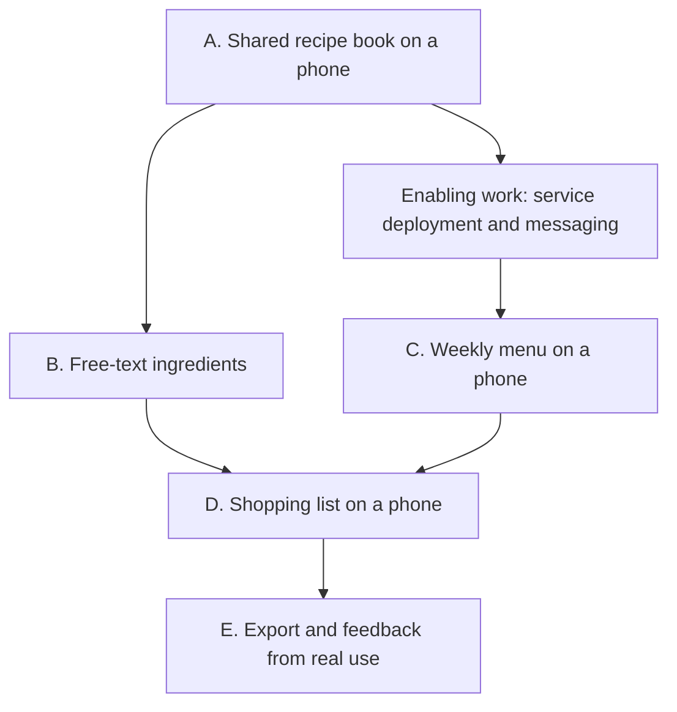
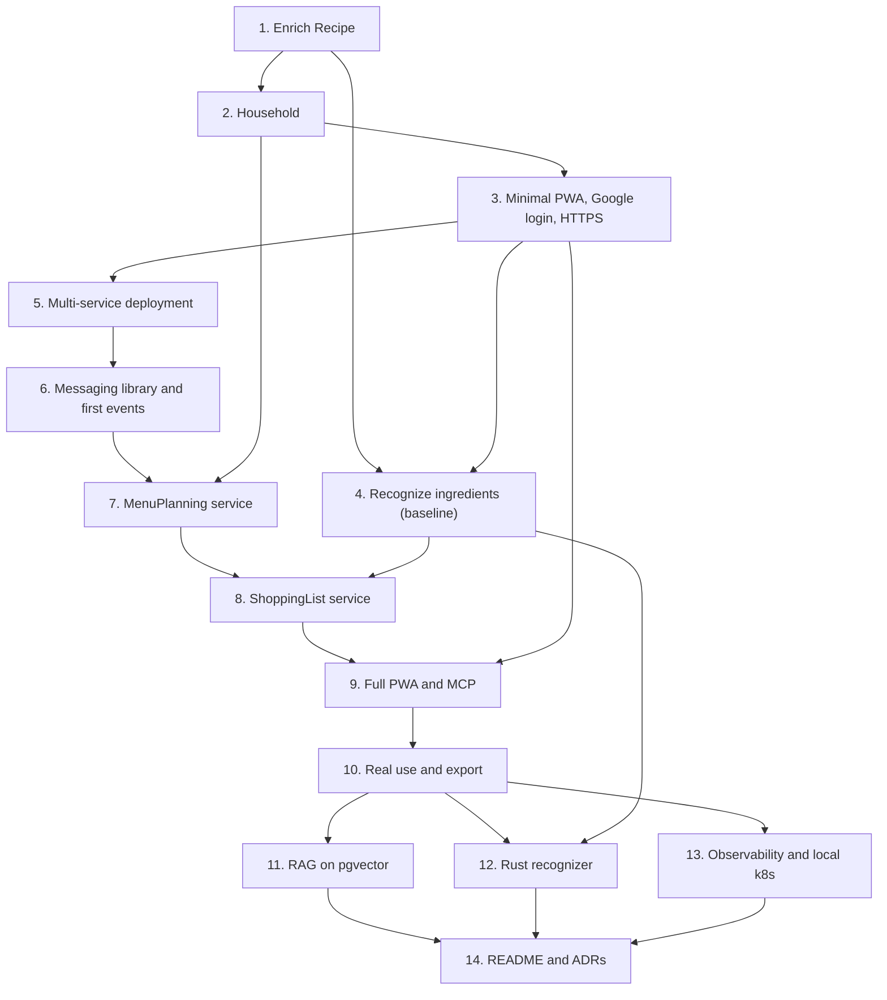

# roadmap · From a recipe CRUD to a shared meal planner

[Español](README.es.md)

**Related epic:** [#33 · Shared household meal planning and shopping](https://dev.azure.com/juampidev/HappyMeal/_workitems/edit/33)
**Plan date:** 2026-11-26
**Plan status:** Agreed
**Story status:** Not started
**Last review:** 2026-11-26
**Origin:** Plan written before the work

This roadmap covers the broader product and learning journey. Epic #33 covers the
initial shared recipe book, weekly menu, shopping list and household data export.
MCP, semantic search/RAG, the Rust recognizer and Kubernetes/Terraform are later
extensions outside that epic. Its initial stories are #34–#41 in Azure DevOps and
will be refined individually before technical planning.

## Current revision · 2026-11-26

The technical planning skill is now named `plan-feature` (formerly
`issue-planning`); business refinement continues to use `refine-feature`.
References to the old skill name in the historical baseline retain that name as
part of the original plan.

**Status:** Agreed. This revision governs the scope and delivery order for epic #33.
The original plan dated 2026-11-26 is preserved below as a historical baseline.
Where it differs from this revision, this revision takes precedence. This is a
planning update; no product implementation or operational validation is complete.

### Objective and scope

Deliver a shared recipe book, weekly meal planning, a shopping list and household
data export for the owner and their partner. Both use Spanish and access the app
from their phones, including outside the home. Data belongs to the household.

The first usable release is the recipe book. Google sign-in, household access
checks, an Angular PWA, HTTPS and homelab hosting remain the agreed direction.
The separate Recipes/household, MenuPlanning and ShoppingList services and RabbitMQ
remain technical decisions from the baseline; their enabling work is planned
separately from business refinement. Source code and CI/CD stay in GitHub; product
planning and backlog stay in Azure DevOps.

### Delivery blocks and observable outcomes

| Delivery | Initial stories | Observable outcome | Baseline relationship |
| --- | --- | --- | --- |
| A · Use the shared recipe book from a phone | #34 Manage recipes with ingredients and cooking details; #35 Access the shared household recipe book; #36 Use the recipe book from a mobile phone | Both authorized members can manage recipes with structured ingredients through an installable PWA over HTTPS, including outside the home. Scheduled backups and a tested restoration are available before real household data is stored. | Steps 1–3; move the initial backup and restore work forward from step 5. |
| B · Enter ingredients as free text | #37 Enter ingredients as free text | Recognition fills structured fields and the user can correct the result. Detailed behavior is confirmed in refinement. | Step 4, after the first usable recipe book. |
| C · Plan the weekly menu from a phone | #38 Plan the weekly menu | Users can plan and change the week through the PWA according to the confirmed meal and serving rules. | Step 7 plus its menu screen from step 9. Service deployment and messaging from steps 5–6 enable this delivery. |
| D · Generate and manage the shopping list from a phone | #39 Generate a shopping list from the weekly menu; #40 Manage the household shopping list | Users can obtain the list from their menu, add manual items and mark products as bought through the PWA, under the rules confirmed in refinement. | Step 8 plus its shopping screen from step 9. |
| E · Export household data and learn from real use | #41 Export household data | Export is verified against the confirmed content and format. Two to three weeks of real use produce a recorded backlog of problems and missing capabilities. | Step 10; it does not depend on MCP or later AI work. |

The blocks group refinement and delivery; each story is refined individually and
may be split into independently valuable stories when agreed. Menu and shopping
screens ship with their respective capabilities. Completing the PWA and validating
real use do not wait for an MCP server.

### Enabling work and later extensions

- Scheduled backups and a tested restoration move to delivery A. Step 5 later
  extends them to every service database and its deployment failure scenarios.
- Service deployment and reliable messaging remain enabling work before the menu
  and shopping services. Their backlog items and technical plans are still pending.
- Observability is separate from Kubernetes/Terraform. Its work can accompany the
  service integration; a local cluster is a later learning extension.
- MCP, semantic search/RAG, the Rust recognizer and Kubernetes/Terraform are outside
  epic #33 and are not completion dependencies. Semantic recipe retrieval and any
  generated answer must be distinguished when the search work is refined.
- Recipe import from URLs, pasted text and photos remains a future backlog
  candidate with its own refinement. The baseline records a proposed direction,
  not an additional delivery required to close epic #33.
- General multi-household onboarding and a multilingual UI remain outside the
  initial scope. Documentation and ADRs evolve alongside the work.

### Business rules and completion

Stories #34–#41 currently establish titles and capabilities, not finalized business
rules. Recipe field requirements, meal slots, serving calculations, recipe changes
and deletions, shopping-list recalculation, preservation of bought marks and export
content and format remain to be confirmed with `refine-feature`. Specific examples
and business acceptance criteria in the historical baseline are refinement inputs,
not confirmed rules where those decisions remain open. A story is ready for
technical planning only after its blocking business decisions are resolved.

Epic #33 is complete when both authorized members can use the recipe-to-menu-to-
shopping flow from their phones outside the home, household access is enforced,
the included stories satisfy their agreed criteria, export and restoration have
been verified, and feedback from real use is recorded. Authentication and hostname
configuration, frontend location and service integration details remain technical
planning topics. The epic and this revision share that completion boundary.

## Historical baseline · Original plan dated 2026-11-26

The following sections preserve the original decisions, steps, diagram and criteria.
They are read together with the current revision above, which takes precedence.

## 1. Objective

Happymeal today is a recipe CRUD. A recipe only has a name and a description. There is no menu planner, no shopping list and no user interface. The goal is a real application that two people use every week: keep recipes, plan the weekly menu and get a shopping list.

The app is for personal use first. The two users are the owner and their partner. They share one set of data, and they speak Spanish. The app runs in the homelab. The first usable version is a recipe book in a phone app (step 3). The menu and the shopping list come as separate services that talk through RabbitMQ. AI features (RAG, MCP, ingredient recognition) are added after the app is useful without them. The project is also a public portfolio, so the steps leave good documentation and ADRs.

## 2. Context

- One bounded context exists: Recipes (CRUD with vertical slices, `Result<T>`, domain validation).
- The outbox works with Postgres. `OutboxDispatcher` sends domain events to in-process handlers. There is no message broker.
- The API has no authentication. `HttpCurrentUser` already reads the `sub` claim, and `ApiServiceExtensions` has a TODO for auth.
- Pull requests run the build and the tests. Merging into `develop` publishes the `api` and `migrate` images to GHCR and deploys through a restricted SSH command. The compose file is owned by root and installed by hand on the server. Each deployment makes a `pg_dump` first.
- The solution targets .NET 10 and Postgres (`Npgsql.EntityFrameworkCore.PostgreSQL`).
- There is no frontend and no AI feature.
- The homelab is a Debian 13 laptop: Intel i5-4200H (2 cores, 4 threads), 8 GB RAM, GTX 950M with 2 GB, 1 TB internal disk and a 256 GB external USB SSD. Local AI models must be small.

## 3. Starting decisions

| Decision | Reason | Alternative considered |
| --- | --- | --- |
| Value first: a usable app before AI | The app must help in daily life. AI is built on real data and real usage. | Start with RAG or Rust. Rejected because there is nothing to search or recognize yet. |
| Three services: the current API (Recipes and household), `MenuPlanning` and `ShoppingList`. One repository and one solution, with shared projects `Happymeal.Common`, `Happymeal.Messaging` and `Happymeal.Contracts`. Each service has its own database in the same Postgres instance. | The owner wants to practice integration events, RabbitMQ and distributed design. It is also a strong portfolio topic. There is no operational gain for two users, and the owner accepts the extra cost. | A modular monolith first, split later. Cheaper, and a valid path if the cost becomes too high. |
| Services talk through integration events on RabbitMQ, using a small own library built on the existing outbox (plus an inbox for consumers). Domain events stay inside each service. | The outbox already exists and is tested. A small library gives full control and is a good learning goal. | MassTransit (check the license of its version 9) or Wolverine. Rejected for now. |
| An integration event is only a notification with `id`, `householdId` and `version`. The consumer reads the details from an internal GET endpoint protected by an API key (one key per consumer). That endpoint has no route in the reverse proxy. Each consumer keeps its own read model. A 404 means the item was deleted. A list endpoint (`updatedSince`) gives the initial load. | Small contracts that rarely change. Events that arrive late or twice do no harm, because the consumer always reads the current state. Only trusted services call the endpoint, so it returns data of any household. | A snapshot event with the full state. Consumers do not need the other service at processing time, but the contract is bigger. |
| Household membership is replicated with the same pattern: the event `HouseholdMembershipChanged` and an internal endpoint. Each service keeps `(UserSub, HouseholdId)` and validates the JWT by itself. | No runtime dependency between services. | The proxy resolves the household and sends it in a header (needs trust in the header), or a call to the main API on every request. |
| All services are deployed together with the same commit SHA. Event contracts only add fields. | Simple, and it keeps compatible versions together. A few seconds of downtime is fine for two users. | Independent deployment of each service. Rejected: too much complexity. |
| A minimal PWA for recipes comes before the new services (step 3) | The owner wants to use the app early. The recipe book is useful by itself. | Build the whole UI after the services. Rejected: the app would be unusable for much longer. |
| Data belongs to a `Household`, not to a user. A `HouseholdId` is added to every aggregate. | Both users share recipes, menu and list. Adding it later means migrating all data. | Owner per user. Rejected: sharing would need extra logic. |
| One fixed household with two members at first | Enough for now. More households only mean creating more rows later. | Full multi-tenant onboarding. Rejected as out of scope. |
| Sign in with Google (OIDC). Each API only validates the JWT. No own identity server. | No passwords to store. No new service. Changing the provider later does not change the APIs. | ASP.NET Core Identity (own passwords) or Keycloak in the homelab. Rejected for two users. |
| Allowed users live in the household members table (Google email). The first two members are created from configuration on first start. | Adding a person does not need a redeploy, and it links the user to a household. | Only a list of emails in configuration. Rejected: every change needs a redeploy. |
| Angular PWA as the user interface | Chosen by the owner. The shopping list is used on a phone in the supermarket. | Blazor or React. Not chosen. |
| Data and UI in Spanish | Both users speak Spanish. This also affects the ingredient catalog and the embeddings. | Multi-language. Not needed now. |
| Ingredients are structured from the start (name, optional quantity and unit, optional original text) | Clean data for the shopping list from day one. Quantity and unit are optional because lines like "sal al gusto" have no number. When the recognizer is active (step 4), the input can change to free text and the recognizer fills the structured fields. | Free text first. Rejected: the shopping list could not add up quantities. |
| The ingredient recognizer starts as a rule-based .NET baseline in a shared library, used by the current API and by `ShoppingList` | The shopping list works before the Rust service exists. The baseline is the reference to beat. | Write the Rust service first. Rejected: it would block the personal use. |
| The ingredient recognizer service is written in Rust | The owner prefers it, it makes the portfolio stand out, and the service (text to data, no state) fits well. The contract does not depend on the language, so a rewrite in Go stays possible. | Go. Faster to learn, but not the owner's preference. |
| `pgvector` in the same Postgres for the RAG | No new infrastructure. Business filters are normal SQL. | Qdrant or Azure AI Search. Rejected for this volume of data. |
| Small AI models run locally with Ollama, behind `IEmbeddingGenerator` and `IChatClient`. The generative model is optional. | No cost, and no data leaves the house. The server is a small laptop, so models must be small. Ollama runs in its own container with a memory limit and loads one model at a time. | A hosted API or `AgentGateway.Api`. Kept as a fallback if the local model is too slow or too weak. ONNX Runtime inside the API is an option for embeddings only. |
| The app is exposed to the internet through port forwarding and a DuckDNS name, like SSH today. A reverse proxy gives it HTTPS. | The phone must reach the app outside the house, and a PWA and Google login need HTTPS. | Tailscale (no public exposure, but every device needs it) or Cloudflare Tunnel. Not chosen for now. |
| Real data lives in the testing environment that deploys from `develop`. The owner accepts the risk. | One server and no extra cost. The risk is reduced by the backup before each deployment, and by the scheduled backups and the restore test in step 5. | A separate environment for real use, updated by hand. Rejected for now. |
| Recipe import creates a draft that the user reviews before saving. It is a .NET use case with one interface per stage (extract, structure), not a Rust or LangGraph service. Order: URLs with `schema.org` data, then pasted text with the local LLM, then photos. | An LLM can misread a recipe, and a wrong ingredient would reach the shopping list. The flow is almost linear, so plain code is enough. Many recipe sites already publish structured data, so they need no AI. | A LangGraph service in Python. Valid as a learning choice, but not needed technically. |

### Pending questions

| Question | How it will be resolved | Step that depends on it |
| --- | --- | --- |
| Does Google accept the DuckDNS name as an OAuth redirect URI? | Try it when the Google client is created. If not, use an own domain or Tailscale. | 3 |
| Where does the Angular project live (for example a `Happymeal-FE` folder next to `Happymeal-BE`)? | Agree it when the step 3 issue is defined. | 3 |
| How to read a photo of a recipe: local OCR (weak with handwriting) or a hosted vision model? Local vision models are too heavy for the server. | Test OCR on real photos when the import work starts. Using a hosted model needs the owner's explicit decision. | 10 |
| How does the MCP server authenticate against the services? | Decide when the step 9 issue is defined. | 9 |
| Which embedding model (for example `bge-m3` or a lighter one) and which small LLM, if any? | Measure speed, memory and quality on the homelab at the start of steps 11 and 12, using the evaluation sets. | 11, 12 |

## 4. Steps overview

| Step | What we will do | Expected outcome |
| --- | --- | --- |
| 1 · Enrich `Recipe` with structured ingredients, steps, servings, prep time and tags | Extend the aggregate, the DTOs, the migration, the events and the tests. Each ingredient has a name, an optional quantity and unit, and an optional original text. | A recipe with its ingredients can be created and read through the API. |
| 2 · Scope all data to a `Household` with two members | Add `HouseholdId`, a members table and a global EF Core filter. Use one fixed household. | No query can return data of another household. |
| 3 · Use recipes from a phone with a minimal Angular PWA, Google login and HTTPS | Build the PWA for recipes only. Add Google OIDC and the members check. Put a reverse proxy with HTTPS in front of the API and expose the DuckDNS name. | Both users sign in with Google on a phone, outside the house, and manage their recipes. |
| 4 · Recognize ingredients from free text with a rule-based .NET baseline | Define `IIngredientRecognizer`, an ingredient catalog with synonyms, units and store sections, and an evaluation set of 50 to 100 examples. Accept ingredient lines as free text in the API and in the PWA form. | "2 dientes de ajo picados" becomes a canonical ingredient with quantity and unit. The baseline score is recorded. |
| 5 · Deploy several services together with RabbitMQ | Add RabbitMQ to the compose file. Build one image pair per service. Extend the deployment script to migrate and check every service, and to back up every database. Add scheduled backups. Prove it with an empty `MenuPlanning` skeleton. | A deployment of the API, the skeleton and RabbitMQ works from a PR merge. A restore from a backup is tested. |
| 6 · Build the `Happymeal.Messaging` library and the first integration events | Build the library over `RabbitMQ.Client`: outbox publisher, inbox, consumers with retries and dead-letter queue. Add `Happymeal.Contracts`, the events `RecipeChanged` and `HouseholdMembershipChanged`, and the internal endpoints of the API. | A change in a recipe reaches a test consumer, once and only once in effect, even if the broker was down for a while. |
| 7 · Plan the weekly menu in the new `MenuPlanning` service | Add the `WeeklyMenu` aggregate, a read model of recipes and members, the public and internal endpoints, and the event `WeeklyMenuPlanned`. | A full week can be planned. `MenuPlanning` keeps working when the recipes service is stopped. |
| 8 · Generate the shopping list from the menu in the new `ShoppingList` service | Keep a read model of recipes with ingredients. React to `WeeklyMenuPlanned`. Add up equal ingredients, convert units and group by store section. Allow manual items and a bought mark. | Planning a menu produces a usable list. Changing a recipe or the menu updates it. |
| 9 · Complete the PWA with the menu and the shopping list, and add an MCP server | Add the two screens to the PWA. Add a C# MCP server with tools such as `search_recipes`, `plan_week` and `add_to_list`. | Both users plan the week and do the shopping from a phone. Claude can plan the week through MCP. |
| 10 · Use the app for 2 to 3 weeks and add data export | No new features. Keep a list of problems. Add an export of the household data. Turn the recipe import design into steps. | A backlog from real use exists. The export is tested. |
| 11 · Search recipes in natural language with a RAG on `pgvector` | Add the `RecipeEmbeddings` table. Index from the notification events. Search with business filters, then similarity. Add an evaluation set. | "Algo con pollo en menos de 30 minutos" returns good recipes. The evaluation set score is recorded. |
| 12 · Replace the baseline recognizer with a Rust service | Build the service behind the same contract (HTTP or gRPC). Optionally add a low-confidence fallback with a small local LLM and a review queue. | The new service beats the baseline on the same evaluation set. The services use it without contract changes. |
| 13 · Add observability and a local Kubernetes and Terraform setup | Add distributed traces, logs and metrics (outbox lag, queue depth, recognizer latency). Run the stack on kind or k3d with Terraform. | A trace follows a recipe change through all services. The stack starts in a local cluster. |
| 14 · Publish the showcase README and ADRs | Write the README (architecture, decisions, how AI tools are used) and ADRs for the main decisions. | A new reader can understand the project and the decisions in 10 minutes. |

Steps 11, 12 and 13 do not depend on each other. They can be done in any order. If debugging across services becomes painful, the traces of step 13 can be moved forward, right after step 6.

## 5. Step descriptions

Each step becomes one or more issues. Each issue gets its own plan, agreed before implementation, using the `issue-planning` skill. This section only fixes the goal and the acceptance criteria.

### Step 1 · Enrich `Recipe` with structured ingredients, steps, servings, prep time and tags

**What we want to achieve**

Give the domain enough data for everything that follows. Without ingredients there is no shopping list, no embeddings and nothing to recognize.

**What we will do**

- Define the new DTOs and `RecipeParams` first, then the domain logic.
- Add ingredients as child entities of the `Recipe` aggregate. Each one has a required name, an optional quantity, an optional unit and an optional original text.
- Add steps, servings, prep time and tags.
- Add the EF Core migration and update the domain events and the existing tests.

**What you need to understand**

Quantity and unit are optional on purpose. A line like "sal al gusto" or "un chorrito de aceite" has no number. The optional original text lets the recognizer (step 4) fill the structured fields later without losing what the user wrote.

**How we will check it is finished**

- A recipe with ingredients, steps, servings, prep time and tags can be created, read, updated and deleted through the API.
- An ingredient without quantity and unit is accepted.
- Validation rules are covered by unit tests. Integration tests keep passing.

**Result of this step**

New domain code in `Happymeal.Domain`, a migration in `Happymeal.Infrastructure/Database/Migrations`, and updated endpoints.

### Step 2 · Scope all data to a `Household` with two members

**What we want to achieve**

Make sure data belongs to the couple and not to one person. Doing it now avoids a data migration later.

**What we will do**

- Add `Household` and a members table.
- Add `HouseholdId` to `Recipe` and set it from the current household.
- Add a global EF Core query filter by `HouseholdId`.
- Use one fixed household with two members until login exists.

**What you need to understand**

A global query filter adds `WHERE HouseholdId = @current` to every query on that entity. Forgetting a filter in one query cannot leak data of another household.

**How we will check it is finished**

- An integration test with two households shows that each one only sees its own recipes.
- The migration keeps the existing recipes by assigning them to the fixed household.

**Result of this step**

`Household` in the domain, the filter in `HappymealDbContext`, and a migration.

### Step 3 · Use recipes from a phone with a minimal Angular PWA, Google login and HTTPS

**What we want to achieve**

Have a first usable version early: a recipe book that both users open on their phones.

**What we will do**

- Build the Angular PWA for recipes only: list, detail, create, edit and delete, with a structured ingredient form.
- Add Google OIDC (code flow with PKCE) in Angular and `AddJwtBearer` in the API.
- Allow only users in the household members table, so a valid Google account alone is not enough. Create the first two members from configuration on first start.
- Put a reverse proxy (Caddy or Traefik) in front of the API with automatic HTTPS for the DuckDNS name. Open only port 443 (and 80 if the certificate method needs it). Postgres stays on the internal Docker network. Keep the API docs (Scalar) closed to the internet.
- Deploy with the existing pipeline. The proxy and the compose changes are installed by hand as root, as today.

**What you need to understand**

Google proves who the user is and issues a JWT. The API trusts the token and reads the `sub` claim, which `HttpCurrentUser` already does. The API never sees a password. Changing to another identity provider later only changes the token issuer.

**How we will check it is finished**

- Both users sign in on a phone, outside the home network, and create and edit a recipe over HTTPS.
- A Google account that is not allowed gets a rejection from the API.
- The PWA can be installed on the phone.

**Result of this step**

A new frontend project, auth configuration in the API, the proxy configuration and an updated deployment guide.

### Step 4 · Recognize ingredients from free text with a rule-based .NET baseline

**What we want to achieve**

Turn dirty ingredient text into canonical ingredients. This is needed to add up quantities in the shopping list.

**What we will do**

- Define `IIngredientRecognizer` and its result type first (quantity, unit, canonical ingredient, confidence).
- Build a catalog of ingredients with synonyms, units and store sections.
- Implement a rule-based recognizer in .NET, in a library shared by the services.
- Write the evaluation set (50 to 100 examples with the expected answer) and a test that scores the recognizer.
- Let the API accept an ingredient line as free text. The recognizer fills the structured fields, and the user can correct them. Let the PWA form accept a free-text line.

**How we will check it is finished**

- "2 dientes de ajo picados", "200g de tomate triturado" and "un chorrito de aceite" give the expected result.
- A recipe created with a free-text ingredient line is saved with the structured fields filled.
- The evaluation score is written in the issue document as the baseline to beat.

**Result of this step**

The interface and the baseline in a shared library, the evaluation set under `tests/`, and the change in the PWA form.

### Step 5 · Deploy several services together with RabbitMQ

**What we want to achieve**

Make the deployment pipeline ready for more than one service before building them.

**What we will do**

- Add RabbitMQ to the compose file, with a persistent volume, credentials in `runtime.env` and the management UI closed to the network.
- Build one image pair (`api` and `migrate`) per service. Generalize `publish-images.sh` and the Dockerfiles.
- Extend `happymeal-deploy`: all services use the same SHA. It starts the broker, stops the services, backs up every database, migrates each one, starts the services and checks the health of each one.
- Extend `test-deploy.sh` and `test-install.sh` with the new failure cases (for example, the first migration works and the second fails).
- Add RabbitMQ to the integration tests in CI (Testcontainers).
- Add scheduled Postgres backups for every database and test a restore.
- Prove the pipeline with an empty `MenuPlanning` skeleton (health endpoint and its own database).
- Install the new compose file by hand as root.

**How we will check it is finished**

- A merge into `develop` deploys the API, the skeleton and RabbitMQ, and all health checks pass.
- A failed second migration leaves the documented recovery state, with a backup of every database.
- A restore from a backup works on a clean Postgres.

**Result of this step**

Updated files in `deploy/` and the CI workflow, and a backup and recovery guide.

### Step 6 · Build the `Happymeal.Messaging` library and the first integration events

**What we want to achieve**

Have a small, tested way to publish and consume events between services.

**What we will do**

- Create `Happymeal.Contracts` with the event contracts (versioned, only adding fields) and `Happymeal.Messaging` over `RabbitMQ.Client`.
- Publish from the outbox with publisher confirmations. Translate domain events into integration events.
- Consume with manual acknowledgement, retries with backoff, a dead-letter queue and an inbox table for idempotency.
- Use standard headers: message id, correlation id, type and schema version.
- Keep the scope small. No sagas, no request-response and no scheduled messages.
- Publish `RecipeChanged` (`recipeId`, `householdId`, `version`) and `HouseholdMembershipChanged`. Add the internal endpoints of the API (detail and `updatedSince` list), protected by an API key per consumer and without a route in the proxy.

**What you need to understand**

A domain event stays inside a service. An integration event is a public contract between services, so changing it needs care. The outbox writes the event in the same transaction as the data. This way, an event is never lost, even if RabbitMQ is down at that moment.

**How we will check it is finished**

- A recipe change reaches a test consumer and is processed once in effect, even when the message arrives twice.
- With the broker stopped, changes stay in the outbox and arrive later.
- A message that always fails ends in the dead-letter queue.
- The internal endpoints reject a call without a key and cannot be reached through the proxy.

**Result of this step**

Two new projects in the solution, the contracts, the internal endpoints and integration tests with RabbitMQ.

### Step 7 · Plan the weekly menu in the new `MenuPlanning` service

**What we want to achieve**

Let the users choose which recipe is cooked in which meal of the week, in a service that works by itself.

**What we will do**

- Create the service with the same layers as the current API (API, Application, Domain, Infrastructure), its own database and its own migration image.
- Add the `WeeklyMenu` aggregate with day and meal slots and servings per slot. Reference recipes only by id.
- Keep a read model of recipes (`RecipeId`, `HouseholdId`, name) and of members. Refresh them on `RecipeChanged` and `HouseholdMembershipChanged`, with the internal endpoint of the other service.
- Validate that a recipe exists and belongs to the household. Handle the short delay after a new recipe is created.
- Publish `WeeklyMenuPlanned` and add an internal endpoint with the menu details, protected by an API key.
- Add a route in the reverse proxy.

**How we will check it is finished**

- A full week can be created and changed through the API.
- A menu cannot reference a recipe from another household.
- A new recipe appears in the read model within seconds.
- With the recipes service stopped, `MenuPlanning` still shows and changes menus.

**Result of this step**

A new service folder with its Dockerfile, migrations and tests.

### Step 8 · Generate the shopping list from the menu in the new `ShoppingList` service

**What we want to achieve**

Produce the list the users take to the supermarket.

**What we will do**

- Create the service with the same layers, its own database and its own migration image.
- Keep a read model of recipes with their ingredients, fed by `RecipeChanged` and the internal endpoint.
- On `WeeklyMenuPlanned`, read the menu details and build the list from the latest menu version.
- Add up equal ingredients, convert units and group by store section.
- Add manual items and a bought mark. Use the recognizer library for manual items.
- Add a route in the reverse proxy.

**How we will check it is finished**

- Two recipes that use garlic on different days give one garlic line with the total quantity.
- Changing a recipe or the menu updates the list. Items marked as bought are not lost.
- A menu event that arrives twice does not duplicate items.

**Result of this step**

A new service folder with its Dockerfile, migrations and integration tests of the whole flow.

### Step 9 · Complete the PWA with the menu and the shopping list, and add an MCP server

**What we want to achieve**

Make the whole app usable in daily life, mainly the shopping list on a phone.

**What we will do**

- Add the weekly menu and the shopping list screens to the PWA.
- Add a C# MCP server with tools such as `search_recipes`, `plan_week` and `add_to_list`.
- Decide how the MCP server authenticates against the services (open question).
- Update the deployment guide.

**How we will check it is finished**

- Both users plan a week and complete a shopping trip from a phone.
- Claude plans a week through the MCP server.

**Result of this step**

New screens in the frontend project, an MCP project and an updated guide.

### Step 10 · Use the app for 2 to 3 weeks and add data export

**What we want to achieve**

Learn from real use before adding more.

**What we will do**

- Use the app every week and keep a list of problems and missing features.
- Add an export of the household data.
- Use the list to review the plan of steps 11 to 13.
- Turn the recipe import design (see the decisions table) into one or more steps.

**How we will check it is finished**

- The export gives back all the data of the household.
- The backlog from real use is written down.

**Result of this step**

An export endpoint and the backlog.

### Step 11 · Search recipes in natural language with a RAG on `pgvector`

**What we want to achieve**

Find recipes with sentences instead of exact words.

**What we will do**

- Start with a small multilingual embedding model on Ollama in the homelab, behind `IEmbeddingGenerator`. Measure speed and memory on the server first. If it is too heavy, try ONNX Runtime inside the API or a hosted API.
- Enable `pgvector` and add the `RecipeEmbeddings` table with `ContentHash` and `EmbeddingModel`.
- Build one embedding text per recipe (name, description, ingredients, tags, steps summary).
- Index from `RecipeChanged`. Add a backfill for existing recipes.
- Search with filters first (prep time, tags), then similarity. Consider hybrid search with full text.
- Expose the search in the API and in the MCP server.

**What you need to understand**

An embedding is a vector that represents the meaning of a text. Similar texts have close vectors. RAG means we search the relevant data first and give it to the LLM in the prompt. The LLM does not learn anything.

**How we will check it is finished**

- "Algo con pollo en menos de 30 minutos" returns matching recipes and respects the time filter.
- Changing a recipe updates its embedding. Deleting it removes the row.
- An evaluation set of questions with expected recipes gives a recorded score.

**Result of this step**

A migration, an indexing handler, a search query and the evaluation set.

### Step 12 · Replace the baseline recognizer with a Rust service

**What we want to achieve**

Build the ingredient recognition as a separate service in Rust. It must be better than the baseline.

**What we will do**

- Implement the service behind the `IIngredientRecognizer` contract over HTTP or gRPC.
- Optional: add a low-confidence fallback with a small local LLM on Ollama (1.5B to 3B). Unsure results go to a review queue. Choose the model by its score on the evaluation set.
- Run the evaluation set from step 4 against both implementations.

**How we will check it is finished**

- The new service has a higher score than the baseline on the same evaluation set.
- The services switch to the new service by configuration, with no contract change.

**Result of this step**

A new project folder for the service, its Dockerfile, and a comparison table in the issue document.

### Step 13 · Add observability and a local Kubernetes and Terraform setup

**What we want to achieve**

Know what the system is doing across services, and show infrastructure skills.

**What we will do**

- Add OpenTelemetry traces that cross HTTP and RabbitMQ, plus structured logs and metrics (outbox lag, queue depth, recognizer latency).
- Describe the stack with Terraform and run it on kind or k3d.

**How we will check it is finished**

- One trace follows a recipe change through all the services.
- A dashboard shows the outbox lag and the queue depth.
- The stack starts in a local cluster with one command.

**Result of this step**

Instrumentation in the services, Terraform and Kubernetes manifests in the repository and a short guide.

### Step 14 · Publish the showcase README and ADRs

**What we want to achieve**

Make the project easy to understand for a reader who does not know it.

**What we will do**

- Write the README: architecture, decisions, how the AI tools are used and validated.
- Write ADRs for the service split, the outbox and integration events, the notification events with internal endpoints, the household model, `pgvector` and the recognizer contract.

**How we will check it is finished**

- A new reader can explain the architecture and the main decisions after reading the README.

**Result of this step**

`README.md` and ADR files in the repository.

## 6. Story closing

Pending. The original plan stays in the sections above.

### Final result

Pending.

### Changes from the original plan

Pending.

### Validation done

Pending.

### Pending work and limits

Pending.

## 7. Final technical reference

Pending.

## 8. Keywords

roadmap, recipes, menu planning, shopping list, household, microservices, RabbitMQ, outbox, inbox, integration events, Google OIDC, Angular PWA, MCP, RAG, pgvector, ingredient recognition, Rust, deployment
